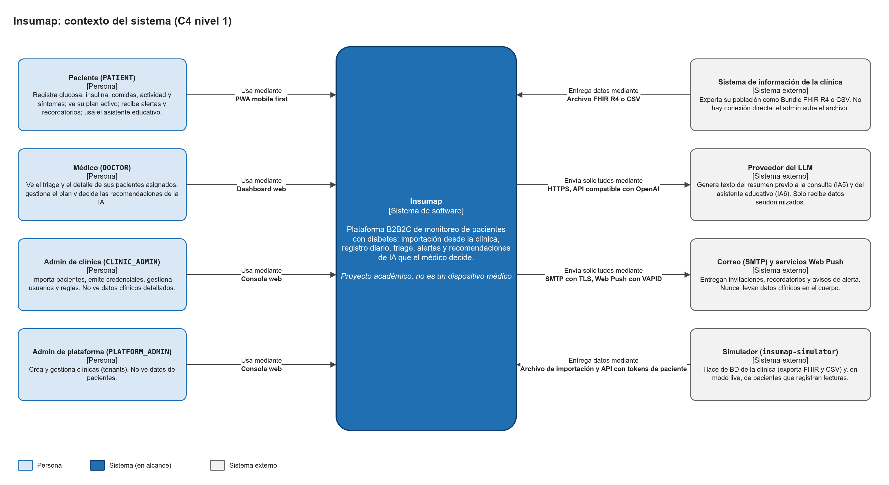
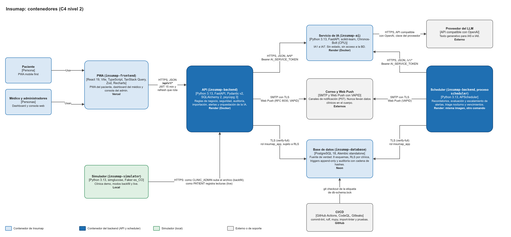
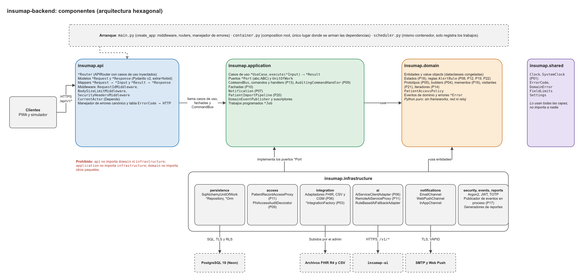
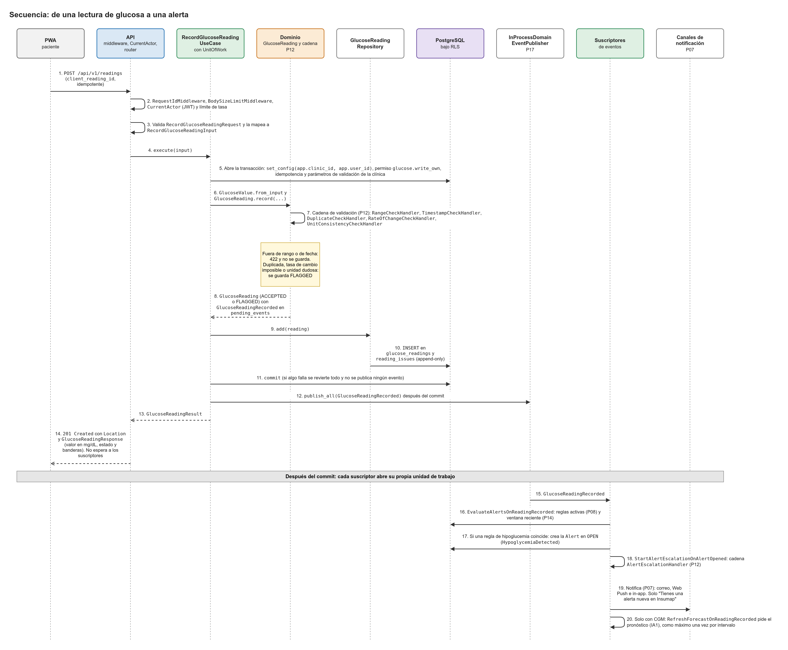
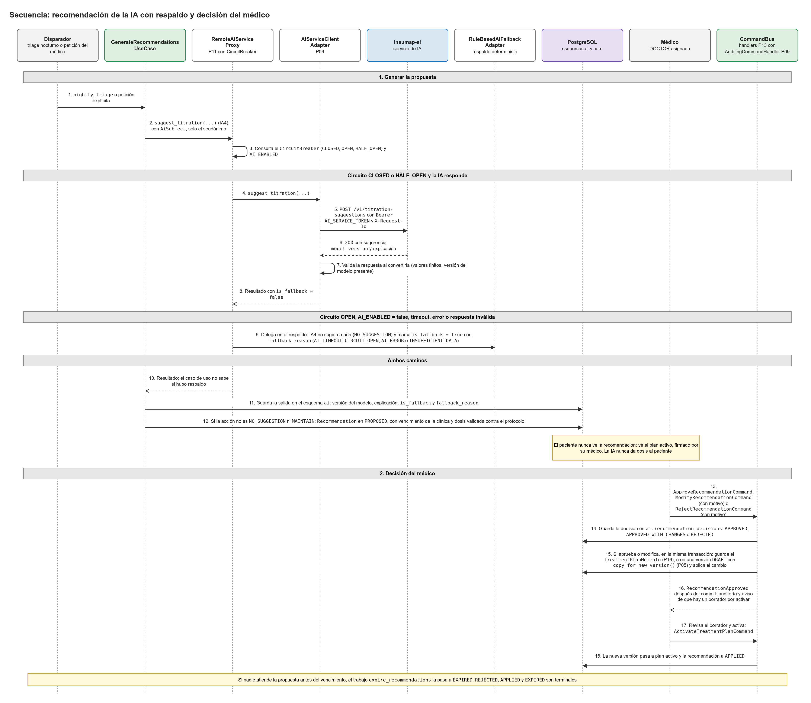
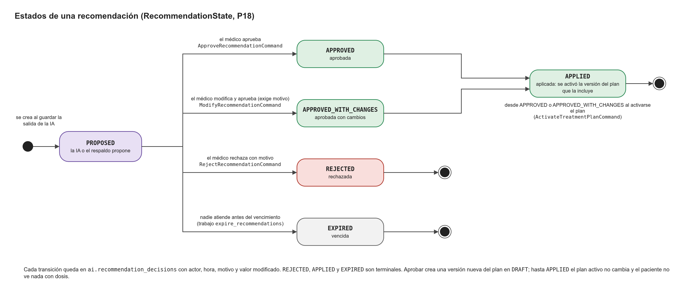
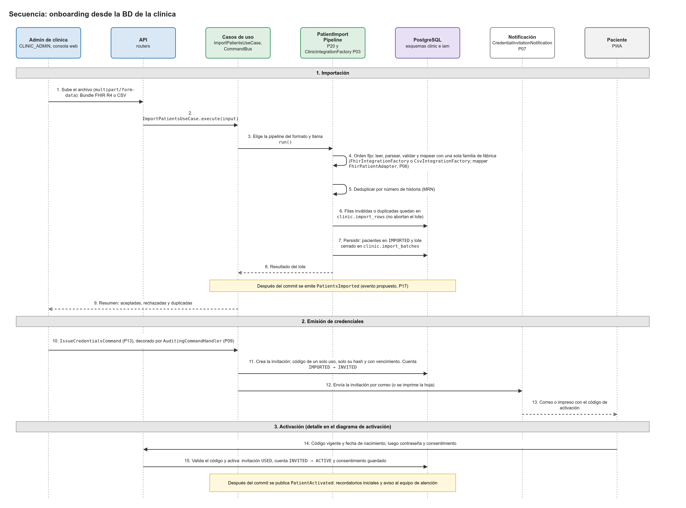
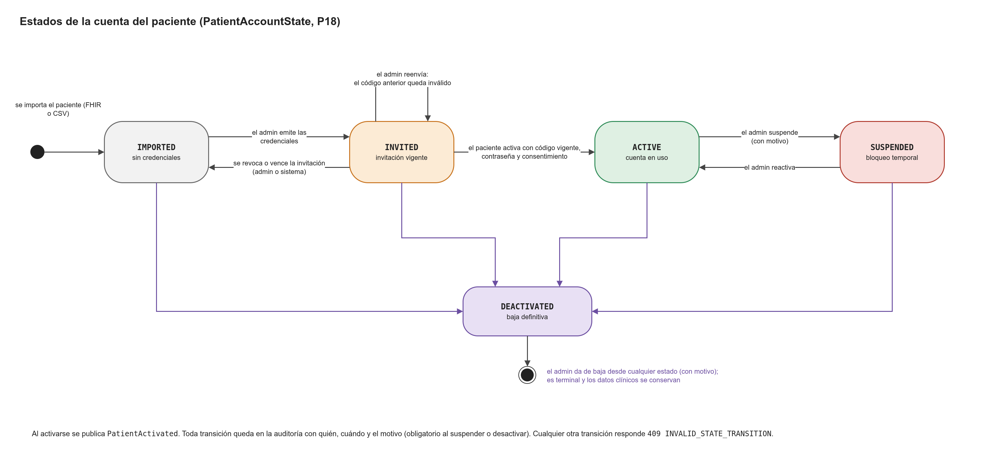
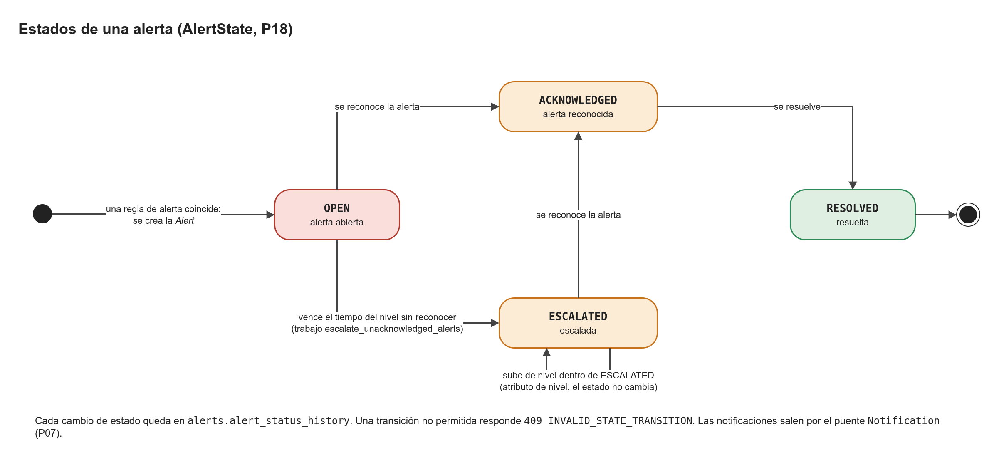
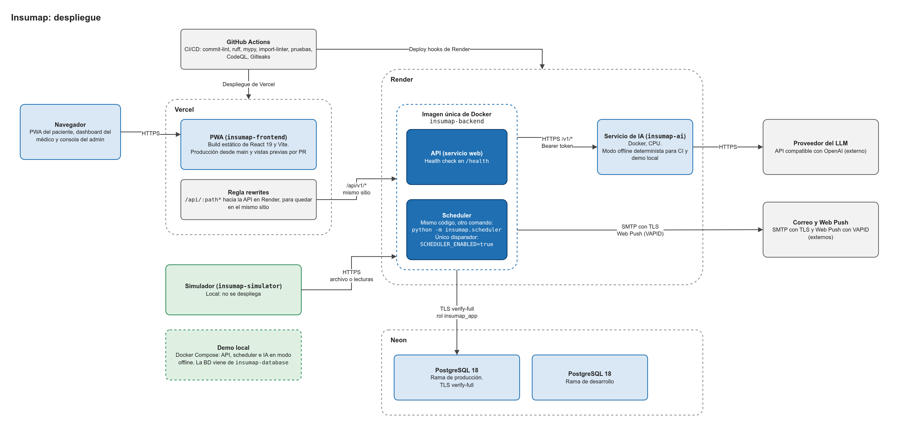

# Arquitectura de Insumap

> Documento canónico de la arquitectura del sistema y, en detalle, del backend (`insumap-backend`). Las decisiones vienen del plan aprobado del proyecto. Lo que aún no está decidido se marca "verificar" o "por definir". La versión operativa para agentes (dónde va cada cosa y cómo se llama) está en [`.agents/architecture.md`](../.agents/architecture.md).

> **Aviso:** Insumap es un proyecto académico. **No es un dispositivo médico**, no reemplaza el criterio clínico y la IA solo apoya al médico, que toma todas las decisiones. Todos los pacientes son simulados.

## 1. Vista general

Insumap es una plataforma B2B2C de monitoreo de pacientes con diabetes. La clínica importa sus pacientes desde su propia base de datos, les emite credenciales de un solo uso, el paciente registra su control diario, uno o varios médicos asignados lo vigilan con triage, métricas y alertas, y la IA propone acciones que el médico aprueba, modifica o rechaza.

La arquitectura separa cuatro piezas de producto (la PWA, la API, el scheduler y la base de datos) de dos servicios de apoyo (la IA y el simulador). Solo el backend habla con la base de datos y con el servicio de IA. El frontend y el simulador solo hablan con la API, como lo haría un cliente real.

### 1.1 Contexto del sistema (C4 nivel 1)



| Actor o sistema externo | Qué hace con Insumap | Canal |
|---|---|---|
| Paciente (`PATIENT`) | Activa su cuenta con el código de un solo uso, registra glucosa, insulina, comidas, actividad y síntomas, ve sus gráficas y su plan activo, recibe recordatorios y alertas, escribe a su médico y usa el asistente educativo. | PWA escritorio primero, instalable y usable desde 360 px |
| Médico (`DOCTOR`) | Ve el triage de sus pacientes asignados y el detalle de cada uno (AGP, TIR, línea de tiempo), gestiona el plan de tratamiento, decide las recomendaciones de la IA, atiende alertas, notas y mensajes. | Dashboard web |
| Admin de clínica (`CLINIC_ADMIN`) | Importa pacientes, emite y reenvía credenciales, gestiona médicos, usuarios y equipos de atención, configura metas, reglas de alerta y plantillas de protocolo, ve la auditoría y los KPIs. **No ve datos clínicos detallados.** | Consola web |
| Admin de plataforma (`PLATFORM_ADMIN`) | Crea y gestiona clínicas (tenants). No ve datos de pacientes. | Consola web |
| Sistema de información de la clínica | Exporta su población como Bundle FHIR R4 o CSV. No hay conexión directa: el admin sube el archivo. | Archivo FHIR R4 o CSV |
| Proveedor del LLM | Genera texto para el resumen previo a la consulta (IA5) y el asistente educativo (IA6). Solo recibe datos seudonimizados y solo desde `insumap-ai`. | HTTPS, API compatible con OpenAI |
| Correo (SMTP) y servicios Web Push | Entregan invitaciones, recordatorios y avisos de alerta. Nunca llevan datos clínicos en el cuerpo. | SMTP con TLS, Web Push con VAPID |
| Simulador (`insumap-simulator`) | Hace de "BD de la clínica" (exporta FHIR y CSV) y, en modo `live`, de pacientes que registran lecturas. | Archivo de importación y API con tokens de paciente |

La clínica demo (`clinic.clinics.is_demo = true`) se marca **"Datos simulados"** en la API, los reportes y la UI.

### 1.2 Contenedores (C4 nivel 2)



| Contenedor | Tecnología | Plataforma | Responsabilidad |
|---|---|---|---|
| PWA (`insumap-frontend`) | React 19, Vite, TypeScript, TanStack Query, Zod, Recharts | Vercel | PWA del paciente, dashboard del médico y consola del admin. |
| API (`insumap-backend`) | Python 3.13, FastAPI, Pydantic v2, SQLAlchemy 2, psycopg 3 | Render (Docker) | Reglas de negocio, seguridad, auditoría, importación, alertas y orquestación de la IA. |
| Scheduler (`insumap-backend`, proceso `scheduler`) | Python 3.13, APScheduler | Render: misma imagen con otro comando (worker o cron según la capa vigente; se decide en la Fase 12) | Recordatorios, evaluación y escalamiento de alertas, triage nocturno y vencimientos (sección 11). |
| Base de datos (`insumap-database`) | PostgreSQL 18, Alembic standalone con SQL escrito a mano | Neon (en local, Docker Compose del repo de BD) | Fuente de verdad: 8 esquemas, RLS por clínica, triggers append-only y auditoría con cadena de hashes. |
| Servicio de IA (`insumap-ai`) | Python 3.13, FastAPI, scikit-learn, Chronos-Bolt (CPU), SDK compatible con OpenAI | Render (Docker) | IA1 a IA7. Sin estado, sin acceso a la BD y protegido con token de servicio. |
| Proveedor del LLM | API compatible con OpenAI (DeepSeek, Qwen vía OpenRouter o Gemini en capa gratuita; se elige en la Fase 10) | Externo | Texto generativo para IA5 e IA6. |
| Correo y Web Push | SMTP y Web Push con VAPID | Externos | Canales de notificación (P07). |
| Simulador (`insumap-simulator`) | Python 3.13, simglucose, Faker `es_CO` | Local | Clínica demo, modos `backfill` y `live`, datasets de entrenamiento para la IA. |
| CI/CD | GitHub Actions, CodeQL, Gitleaks | GitHub | commit-lint, ruff, mypy, import-linter y pruebas contra la etiqueta de BD fijada. |

Protocolos principales:

| Desde | Hacia | Protocolo | Autenticación |
|---|---|---|---|
| PWA | API | HTTPS, JSON, `/api/v1/*` | JWT de acceso de 15 minutos y refresh opaco que rota (transporte y cookies en [Seguridad](Seguridad.md)) |
| API y scheduler | PostgreSQL | TLS (`sslmode=verify-full`) | Rol `insumap_app`: sin DDL y sujeto a RLS |
| API y scheduler | Servicio de IA | HTTPS, JSON, `/v1/*` (ver [Contrato IA](Contrato-IA.md)) | `Authorization: Bearer <AI_SERVICE_TOKEN>` |
| Servicio de IA | Proveedor del LLM | HTTPS, API compatible con OpenAI | Clave del proveedor, solo en `insumap-ai` |
| API y scheduler | Servidor SMTP | SMTP con TLS | Credenciales en variables de entorno |
| API y scheduler | Servicios Web Push del navegador | Web Push (RFC 8030) | VAPID (RFC 8292) |
| Simulador | API | HTTPS | Como `CLINIC_ADMIN` para subir el archivo (modo `backfill`); como `PATIENT` con su propio token (modo `live`) |
| CI del backend | `insumap-database` | `git checkout` en la etiqueta de `db-schema.lock` | Repositorio público |

Regla de separación: el simulador no conoce la base de datos y la IA tampoco. Todo lo que el sistema "ve" entra por la API.

### 1.3 Módulos y dónde viven

Los módulos `M1` a `M13` de [Requerimientos](Requerimientos.md) se reparten en subpaquetes con el mismo nombre en `api`, `application` y `domain` (no todos los módulos tienen las tres capas).

| Módulo | Subpaquete | Esquema de BD |
|---|---|---|
| M1 Identidad y acceso | `identity` | `iam` |
| M2 Clínicas y usuarios | `clinic` | `clinic`, `iam` (`memberships`) |
| M3 Onboarding y credenciales | `onboarding` | `clinic` (`import_batches`, `import_rows`, `patients`), `iam` (`credential_invitations`) |
| M4 Equipo de atención | `care_team` y `access` | `clinic` (`care_team_assignments`) |
| M5 Registros del paciente | `monitoring` | `monitoring` |
| M6 Plan de tratamiento | `treatment` | `care` (`protocol_templates`, `treatment_plans`, `treatment_plan_items`, `treatment_plan_snapshots`, `reminder_schedules`) |
| M7 Métricas glucémicas | `metrics` | `care` (`target_profiles`) y lectura de `monitoring` |
| M8 Alertas y notificaciones | `alerts` y `notifications` | `alerts` |
| M9 IA y soporte a decisiones | `ai` | `ai` |
| M10 Dashboard médico y reportes | `dashboard`, `triage` y `reports` | Lectura de varios esquemas; `ai.clinical_summaries` |
| M11 Mensajería y seguimiento | `messaging` | `messaging`, `care` (`follow_ups`, `clinical_notes`) |
| M12 Auditoría y cumplimiento | `audit` | `audit`, `clinic` (`patient_consents`) |
| M13 Datos simulados | Sin subpaquete propio | `clinic.clinics.is_demo` |

## 2. Arquitectura hexagonal del backend

El backend sigue arquitectura hexagonal (puertos y adaptadores). El dominio es Python puro: no conoce FastAPI, Pydantic ni SQLAlchemy. Las dependencias apuntan hacia el dominio.



### 2.1 Capas y responsabilidades

Paquete base: `insumap`, en `src/insumap/`.

| Capa | Contiene | No contiene |
|---|---|---|
| `insumap.api` | `*Router` (clases que arman un `APIRouter` con los casos de uso inyectados), modelos `*Request` y `*Response` (Pydantic v2 con `extra="forbid"`), mappers `*Request → *Input` y `*Result → *Response`, middleware (request id, límite de cuerpo, cabeceras de seguridad), la dependencia del actor autenticado, el manejador de errores canónico y la tabla `ErrorCode → HTTP`. | Reglas de negocio, SQL, llamadas a la IA, imports de `domain` o de `infrastructure`. |
| `insumap.application` | Casos de uso `*UseCase.execute(*Input)`, `*Input` y `*Result` (dataclasses congeladas), puertos `*Port` (`abc.ABC`), `UnitOfWork`, `CommandBus` con comandos y handlers (P13), `AuditingCommandHandler` (P09), fachadas (P10), la abstracción `Notification` (P07), la plantilla `PatientImportPipeline` (P20), suscriptores de eventos y trabajos programados (`*Job`). | FastAPI, Pydantic, SQLAlchemy, httpx o formatos de cable de terceros. |
| `insumap.domain` | Entidades y value objects (dataclasses congeladas con validación en `__post_init__`), estados (P18), reglas (P08, P12, P19, P22), prototipos (P05), builders (P04), mementos (P16), visitantes (P21), iteradores (P14), la política de acceso al paciente, eventos de dominio y errores `*Error`. | Frameworks, red, archivos, reloj del sistema y generación de identificadores al azar. |
| `insumap.infrastructure` | `*Repository` y `*Orm` (SQLAlchemy 2), `SqlAlchemyUnitOfWork`, adaptadores `*Adapter` (FHIR, CSV, IA, correo, Web Push), proxies `*Proxy` (P11), `PhiAccessAuditDecorator` (P09), fábricas de integración y de documentos (P03), generadores de reportes (P02, P20), seguridad (Argon2id, JWT, TOTP, seudónimos), logging JSON y el publicador de eventos. | Reglas de negocio. Decisiones que deban probarse sin BD. |
| `insumap.shared` | `Clock` y `SystemClock` (P01), `FieldLimits`, `ErrorCode` y `DomainError`, el catálogo `i18n/messages_es.json` con su lector, las constantes de unidad con nombre (`MG_DL_PER_MMOL_L`) y `Settings` (`shared.config`, pydantic-settings, único lector del entorno; ver [`.agents/configuration.md`](../.agents/configuration.md)). | Imports de otras capas del proyecto. Frameworks fuera de `shared.config`. |
| Arranque (`main.py`, `container.py`, `scheduler.py`) | `create_app()`, el composition root y el proceso del scheduler. | Lógica de negocio. |

Los casos de uso reciben `*Input` (definido en `application`) y devuelven `*Result`. El router transforma `*Request` en `*Input` con un mapper, así la API nunca expone objetos del dominio ni modelos ORM.

### 2.2 Reglas de dependencia

```text
   main.py · container.py · scheduler.py      (arranque: pueden importar todo)
          │                         │
          ▼                         ▼
         api                  infrastructure ───────────────┐
          │                         │ implementa puertos     │ usa entidades
          ▼                         ▼                        ▼
         application ──────────────────────────────────►  domain
                                                             │
   shared  ◄──────────────── todas las capas ────────────────┘   (shared no importa a nadie)
```

| Regla | Sentido permitido |
|---|---|
| `api` usa `application` | Sí. Los routers llaman casos de uso, fachadas o el `CommandBus`. |
| `api` usa `infrastructure` | No, ni directa ni indirectamente. |
| `api` usa `domain` | No directamente. Le llega solo a través de `application`. |
| `application` usa `domain` | Sí. |
| `application` usa `infrastructure` o `api` | No. La infraestructura implementa sus puertos. |
| `infrastructure` implementa puertos de `application` y usa `domain` | Sí. |
| `domain` usa otro paquete de `insumap` | No. Solo la biblioteca estándar y `shared`. |
| `shared` usa otro paquete de `insumap` | No. Solo `shared.config` usa pydantic-settings, y solo lo leen el arranque, `api` e `infrastructure`. |
| Un router importa `insumap.container` | No. `container.py` crea los `*Router` y les inyecta los casos de uso. |

### 2.3 Contratos de import-linter y pruebas de arquitectura

Las reglas se verifican en la CI con `uv run lint-imports` (contratos de import-linter en `pyproject.toml`, con `include_external_packages = true` para poder prohibir frameworks) y con pruebas AST en `tests/architecture/`. Cada regla rompe el build si se incumple.

| Id | Regla | Mecanismo | Expresión |
|---|---|---|---|
| `ARCH-01` | El dominio no depende de frameworks. | `forbidden` | `insumap.domain` no importa `fastapi`, `starlette`, `pydantic`, `pydantic_settings`, `sqlalchemy`, `psycopg`, `httpx` ni `apscheduler`. |
| `ARCH-02` | El dominio no depende de otras capas. | `forbidden` | `insumap.domain` no importa `insumap.api`, `insumap.application`, `insumap.infrastructure`, `insumap.container` ni `insumap.main`. |
| `ARCH-03` | La aplicación no depende de la API ni de la infraestructura. | `forbidden` | `insumap.application` no importa `insumap.api`, `insumap.infrastructure` ni `insumap.container`. |
| `ARCH-04` | La aplicación no depende de frameworks web, de validación ni de persistencia. | `forbidden` | `insumap.application` no importa `fastapi`, `starlette`, `pydantic`, `sqlalchemy`, `psycopg` ni `httpx`. |
| `ARCH-05` | La API no depende de la infraestructura. | `forbidden` | `insumap.api` no importa `insumap.infrastructure` ni `insumap.container`, ni directa ni indirectamente. |
| `ARCH-06` | La API no importa el dominio directamente. | `forbidden` con `allow_indirect_imports = true` | `insumap.api` no importa `insumap.domain`. Se permite la cadena indirecta porque los casos de uso sí usan el dominio. |
| `ARCH-07` | `shared` no depende de nadie. | `forbidden` | `insumap.shared` no importa otras capas de `insumap`. Fuera de `insumap.shared.config`, tampoco importa frameworks. Como `ARCH-01` y `ARCH-04` prohíben también los imports indirectos de `pydantic`, el dominio y la aplicación nunca leen `Settings`: reciben valores tipados desde el contenedor. |
| `ARCH-08` | Las capas no forman ciclos. | `layers` | Arranque, luego `insumap.api \| insumap.infrastructure` (independientes entre sí), luego `insumap.application`, `insumap.domain` y `insumap.shared` (verificar la sintaxis de capas independientes en la versión fijada de import-linter). |
| `ARCH-09` | Solo `SystemClock` lee la hora del sistema. | Prueba AST `tests/architecture/test_no_wall_clock.py` | Prohíbe `datetime.now`, `datetime.utcnow`, `datetime.today`, `date.today` y `time.time` fuera de `shared/time/system_clock.py`. `time.perf_counter` solo se permite para medir duraciones en `infrastructure`. Opcional: ruff `TID251` (banned-api) con excepción por archivo (verificar). |
| `ARCH-10` | Nombres y ubicación de las clases. | Prueba AST `test_layer_naming.py` | `*Orm` solo en `infrastructure.persistence`; `*Router` solo en `api`; toda clase que implementa un `*Port` vive en `infrastructure` y se llama `*Repository`, `*Adapter`, `*Proxy` o `*Decorator`. |
| `ARCH-11` | Sin SQL armado con texto ni DDL desde la app. | Prueba AST `test_no_dynamic_sql.py` y ruff `S608` | Ningún `text()` recibe f-strings, `%` ni concatenación; no hay `metadata.create_all` ni `op.` de Alembic en este repositorio. |
| `ARCH-12` | El dominio no genera identificadores al azar. | Prueba AST `test_domain_does_not_generate_ids.py` | `insumap.domain` no llama a `uuid.uuid4` ni a `uuid.uuid1`. Los identificadores llegan por el puerto `IdGenerator`. |

Cualquier excepción a estas reglas requiere revisión del líder de patrones (`Drako2305`) y queda escrita en este documento.

### 2.4 Composition root

`container.py` es el único lugar donde se arman las dependencias. `build_container(settings)` crea, en orden: el engine de SQLAlchemy, la fábrica de unidades de trabajo, los repositorios, los adaptadores, los proxies y decoradores, el `CommandBus` con sus handlers ya decorados, los casos de uso, las fachadas, los suscriptores de eventos y los `*Router`. `main.create_app(settings)` llama a `build_container`, registra el middleware y el manejador de errores, e incluye `router.build()` de cada router.

- No hay service locators ni instancias globales repartidas por los módulos.
- `Depends` de FastAPI se usa solo en `api` para obtener el actor autenticado (`CurrentActor`) y parámetros de paginación. Los casos de uso nunca se resuelven con `Depends`: llegan por el constructor del `*Router`.
- Las pruebas de API crean la app con un contenedor de prueba que usa dobles de los casos de uso.
- El scheduler (`scheduler.py`) usa el mismo `build_container` y solo registra los trabajos.

### 2.5 Árbol de carpetas

Estructura del proyecto. Se confirma al crear el esqueleto en la Fase 1 (verificar nombres de archivo).

```text
insumap-backend/
├── .agents/                          # Guías operativas para agentes
├── .githooks/commit-msg              # Formato de commits y bloqueo de trailers de IA
├── .github/                          # Plantilla de PR, CODEOWNERS y workflows
├── docs/                             # Documentación canónica
│   └── images/                       # Fuentes .drawio y exportaciones .png
├── src/insumap/
│   ├── __init__.py
│   ├── main.py                       # create_app(): middleware, routers y manejador de errores
│   ├── container.py                  # Composition root explícito
│   ├── scheduler.py                  # python -m insumap.scheduler
│   ├── api/
│   │   ├── errors/                   # ErrorResponse, manejadores, ERROR_HTTP_STATUS
│   │   ├── middleware/               # RequestIdMiddleware, BodySizeLimitMiddleware, SecurityHeadersMiddleware
│   │   ├── security/                 # CurrentActor (Depends) y lectura del Bearer
│   │   ├── common/                   # ApiModel (extra="forbid"), paginación por cursor
│   │   ├── health/                   # HealthRouter: GET /health
│   │   ├── monitoring/
│   │   │   ├── router.py             # GlucoseReadingRouter, InsulinDoseRouter, ...
│   │   │   ├── schemas.py            # RecordGlucoseReadingRequest, GlucoseReadingResponse, ...
│   │   │   └── mappers.py            # *Request -> *Input, *Result -> *Response
│   │   └── identity/ clinic/ onboarding/ care_team/ treatment/ metrics/ alerts/
│   │       notifications/ ai/ dashboard/ reports/ messaging/ audit/   # misma forma
│   ├── application/
│   │   ├── common/                   # Actor, UnitOfWork, UnitOfWorkFactory, IdGenerator, CursorPage
│   │   ├── commands/                 # Command, CommandHandler, CommandBus, InMemoryCommandBus, AuditingCommandHandler (P09)
│   │   ├── events/                   # DomainEventPublisher (P17), EventSubscriber
│   │   ├── access/                   # PatientRecordPort, CareTeamAssignmentPort, DataAccessLogPort
│   │   ├── monitoring/
│   │   │   ├── ports.py              # GlucoseReadingPort, ValidationSettingsPort
│   │   │   ├── record_glucose_reading.py   # RecordGlucoseReadingInput, *Result, *UseCase
│   │   │   └── subscribers.py        # EvaluateAlertsOnReadingRecorded
│   │   ├── onboarding/               # ClinicIntegrationFactory (interfaz P03), PatientImportPipeline (P20), IssueCredentialsCommand (P13)
│   │   ├── treatment/                # CreatePlanFromTemplateUseCase, ActivateTreatmentPlanCommand (P13)
│   │   ├── ai/                       # AiServicePort, GenerateRecommendationsUseCase, Approve/Modify/RejectRecommendationCommand
│   │   ├── notifications/            # Notification (P07, abstracción) y NotificationChannel (implementador)
│   │   ├── dashboard/                # DoctorDashboardFacade, PatientOverviewFacade (P10)
│   │   ├── reports/                  # ReportRenderingPort, GenerateReportUseCase
│   │   ├── jobs/                     # ScheduledJob y los trabajos de la sección 11
│   │   └── identity/ clinic/ care_team/ metrics/ triage/ alerts/ messaging/ audit/
│   ├── domain/
│   │   ├── common/                   # DomainEvent, identificadores tipados
│   │   ├── identity/                 # PermissionCode, CredentialInvitation, PasswordPolicy
│   │   ├── clinic/                   # Clinic, StaffProfile, Patient, PatientConsent
│   │   ├── onboarding/               # PatientImportCandidate, ImportRowOutcome, PatientAccountState (P18)
│   │   ├── care_team/                # CareTeamAssignment
│   │   ├── access/                   # PatientAccessPolicy, AccessDecision, AccessPurpose
│   │   ├── monitoring/
│   │   │   ├── glucose.py            # GlucoseReading, GlucoseValue (mg/dL), ReadingSource, ReadingContext
│   │   │   ├── validation/           # GlucoseReadingValidationHandler y sus manejadores (P12)
│   │   │   ├── clinical_event.py     # ClinicalEvent (unión cerrada) y ClinicalEventVisitor (P21)
│   │   │   └── insulin.py, meal.py, activity.py, symptom.py
│   │   ├── treatment/                # ProtocolTemplate y TreatmentPlan (P05), TreatmentPlanBuilder (P04),
│   │   │                             # TreatmentPlanMemento (P16), TitrationStrategy (P19), InsulinProductFlyweightFactory (P23)
│   │   ├── metrics/                  # GlucoseWindowIterator (P14), GlycemicMetrics, TargetProfile, GlycemicTargetStrategy (P19)
│   │   ├── triage/                   # RiskScoringStrategy (P19), RuleBasedRiskStrategy, TriageFlag
│   │   ├── alerts/                   # Alert, AlertState (P18), AlertRule (P08), rule_dsl (P22), AlertEscalationHandler (P12)
│   │   ├── ai/                       # Recommendation, RecommendationState (P18), GlucoseForecast, RiskAssessment, AiSubject, FallbackReason
│   │   ├── messaging/                # Thread, Message
│   │   └── audit/                    # DataAccessRecord, AuditAction
│   ├── infrastructure/
│   │   ├── persistence/
│   │   │   ├── engine.py             # Engine y sessionmaker con psycopg 3
│   │   │   ├── unit_of_work.py       # SqlAlchemyUnitOfWork: set_config de app.clinic_id y app.user_id
│   │   │   ├── orm/                  # *Orm por esquema: iam.py, clinic.py, care.py, monitoring.py, alerts.py, ai.py, messaging.py, audit.py
│   │   │   └── repositories/         # *Repository por módulo
│   │   ├── access/                   # PatientRecordAccessProxy (P11), PhiAccessAuditDecorator (P09)
│   │   ├── integration/
│   │   │   ├── fhir/                 # FhirIntegrationFactory (P03), FhirBundleParser, FhirPatientAdapter (P06), FhirImportValidator, FhirPatientImportPipeline
│   │   │   ├── csv/                  # CsvIntegrationFactory (P03), CsvPatientParser, CsvPatientRecordMapper, CsvImportValidator, CsvPatientImportPipeline
│   │   │   └── cgm/                  # CgmCsvAdapter (P06)
│   │   ├── ai/                       # AiServiceClientAdapter (P06), RemoteAiServiceProxy (P11), CircuitBreaker y CircuitBreakerState (P18), RuleBasedAiFallbackAdapter
│   │   ├── notifications/            # EmailChannel, WebPushChannel, InAppChannel
│   │   ├── reports/                  # ReportGeneratorCreator (P02), ReportGenerator (P20), ReportDocumentFactory (P03), ReportRenderingAdapter
│   │   ├── security/                 # Argon2PasswordHasher, JwtTokenService, TotpVerifier, HmacPseudonymizer, rate limiting
│   │   ├── events/                   # InProcessDomainEventPublisher (P17)
│   │   ├── ids/                      # UuidV7Generator
│   │   └── logging/                  # JsonLogFormatter, PhiRedactionFilter, contexto de request_id
│   └── shared/
│       ├── time/                     # Clock (Protocol), SystemClock (P01)
│       ├── config.py                 # Settings (pydantic-settings): único lector del entorno
│       ├── errors/                   # ErrorCode (StrEnum), DomainError
│       ├── i18n/                     # messages_es.json y MessageCatalog
│       ├── field_limits.py           # FieldLimits
│       └── units.py                  # MG_DL_PER_MMOL_L
├── tests/                            # Estructura de .agents/testing-plan.md
│   ├── conftest.py                   # Reloj fijo, Settings de prueba y app de prueba
│   ├── factories/                    # Constructores de datos de prueba, FixedClock, SequentialIdGenerator
│   ├── fixtures/                     # Bundles FHIR R4 y CSV de prueba
│   ├── unit/                         # Dominio y aplicación por módulo; sin FastAPI ni BD
│   │   └── patterns/                 # Una prueba por patrón (P01 a P23)
│   ├── architecture/                 # import-linter y pruebas AST (ARCH-09 a ARCH-12)
│   ├── api/                          # TestClient con dobles de los casos de uso
│   ├── contract/                     # AiServiceClientAdapter frente a un servidor simulado
│   └── integration/                  # Testcontainers: repositorios, UoW, RLS y test_field_limits_drift.py
├── db-schema.lock                    # Etiqueta db-vX.Y.Z de insumap-database en uso
├── pyproject.toml                    # uv, ruff, mypy --strict, pytest e import-linter
├── uv.lock
├── Dockerfile                        # Imagen única para la API y el scheduler
├── docker-compose.yml                # API, scheduler e IA en modo offline (la BD viene de insumap-database)
└── .env.example                      # Variables con marcadores seguros
```

## 3. Flujo de escritura: registrar una glucosa

Caso: el paciente registra una glucosa capilar desde la PWA. La lectura queda guardada, se evalúan las reglas de alerta y, si hay hipoglucemia, se notifica según la cadena de escalamiento. La ruta es `POST /api/v1/readings` (ruta propia del paciente; la ruta canónica y sus errores están en [API](API.md)) y es idempotente por el `client_reading_id` que genera el cliente.



1. **Middleware.** `RequestIdMiddleware` toma `X-Request-Id` si es un UUID válido o genera uno, y lo guarda en el contexto del log. `BodySizeLimitMiddleware` rechaza el cuerpo mayor a `FieldLimits.MAX_JSON_BODY_BYTES` con `413 PAYLOAD_TOO_LARGE` antes de parsearlo.
2. **Autenticación.** `CurrentActor` valida el JWT (algoritmo explícito, `iss`, `aud`, `exp`, versión de token) y arma el `Actor` (`user_id`, `clinic_id`, rol). Si falla, `401`. Los detalles están en [Seguridad](Seguridad.md).
3. **Límite de tasa.** Si se agota, `429 RATE_LIMITED` con `Retry-After`.
4. **Validación de forma.** `RecordGlucoseReadingRequest` (Pydantic, `extra="forbid"`, tipos estrictos y límites de `FieldLimits`): `value`, `unit` (`mg/dL` o `mmol/L`), `measured_at` (ISO-8601 con zona), `source` (`CGM`, `SMBG` o `MANUAL`), `context` y `client_reading_id`. Un campo desconocido, un tipo incorrecto o un valor fuera de límites técnicos responde `422 VALIDATION_ERROR` con los errores por campo en `detail`.
5. **Mapeo.** `mappers.py` convierte el request en `RecordGlucoseReadingInput` (dataclass congelada de `application`). La conversión de unidades no ocurre aquí: es conocimiento del dominio.
6. **Caso de uso.** `RecordGlucoseReadingUseCase.execute(input)` abre la unidad de trabajo con el actor. Dentro de la transacción:
   1. Fija el contexto de la RLS con `SELECT set_config('app.clinic_id', :clinic_id, true), set_config('app.user_id', :user_id, true)` (sección 5).
   2. Verifica el permiso `glucose.write_own` del rol, leído de `iam.role_permissions` (denegación por defecto). Si falta, `403 FORBIDDEN`.
   3. Toma el `patient_id` del actor autenticado, nunca de la ruta ni del cuerpo (regla V3 de [Actores y permisos](Actores-y-permisos.md)). La RLS sobre las filas propias del paciente lo confirma en la BD.
   4. Idempotencia: si ya existe una lectura con ese `client_reading_id` para el paciente y el mismo contenido, responde `200` con la original; si el contenido cambió, `409 CONFLICT`.
   5. Carga los parámetros de validación de la clínica desde la BD (rango medible, retraso máximo, ventana de duplicado, tasa de cambio máxima). Ningún umbral vive en el código.
7. **Dominio.** `GlucoseValue.from_input(value, unit)` normaliza a mg/dL. `GlucoseReading.record(...)` crea la entidad y la cadena de validación (P12) la revisa en este orden: los manejadores bloqueantes primero y las banderas después.
   1. `RangeCheckHandler`: fuera del rango medible responde `422 GLUCOSE_OUT_OF_RANGE` y no se guarda.
   2. `TimestampCheckHandler`: en el futuro (más allá de la tolerancia) o más antigua que el retraso máximo responde `422` (`READING_IN_FUTURE` o `READING_TOO_OLD`) y no se guarda.
   3. `DuplicateCheckHandler`: mismo valor dentro de la ventana con otro `client_reading_id`: se guarda `FLAGGED` con `DUPLICATE_SUSPECTED`.
   4. `RateOfChangeCheckHandler`: cambio por minuto imposible frente a la lectura anterior: `FLAGGED` con `IMPLAUSIBLE_RATE_OF_CHANGE`.
   5. `UnitConsistencyCheckHandler`: el valor es unas 18 veces distinto del historial reciente (posible confusión mg/dL y mmol/L): `FLAGGED` con `UNIT_MISMATCH_SUSPECTED`.
8. **Persistencia.** `GlucoseReadingRepository.add(reading)` inserta en `monitoring.glucose_readings` y una fila en `monitoring.reading_issues` por cada bandera. Las tablas son append-only: no hay `UPDATE` ni `DELETE`; una corrección es una fila nueva con `supersedes_id`.
9. **Eventos.** La entidad trae `GlucoseReadingRecorded` en `pending_events`. El repositorio lo entrega a la unidad de trabajo.
10. **Commit.** Si todo va bien, la transacción confirma. Si algo falla, se revierte completa y no se publica ningún evento.
11. **Publicación después del commit.** `InProcessDomainEventPublisher` (P17) entrega `GlucoseReadingRecorded` a sus suscriptores, cada uno con su propia unidad de trabajo:
    - `EvaluateAlertsOnReadingRecorded` carga las reglas activas (P08) y evalúa la ventana reciente (P14). Si una regla de hipoglucemia coincide, crea la `Alert` en `OPEN`, que trae `HypoglycemiaDetected`.
    - Después de ese commit, `StartAlertEscalationOnAlertOpened` corre la cadena `AlertEscalationHandler` (P12) y envía las notificaciones (P07). El correo y el push dicen solo "Tienes una alerta nueva en Insumap"; el detalle se ve dentro de la app.
    - Para pacientes con CGM, `RefreshForecastOnReadingRecorded` pide el pronóstico (IA1) como máximo una vez por intervalo configurado.
12. **Respuesta.** `201 Created` con `Location` y `GlucoseReadingResponse` (valor en mg/dL, estado `ACCEPTED` o `FLAGGED` y banderas). La respuesta no espera a los suscriptores.
13. **Log.** Una línea JSON con `request_id`, `user_id`, `clinic_id`, ruta (plantilla), estado y duración. Nunca el valor de glucosa, notas ni cabeceras de autenticación.

Las lecturas registradas sin conexión se envían después en lote; cada elemento pasa por los pasos 6 a 9 y el lote queda en `monitoring.sync_batches`.

## 4. Flujo de lectura: expediente del paciente

Caso: el médico abre el detalle de un paciente (resumen, métricas de 14 días, plan activo, alertas abiertas y recomendaciones pendientes). Ruta de ejemplo: `GET /api/v1/patients/{patient_id}/overview?window=14d`.

1. `PatientOverviewRouter` delega en `PatientOverviewFacade` (P10). El router no conoce las consultas. El caso de uso exige el permiso `patients.read_assigned` (o `patients.read_own` para el propio paciente).
2. La fachada abre una unidad de trabajo con el actor. Las lecturas también corren dentro de una transacción, porque la RLS necesita `app.clinic_id` y porque la lectura deja una fila de auditoría.
3. La fachada usa `PatientRecordPort`. El composition root lo arma así, de afuera hacia adentro:

   ```text
   PhiAccessAuditDecorator(        # P09: registra cada acceso en audit.data_access_log
       PatientRecordAccessProxy(   # P11: decide si el actor puede ver a ese paciente
           PatientRecordRepository # SQLAlchemy, bajo RLS
       )
   )
   ```

4. **Proxy de protección.** `PatientRecordAccessProxy` consulta `PatientAccessPolicy` con el actor, el paciente y las asignaciones vigentes de `clinic.care_team_assignments`:

   | Actor | Resultado |
   |---|---|
   | `DOCTOR` con asignación vigente al paciente | Acceso clínico completo. |
   | `DOCTOR` sin asignación | Denegado. Responde `404 NOT_FOUND`, igual que si no existiera. |
   | `PATIENT` sobre su propio expediente | Acceso completo a sus datos. |
   | `PATIENT` sobre otro paciente | Denegado con `404 NOT_FOUND`. |
   | `CLINIC_ADMIN` | Solo la vista administrativa (datos de contacto, estado de cuenta, equipo de atención). Un método clínico responde `403 FORBIDDEN`. |
   | `PLATFORM_ADMIN` | Denegado (`403 FORBIDDEN`). |
   | Cualquier actor sobre un paciente de otra clínica | La RLS oculta la fila: `404 NOT_FOUND`. |

5. **Decorador de auditoría.** `PhiAccessAuditDecorator` registra en `audit.data_access_log` quién leyó qué (actor, paciente, tipo de recurso, propósito, `request_id`, resultado):
   - Acceso concedido: la fila se escribe en la misma transacción que la lectura.
   - Acceso denegado: la fila se escribe con resultado `DENIED` en una transacción corta e independiente (`DataAccessLogPort.record_denied`), porque la transacción de la petición se revierte al propagarse el error. Luego el decorador relanza el error.
6. La fachada compone la respuesta: últimas lecturas, métricas por ventana con `GlucoseWindowIterator` (P14) y `GlycemicTargetStrategy` (P19), plan activo, alertas abiertas, recomendaciones pendientes y el último pronóstico guardado. **Leer el expediente no llama a la IA.**
7. Commit (persiste la auditoría) y respuesta `PatientOverviewResponse`. Si la clínica es demo, incluye `data_source = "SIMULATED"`. Las glucosas salen en mg/dL; la conversión a mmol/L para mostrar la hace el frontend.

## 5. Transacciones, Unit of Work y contexto de la RLS

- Cada caso de uso, de escritura o de lectura de datos clínicos, corre dentro de un `UnitOfWork` (puerto en `application.common`). Su adaptador es `SqlAlchemyUnitOfWork` (en `infrastructure.persistence`). Un caso de uso nunca abre una transacción ni una sesión por su cuenta.
- Al entrar, la unidad de trabajo abre la transacción y fija el contexto con `SELECT set_config('app.clinic_id', :clinic_id, true), set_config('app.user_id', :user_id, true)`. El tercer argumento `true` hace que el valor sea local a la transacción, igual que `SET LOCAL`, pero `set_config` acepta parámetros enlazados y `SET LOCAL` no. Nunca se fija a nivel de conexión: al terminar la transacción PostgreSQL descarta el valor, así una conexión del pool no arrastra la clínica anterior. Esto también funciona con el pooler de Neon en modo transacción (verificar `prepare_threshold` de psycopg con ese pooler).
- La API se conecta con el rol `insumap_app`, sin DDL y sujeto a la RLS (`FORCE ROW LEVEL SECURITY` en las tablas con `clinic_id`). Ningún proceso de la aplicación usa un rol con `BYPASSRLS`.
- Nivel de aislamiento: `READ COMMITTED` (el valor por defecto de PostgreSQL). Las violaciones de unicidad, de exclusión o de bloqueo optimista (`lock_version`) se traducen en un `*Error` de negocio con `409`.
- Los límites de sesión del rol (`statement_timeout`, `lock_timeout`, `idle_in_transaction_session_timeout`) los define `insumap-database` (valores por definir en [Modelo de datos](Modelo-de-datos.md)).
- **Repository.** El puerto (`GlucoseReadingPort`) habla en términos del dominio y el adaptador (`GlucoseReadingRepository`) usa SQLAlchemy y los modelos `GlucoseReadingOrm`. Un `*Orm` nunca sale de `infrastructure.persistence`; el repositorio convierte entre `*Orm` y entidades.
- **Append-only.** Los registros clínicos (`monitoring.*`), las decisiones sobre recomendaciones y la auditoría no se editan ni se borran. Los triggers de `insumap-database` lo impiden y el código nunca lo intenta. Una corrección es una fila nueva que referencia a la original con `supersedes_id`.
- Los eventos se publican después del commit (sección 6).

## 6. Eventos de dominio

Los eventos describen hechos ocurridos. Se nombran en inglés y en pasado. Son dataclasses congeladas en `domain/<módulo>/events.py`, con `event_id` y `occurred_at` (tomado del `Clock`).

| Evento | Cuándo se genera | Quién reacciona |
|---|---|---|
| `GlucoseReadingRecorded` | Una lectura queda `ACCEPTED` o `FLAGGED`. | Evaluación de reglas de alerta; pronóstico IA1 para pacientes con CGM. |
| `HypoglycemiaDetected` | Se abre una alerta de una regla de categoría hipoglucemia. | Inicio de la cadena de escalamiento y notificaciones. |
| `RecommendationApproved` | El médico aprueba una recomendación, con o sin cambios. | Auditoría y aviso al médico de que hay un borrador de plan para activar. |
| `PatientActivated` | El paciente activa su cuenta (`INVITED → ACTIVE`). | Recordatorios iniciales y aviso al equipo de atención. |

Eventos propuestos (verificar antes de implementarlos): `PatientsImported`, `CredentialsIssued`, `AlertOpened`, `AlertEscalated`, `TreatmentPlanActivated`.

Implementación (P17):

- Las entidades son inmutables: un método que cambia el estado devuelve una instancia nueva con el evento en `pending_events`. El dominio no conoce al publicador.
- El repositorio entrega a la unidad de trabajo los eventos de la instancia que guarda. Después de que `commit()` retorna, la unidad de trabajo los pasa a `DomainEventPublisher.publish_all()`.
- `InProcessDomainEventPublisher` llama a los suscriptores registrados en `container.py` por tipo de evento, en el mismo proceso y en orden. Cada suscriptor abre su propia unidad de trabajo. Si uno falla, se registra en el log (tipo de evento, `request_id`, sin datos de salud) y no afecta a la respuesta ni a los demás suscriptores.
- No se usan los eventos de sesión de SQLAlchemy (`after_commit`) para esto, porque atan el dominio al ORM y esconden el flujo (ver [Patrones de diseño](Patrones-de-diseno.md), sección 1.1).
- No hay outbox transaccional en el MVP. Si el proceso muere entre el commit y la entrega, el evento se pierde; el trabajo `evaluate_alerts` del scheduler reevalúa las lecturas recientes y cubre ese hueco para las alertas (ADR-06).

## 7. Integración con la IA



### 7.1 Puerto, adaptador y proxy

- **Puerto.** `AiServicePort` (en `application.ai`) define una operación por caso: `forecast_glucose` (IA1), `score_risk` (IA2), `detect_patterns` (IA3), `suggest_titration` (IA4), `summarize_pre_visit` (IA5), `answer_patient_question` (IA6) y `score_dropout_risk` (IA7). Recibe y devuelve tipos del dominio.
- **Adaptador (P06).** `AiServiceClientAdapter` es la única clase que conoce el JSON de `insumap-ai`. Usa `httpx.Client` con `AI_SERVICE_URL`, el token `AI_SERVICE_TOKEN` y los timeouts `AI_TIMEOUT_*_SECONDS` del contrato, y envía el `X-Request-Id` de la petición. Valida la respuesta al convertirla (cuantiles en orden, valores finitos, versión del modelo presente) y traduce los errores HTTP, las respuestas inválidas y los timeouts a errores de dominio (`AiServiceTimeoutError`, `AiServiceUnavailableError`). El contrato está en [Contrato IA](Contrato-IA.md).
- **Proxy (P11).** `RemoteAiServiceProxy` implementa el mismo puerto. Antes de llamar consulta el `CircuitBreaker`, cuyo estado (`CircuitBreakerState`, P18) es `CLOSED`, `OPEN` o `HALF_OPEN`. Si el circuito está abierto o la llamada falla, delega en `RuleBasedAiFallbackAdapter` y marca el resultado con `is_fallback = true` y un `fallback_reason` de la enumeración cerrada del contrato (`AI_TIMEOUT`, `CIRCUIT_OPEN`, `AI_ERROR`, `INSUFFICIENT_DATA`). Una respuesta que viola el contrato cuenta como `AI_ERROR`. Si el servicio responde `200` con `is_fallback = true` (su respaldo propio), el proxy guarda esa salida tal cual. Con `AI_ENABLED = false`, el proxy usa siempre el respaldo con `CIRCUIT_OPEN`. El caso de uso no sabe si hubo respaldo.
- El umbral de fallos y el tiempo de apertura del circuito son configuración técnica de entorno, no parámetros clínicos. El estado del circuito vive en la memoria de cada proceso (la API y el scheduler tienen el suyo); se acepta en el MVP.

### 7.2 Respaldo determinista por caso

| Caso | Operación | Respaldo (`RuleBasedAiFallbackAdapter`) |
|---|---|---|
| IA1 Pronóstico de glucosa | `forecast_glucose` | Tendencia lineal o tasa de cambio sobre la ventana reciente. |
| IA2 Triage y riesgo | `score_risk` | Reglas tipo TIDE (`RuleBasedRiskStrategy`, P19). |
| IA3 Patrones y anomalías | `detect_patterns` | Detectores por reglas (hipos nocturnas, fenómeno del alba, dosis omitidas). |
| IA4 Ajuste de tratamiento | `suggest_titration` | Ninguna sugerencia: devuelve vacío con el motivo. |
| IA5 Resumen previo a la consulta | `summarize_pre_visit` | Plantilla determinista con los mismos datos. |
| IA6 Asistente educativo | `answer_patient_question` | Respuestas predefinidas y escalamiento ante síntomas de alarma. |
| IA7 Riesgo de abandono | `score_dropout_risk` | Reglas de inactividad. |

Para IA1 e IA2, el respaldo también se calcula en sombra junto a la IA y se guarda marcado, para comparar ambos en la evaluación (detalle en [Módulo IA](Modulo-IA.md)).

### 7.3 Minimización de datos

Las entradas del puerto usan `AiSubject`, que solo tiene un seudónimo (`subject_ref` con el formato `sub_<32 hex>` del contrato, HMAC-SHA256 del `patient_id` con una clave por entorno, propuesta `AI_PSEUDONYM_KEY`), el tipo de diabetes, una franja de edad y las series. El tipo no tiene campos para nombre, documento, número de historia ni contacto, así que no pueden filtrarse por error. La prueba `test_ai_request_contains_no_identifiers` lo verifica sobre el cuerpo que arma el adaptador. Al LLM solo llega lo que `insumap-ai` deriva de ese cuerpo.

### 7.4 Recomendaciones y decisión del médico



1. El triage nocturno, o una petición explícita del médico, llama a `suggest_titration` a través del proxy. Cada salida se guarda en el esquema `ai` con la versión del modelo, la explicación, `is_fallback` y `fallback_reason`.
2. La recomendación nace en `PROPOSED`, con un vencimiento calculado con el parámetro de la clínica (BD).
3. El médico decide con un comando del `CommandBus` (P13), decorado por `AuditingCommandHandler` (P09): `ApproveRecommendationCommand`, `ModifyRecommendationCommand` (pasa a `APPROVED_WITH_CHANGES`) o `RejectRecommendationCommand`. Modificar y rechazar exigen motivo. La decisión queda en `ai.recommendation_decisions`.
4. Al aprobar, el handler crea en la misma transacción una versión nueva del plan en `DRAFT` con `TreatmentPlan.copy_for_new_version()` (P05) y aplica el cambio. Antes guarda el `TreatmentPlanMemento` (P16) del plan vigente.
5. El médico revisa ese borrador y lo activa con `ActivateTreatmentPlanCommand`. Al activarse, la recomendación pasa a `APPLIED`.
6. Una recomendación `PROPOSED` que nadie atiende antes del vencimiento pasa a `EXPIRED` (trabajo `expire_recommendations`). `REJECTED`, `APPLIED` y `EXPIRED` son terminales.

El paciente nunca ve la recomendación de la IA. Ve el plan activo, firmado por su médico. **La IA nunca da dosis al paciente.**

## 8. Onboarding desde la BD de la clínica



1. El admin sube el archivo (`multipart/form-data`) con su formato: Bundle FHIR R4 o CSV. El tamaño máximo está en `FieldLimits`.
2. `ImportPatientsUseCase` elige la `PatientImportPipeline` (P20) del formato. `run()` sigue un orden fijo: leer, parsear, validar, mapear, deduplicar, persistir y emitir.
3. Parsear, validar y mapear usan los productos de una sola familia de `ClinicIntegrationFactory` (P03): `FhirIntegrationFactory` o `CsvIntegrationFactory`. Así nunca se mezcla un parser FHIR con un mapper CSV. En la familia FHIR, el mapper es `FhirPatientAdapter` (P06), que adapta `Patient` y `Condition` de FHIR R4 al candidato de importación.
4. Deduplicar usa el número de historia de la clínica (MRN). Una fila inválida o duplicada no aborta el lote: queda en `clinic.import_rows` con su resultado y sus códigos.
5. Persistir crea los pacientes en `IMPORTED` y cierra el lote en `clinic.import_batches`. Emitir publica `PatientsImported` después del commit.
6. El admin emite las credenciales con `IssueCredentialsCommand` (P13): una invitación con un código de activación de un solo uso, guardado como hash y con vencimiento, enviada por correo (`CredentialInvitationNotification`, P07) o impresa. La cuenta pasa a `INVITED`.
7. El paciente activa la cuenta con el código vigente, define su contraseña y acepta el consentimiento. La cuenta pasa a `ACTIVE` y se publica `PatientActivated`.



| Desde | Hacia | Disparador |
|---|---|---|
| `IMPORTED` | `INVITED` | El admin emite las credenciales. |
| `INVITED` | `INVITED` | El admin reenvía la invitación: el código anterior queda inválido. |
| `INVITED` | `ACTIVE` | El paciente activa con un código vigente, define su contraseña y acepta el consentimiento. |
| `ACTIVE` | `SUSPENDED` | El admin suspende la cuenta (con motivo). |
| `SUSPENDED` | `ACTIVE` | El admin reactiva la cuenta. |
| `IMPORTED`, `INVITED`, `ACTIVE` o `SUSPENDED` | `DEACTIVATED` | El admin da de baja al paciente (con motivo). Es terminal; los datos clínicos se conservan. |

`PatientAccountState` (P18) aplica estas transiciones. Cualquier otra responde `409 INVALID_STATE_TRANSITION`. El inicio de sesión del personal y del paciente se describe en [Seguridad](Seguridad.md) (diagrama `images/seq-login.png`).

## 9. Alertas y escalamiento



- Las reglas viven en `alerts.alert_rules` y las configura el `CLINIC_ADMIN`. Cada una es un árbol `AlertRule` (P08): hojas `ThresholdRule`, `DurationRule` y `RateOfChangeRule`, y compuestos `AllOfRule` y `AnyOfRule`. Opcionalmente se escriben con el DSL de P22 (`glucose < 70 for 15m`), que se traduce al mismo árbol.
- Las reglas se evalúan sobre ventanas de lecturas (P14). Las lecturas `ACCEPTED` y `FLAGGED` cuentan para las alertas: ante la duda, se alerta.
- Estados: `OPEN → ACKNOWLEDGED → RESOLVED` y `OPEN → ESCALATED → ACKNOWLEDGED → RESOLVED`. Mientras está `ESCALATED`, la alerta puede subir de nivel sin cambiar de estado (atributo de nivel). Cada cambio queda en `alerts.alert_status_history`.
- La cadena `AlertEscalationHandler` (P12) recorre paciente, médico principal, equipo de atención y admin de clínica. Los tiempos de espera por nivel vienen de la regla (BD). El trabajo `escalate_unacknowledged_alerts` la dispara cuando vence el tiempo de un nivel.
- Las notificaciones usan el puente `Notification` × `NotificationChannel` (P07): correo, Web Push e in-app. Cada entrega queda en `alerts.notification_deliveries`.

## 10. Contrato con `insumap-database`

- El esquema lo define `insumap-database`. Este repositorio nunca crea ni altera tablas: nada de `metadata.create_all` ni Alembic propio. Los `*Orm` solo mapean tablas existentes.
- `insumap-database` publica etiquetas `db-vX.Y.Z`. El backend fija la que usa en `db-schema.lock`.
- La CI del backend hace checkout de `NicoalsD/insumap-database` en esa etiqueta, levanta PostgreSQL 18 y aplica `alembic upgrade head` antes de las pruebas de integración. En local, las pruebas con Testcontainers aplican las mismas migraciones.
- Un cambio de esquema va primero en `insumap-database` (PR, merge y etiqueta). Después se sube `db-schema.lock` aquí, en el mismo PR que usa el cambio.
- La prueba de deriva (`tests/integration/test_field_limits_drift.py`) compara `FieldLimits` con `information_schema` del esquema fijado. Si falla, se corrige con una migración nueva en `insumap-database` y la constante aquí, nunca editando la BD a mano.
- Los permisos, los catálogos, los perfiles de metas y las plantillas de protocolo son semillas de `insumap-database`, no constantes del backend.

## 11. Scheduler y trabajos programados

Los trabajos son clases independientes del disparador. El disparador por defecto es un proceso aparte con la misma imagen (`python -m insumap.scheduler`), que usa el mismo `build_container`. Si la plataforma no ofrece un worker, se acepta una de dos alternativas, que se decide en la Fase 12 ([`.agents/deployment.md`](../.agents/deployment.md), sección 4.4): APScheduler dentro de una sola instancia de la API con `SCHEDULER_ENABLED=true` y un solo worker de uvicorn, o un cron externo que ejecuta el mismo comando por trabajo. En todos los casos solo un disparador tiene `SCHEDULER_ENABLED=true`, y el advisory lock impide duplicados aunque haya un error de configuración.

| Trabajo | Frecuencia (configurable por entorno) | Qué hace | Patrones |
|---|---|---|---|
| `send_due_reminders` | Cada minuto | Envía los recordatorios de dosis y de registro que vencen según `care.reminder_schedules`. | P07 |
| `evaluate_alerts` | Cada 5 minutos | Reevalúa las reglas sobre las lecturas recientes. Es la red de seguridad de los eventos y es idempotente por regla y ventana. | P08, P14 |
| `escalate_unacknowledged_alerts` | Cada minuto | Escala las alertas `OPEN` o `ESCALATED` cuyo tiempo de nivel venció. | P12, P18, P07 |
| `nightly_triage` | Una vez por noche, en la zona de cada clínica | Calcula métricas de 24 h, 7, 14 y 30 días, banderas tipo TIDE, riesgo (IA2 e IA7), patrones (IA3) y sugerencias de ajuste (IA4). | P14, P19, P11 |
| `expire_recommendations` | Cada hora | Pasa a `EXPIRED` las recomendaciones `PROPOSED` vencidas. | P18 |
| `expire_invitations` | Cada hora | Marca vencidos los códigos de activación; la cuenta sigue `INVITED` hasta que se reenvíe. | P18 |
| `apply_retention_policies` | Diario | Aplica `audit.retention_policies` a datos técnicos (intentos de login, refresh vencidos). Nunca toca registros clínicos ni auditoría. | |

Reglas:

- Cada trabajo es una clase `*Job` en `application.jobs` con `name` y `run(now)`. El scheduler solo la dispara.
- Cada ejecución toma un advisory lock de PostgreSQL por nombre de trabajo; si otro proceso lo tiene, se salta la corrida. Todos los trabajos son idempotentes.
- Los trabajos recorren las clínicas activas y abren una unidad de trabajo por clínica, con `app.clinic_id` de esa clínica y `app.user_id` del usuario de sistema que siembra `insumap-database` (sin credenciales ni rol). La lista de clínicas activas sale de una función de solo lectura de la BD (por definir en [Modelo de datos](Modelo-de-datos.md)).

## 12. Multi-tenancy y aislamiento

Insumap es multi-clínica por diseño. Un error de filtro en el código no debe exponer datos de otra clínica ni de un paciente no asignado. Hay cuatro defensas independientes:

1. **Permisos desde la BD.** Cada caso de uso exige un permiso (`PermissionCode`, con los códigos de [Actores y permisos](Actores-y-permisos.md), por ejemplo `glucose.write_own`) que se verifica contra `iam.role_permissions`. Lo que no está concedido está denegado.
2. **RLS por clínica.** Las tablas con `clinic_id` tienen `FORCE ROW LEVEL SECURITY` con políticas sobre `app.clinic_id`, fijado en cada transacción (sección 5).
3. **Asignación médico-paciente.** `PatientRecordAccessProxy` (P11) con `PatientAccessPolicy`. La asignación vive en `clinic.care_team_assignments` y se controla en la aplicación.
4. **Filas propias del paciente.** Para el rol `PATIENT`, las políticas de la BD también limitan sus filas con `app.user_id`.

Reglas adicionales:

- Un usuario puede tener membresías en varias clínicas (`iam.memberships`), pero cada sesión trabaja en una sola. Cambiar de clínica emite un token nuevo.
- `PLATFORM_ADMIN` gestiona clínicas y no tiene acceso a datos de pacientes. Sus operaciones no fijan `app.clinic_id` y solo tocan tablas sin datos clínicos (políticas en [Modelo de datos](Modelo-de-datos.md) y [Seguridad](Seguridad.md)).
- Las pruebas de integración cubren el aislamiento entre dos clínicas y entre un médico asignado y uno no asignado en cada repositorio que lee datos clínicos.

## 13. Manejo de errores

Todas las respuestas de error tienen el mismo formato:

```json
{
  "error": {
    "code": "GLUCOSE_OUT_OF_RANGE",
    "message": "La glucosa está fuera del rango medible.",
    "detail": {}
  }
}
```

- `code`: valor de `ErrorCode`, en inglés y en mayúsculas.
- `message`: texto en español tomado de `shared/i18n/messages_es.json` con la clave en inglés del código (por ejemplo `glucose.out_of_range`) y sus parámetros.
- `detail`: objeto opcional con datos que el usuario puede corregir (por ejemplo, errores por campo). Nunca trazas, SQL, rutas internas, nombres de clase ni datos de otros usuarios.
- El `request_id` no va en el cuerpo: va en la cabecera de respuesta `X-Request-Id` y en los logs.
- Las excepciones de negocio son `*Error` que heredan de `DomainError` (en `shared.errors`) y llevan un `ErrorCode`. La tabla `ErrorCode → HTTP` vive solo en `api.errors`; una prueba verifica que todo `ErrorCode` tiene su estado.
- Los mensajes de inicio de sesión son genéricos y no revelan si el usuario existe.

Mapeo general (la lista completa de códigos está en [API](API.md)):

| Situación | HTTP | Ejemplo de `code` |
|---|---|---|
| Sin sesión o token inválido | `401` | `UNAUTHORIZED`, `SESSION_REVOKED` |
| Sin permiso para la acción | `403` | `FORBIDDEN` |
| Recurso inexistente, de otra clínica o de un paciente no asignado (no se distingue) | `404` | `NOT_FOUND` |
| Estado, versión o idempotencia en conflicto | `409` | `CONFLICT`, `INVALID_STATE_TRANSITION` |
| Cuerpo demasiado grande | `413` | `PAYLOAD_TOO_LARGE` |
| Formato, tipo, longitud o campo desconocido | `422` | `VALIDATION_ERROR` |
| Regla de negocio no cumplida (no se guarda nada) | `422` | `GLUCOSE_OUT_OF_RANGE`, `READING_IN_FUTURE`, `REASON_REQUIRED` |
| Límite de tasa | `429` | `RATE_LIMITED` (con `Retry-After`) |
| Error no esperado | `500` | `INTERNAL_ERROR`, sin detalle |

Un manejador global convierte `RequestValidationError` de FastAPI al formato canónico con `422 VALIDATION_ERROR`, sin los campos `input` ni `ctx` de cada error (repetirían valores como contraseñas). Detalle en [`.agents/api-documentation.md`](../.agents/api-documentation.md).

## 14. Hora, zona y unidades

- En la BD toda marca de tiempo es `timestamptz` en UTC. En Python, el tiempo llega solo por el `Clock` inyectado, que devuelve `datetime` con zona UTC. `SystemClock` (P01) es la única implementación que lee el reloj del sistema; las pruebas usan `FixedClock`.
- La API recibe y devuelve instantes ISO-8601 con zona (`2026-11-15T14:30:00Z`).
- Las ventanas diarias y nocturnas de las métricas, los recordatorios y el triage nocturno se calculan en la zona de la clínica (`clinic.clinics.timezone`, por defecto `America/Bogota`). Los límites de la ventana nocturna vienen del perfil de metas (BD).
- La glucosa se guarda y se transmite en **mg/dL**. La entrada puede declarar `mmol/L`; el dominio la convierte con `GlucoseValue` y la constante `MG_DL_PER_MMOL_L` de `shared.units`. La conversión a mmol/L para mostrar ocurre solo en el frontend, según la preferencia del usuario.

## 15. Observabilidad

- **Logs JSON** a la salida estándar, con `logging` de la biblioteca estándar, `JsonLogFormatter` y `PhiRedactionFilter`. Campos: `timestamp`, `level`, `logger`, `message`, `request_id`, `user_id`, `clinic_id`, ruta (plantilla, no la URL con valores), `status`, `duration_ms` y, en el scheduler, `job`.
- El `request_id` viaja en una `ContextVar` desde el middleware hasta los suscriptores de eventos, y se devuelve en `X-Request-Id`.
- **Redacción de PHI.** `PhiRedactionFilter` reemplaza por `[REDACTED]` las claves de una lista de denegación (`password`, `token`, `authorization`, `cookie`, `activation_code`, `email`, `phone`, `document`, `name`, `mrn`, `note`, `message`, `value`) y los patrones de correo, documento y JWT en el texto. Nunca se registran cuerpos de petición, glucosas, notas, mensajes ni nombres. Solo identificadores (UUID).
- **Salud.** `GET /health`, fuera de `/api/v1`, con un cuerpo mínimo y sin consultar la BD, para que la suspensión de Neon no marque el servicio como caído ([`.agents/deployment.md`](../.agents/deployment.md), sección 4.3). Un chequeo de dependencias (BD e IA) para RNF-18 queda por definir.
- **Auditoría** (no son logs): `audit.audit_log` (append-only con cadena de hashes) para comandos, cambios de seguridad y administración; `audit.data_access_log` para cada lectura de datos clínicos.
- Métricas y trazas distribuidas (OpenTelemetry): por definir, fuera del MVP.

## 16. Atributos de calidad

| Atributo | Escenario | Táctica | Verificación |
|---|---|---|---|
| Privacidad y seguridad | Un médico intenta ver un paciente no asignado o de otra clínica. | RLS, `PatientRecordAccessProxy`, permisos desde la BD, auditoría de cada acceso. | Pruebas de integración de RLS y de API con `404`; fila `DENIED` en `audit.data_access_log`. |
| Trazabilidad | La clínica pregunta quién vio o cambió el plan de un paciente. | `PhiAccessAuditDecorator`, `AuditingCommandHandler`, mementos del plan, cadena de hashes. | `test_phi_access_audit_decorator.py`, `test_auditing_command_handler.py`, pruebas de la cadena en `insumap-database`. |
| Disponibilidad ante fallos de la IA | `insumap-ai` no responde durante el triage nocturno. | `RemoteAiServiceProxy` con circuit breaker y respaldo determinista por caso. | `test_remote_ai_service_proxy.py`: respuesta con `is_fallback = true`. |
| Seguridad clínica | Una lectura de hipoglucemia no debe perderse. | Alertas sobre lecturas aceptadas y marcadas; eventos después del commit más el trabajo `evaluate_alerts`. | Prueba de extremo a extremo glucosa a alerta. |
| Mantenibilidad y testabilidad | Cambiar el proveedor del LLM o el formato de importación. | Hexagonal, puertos `abc.ABC`, patrones explícitos, composition root. | `lint-imports`, cobertura del dominio ≥ 90 % y global ≥ 80 %. |
| Interoperabilidad | Una clínica entrega su población en FHIR R4 o CSV. | `ClinicIntegrationFactory` por familias y `PatientImportPipeline`. | Pruebas con Bundles FHIR y CSV de `tests/fixtures/`. |
| Corrección de datos | Una lectura duplicada o en mmol/L declarada como mg/dL. | Cadena de validación con banderas; append-only con correcciones. | Una prueba por manejador de la cadena. |
| Rendimiento | El dashboard de un médico con decenas de pacientes. | El triage y las métricas pesadas se precalculan en el trabajo nocturno; leer no llama a la IA. | Objetivo p95 por definir en [Requerimientos](Requerimientos.md) (verificar). |
| Portabilidad | Levantar todo en local para la demo. | Una sola imagen para API y scheduler; IA en modo offline; BD por Docker Compose. | Recorrido de extremo a extremo con Playwright. |

## 17. Despliegue



| Componente | Plataforma | Notas |
|---|---|---|
| PWA | Vercel | Producción desde `main` y vistas previas por PR. |
| API | Render (servicio web con Docker) | Health check en `/health`. |
| Scheduler | Render (misma imagen, otro comando) | Disparador único (`SCHEDULER_ENABLED=true`). Worker, API de instancia única o cron según la capa vigente (verificar). |
| PostgreSQL 18 | Neon (proyecto nuevo) | TLS `verify-full`. Rama de producción y rama de desarrollo. |
| Servicio de IA | Render (Docker, CPU) | Modo offline determinista para la CI y la demo local. |
| Simulador | Local | No se despliega. |

Configuración y pasos en [`.agents/deployment.md`](../.agents/deployment.md). Tecnologías y versiones en [Stack tecnológico](Stack-tecnologico.md).

## 18. Decisiones de arquitectura

Cada decisión sigue el formato corto: decisión, razón y consecuencia.

### ADR-01: Arquitectura hexagonal verificada con import-linter

- **Decisión.** Separar `api`, `application`, `domain`, `infrastructure` y `shared`, y verificar la dirección de las dependencias con contratos de import-linter y pruebas AST (`ARCH-01` a `ARCH-12`).
- **Razón.** Las reglas clínicas deben probarse sin BD ni FastAPI, y hay muchos adaptadores (BD, IA, FHIR, CSV, correo, push, PDF).
- **Consecuencia.** Más clases (puertos, adaptadores, mappers, `*Input` y `*Result`). Las pruebas del dominio son rápidas y no necesitan contenedores.

### ADR-02: FastAPI síncrono con SQLAlchemy 2 y psycopg 3

- **Decisión.** Los routers, casos de uso, puertos y adaptadores son síncronos (`def`). FastAPI ejecuta los endpoints `def` en su pool de hilos. El cliente de la IA usa `httpx.Client`.
- **Razón.** La carga de un proyecto académico no necesita `async`, y el código síncrono hace más legibles los patrones, la unidad de trabajo y las pruebas.
- **Consecuencia.** Ningún puerto es `async`. Si en el futuro hiciera falta, se cambia por capas detrás de los mismos puertos.

### ADR-03: Esquema en un repositorio aparte, fijado con `db-schema.lock`

- **Decisión.** `insumap-database` es dueño del esquema, las migraciones, la RLS, los roles y las semillas. El backend fija la etiqueta `db-vX.Y.Z`.
- **Razón.** El esquema, la seguridad de la BD y sus pruebas evolucionan con su propio ciclo, y el backend no debe tener DDL.
- **Consecuencia.** Un cambio de esquema exige dos PR en orden. La prueba de deriva detecta desacuerdos entre `FieldLimits` y la BD.

### ADR-04: Aislamiento por RLS con contexto transaccional y proxy de asignación

- **Decisión.** RLS por `clinic_id` con `set_config(..., true)` en cada transacción, más `PatientRecordAccessProxy` para la asignación médico-paciente.
- **Razón.** Un filtro olvidado en el código no debe exponer datos de otra clínica, y la asignación cambia con frecuencia y necesita reglas de negocio (médico principal, admin limitado).
- **Consecuencia.** Dos capas de defensa con pruebas de integración propias. Toda lectura de datos clínicos pasa por una unidad de trabajo.

### ADR-05: Servicio de IA externo, sin estado y detrás de un proxy con respaldo

- **Decisión.** `insumap-ai` no accede a la BD ni guarda datos. El backend lo llama con `AiServiceClientAdapter` envuelto en `RemoteAiServiceProxy`, con circuit breaker y respaldo determinista por caso.
- **Razón.** Los modelos (Chronos-Bolt, scikit-learn, LLM) tienen requisitos propios, y el sistema debe responder aunque la IA falle.
- **Consecuencia.** Cada resultado indica si vino del respaldo. La comparación IA contra respaldo requiere guardar ambos.

### ADR-06: Eventos en proceso después del commit, sin outbox

- **Decisión.** La unidad de trabajo publica los eventos en el mismo proceso, después del commit.
- **Razón.** Es suficiente para el alcance académico y evita una cola o una tabla outbox.
- **Consecuencia.** Un evento puede perderse si el proceso muere justo después del commit. El trabajo `evaluate_alerts` cubre ese hueco para las alertas, que son lo crítico.

### ADR-07: Composition root explícito

- **Decisión.** Todas las dependencias se arman en `container.py`. `Depends` solo resuelve el actor autenticado y la paginación.
- **Razón.** La cadena de decoradores y proxies (por ejemplo, auditoría alrededor del proxy alrededor del repositorio) debe leerse en un solo lugar y probarse sin FastAPI.
- **Consecuencia.** Los routers son clases con constructor. Agregar un caso de uso exige registrarlo en el contenedor.

### ADR-08: Registros clínicos append-only con correcciones

- **Decisión.** Los registros clínicos, las decisiones y la auditoría no se editan ni se borran. Una corrección es una fila nueva con `supersedes_id`.
- **Razón.** La historia clínica debe conservarse (Resolución 1995 de 1999; ver [Cumplimiento y privacidad](Cumplimiento-y-privacidad.md)) y las decisiones deben poder reconstruirse.
- **Consecuencia.** Las consultas usan la versión vigente de cada registro. Los triggers de `insumap-database` lo hacen cumplir.

### ADR-09: Trabajos programados con un disparador único

- **Decisión.** Los trabajos son clases `*Job` idempotentes, con un advisory lock por trabajo. Los dispara un solo proceso: por defecto `python -m insumap.scheduler`; como alternativa, la API de instancia única con `SCHEDULER_ENABLED=true` o un cron externo.
- **Razón.** APScheduler dentro de varios workers o réplicas de la API ejecutaría cada trabajo varias veces y duplicaría alertas y recordatorios.
- **Consecuencia.** El trabajo no depende de cómo se dispara. La elección final del disparador se toma en la Fase 12 según la plataforma.

### ADR-10: Minimización hacia la IA garantizada por tipos

- **Decisión.** Las entradas de `AiServicePort` solo aceptan `AiSubject` con seudónimo; los tipos no tienen campos de identificación.
- **Razón.** Las capas gratuitas de los LLM pueden usar los datos para entrenar.
- **Consecuencia.** Agregar un dato al contrato de la IA exige cambiar el tipo, lo que se revisa en el PR.

### ADR-11: El simulador entra solo por la API

- **Decisión.** `insumap-simulator` es un proceso propio que usa la importación real (M3) y la API con tokens de paciente.
- **Razón.** Los datos simulados deben recorrer el mismo camino que los reales, con las mismas validaciones.
- **Consecuencia.** Hay un costo de integración, pero el backend no depende de atajos del simulador.

## 19. Diagramas

| Diagrama | Imagen | Qué muestra |
|---|---|---|
| Contexto | `images/c4-contexto.png` | Actores y sistemas externos (sección 1.1). |
| Contenedores | `images/c4-contenedores.png` | Contenedores y protocolos (sección 1.2). |
| Componentes del backend | `images/componentes-backend.png` | Capas, puertos y adaptadores (sección 2). |
| Onboarding | `images/seq-onboarding.png` | Importación, credenciales y activación (sección 8). |
| Inicio de sesión | `images/seq-login.png` | Login, MFA del personal, JWT y refresh ([Seguridad](Seguridad.md)). |
| Glucosa a alerta | `images/seq-glucosa-alerta.png` | Escritura, validación en cadena, evento y alerta (sección 3). |
| Recomendación | `images/seq-recomendacion.png` | IA con respaldo, decisión del médico y nueva versión del plan (sección 7). |
| Estados de la cuenta | `images/estados-cuenta-paciente.png` | `PatientAccountState` (sección 8). |
| Estados de la recomendación | `images/estados-recomendacion.png` | `RecommendationState` (sección 7.4). |
| Estados de la alerta | `images/estados-alerta.png` | `AlertState` (sección 9). |
| Despliegue | `images/despliegue.png` | Plataformas (sección 17). |
| Modelo entidad-relación | `images/modelo-er.png` | Esquemas y tablas ([Modelo de datos](Modelo-de-datos.md)). |

Relacionados: [Patrones de diseño](Patrones-de-diseno.md), [Modelo de datos](Modelo-de-datos.md), [API](API.md), [Seguridad](Seguridad.md), [Contrato IA](Contrato-IA.md), [Arquitectura operativa para agentes](../.agents/architecture.md), [Plan de pruebas](../.agents/testing-plan.md)
