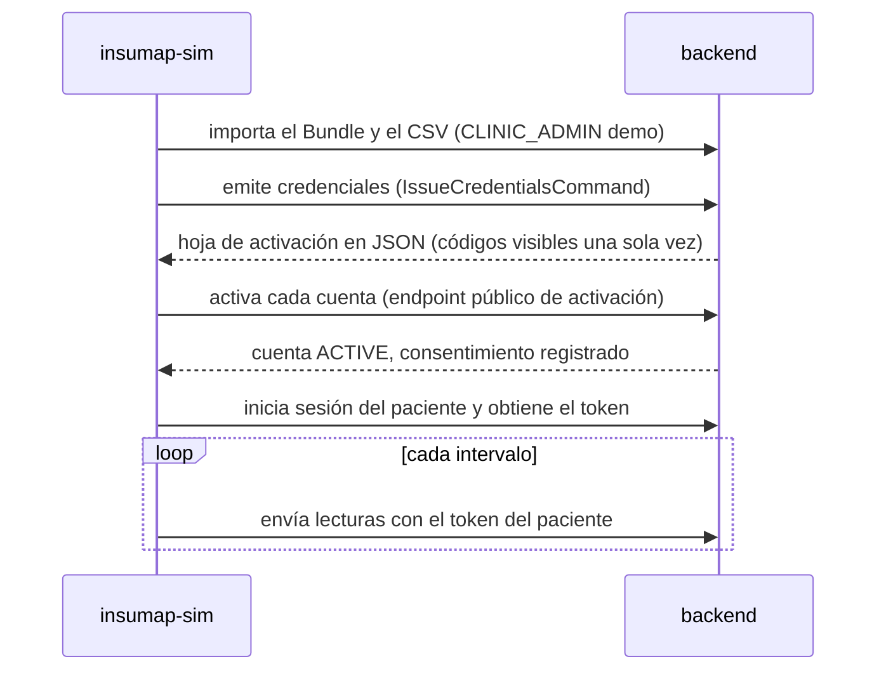

# Datos simulados

Insumap no tiene datos reales de pacientes en ningún entorno. Todo lo que en la práctica llegaría de una clínica (pacientes, médicos, glucosa, insulina, comidas, HbA1c) lo genera `insumap-simulator`, y entra al sistema **por las mismas puertas que usaría una clínica real**. Este documento explica por qué se simula, qué se simula, cómo, qué formatos produce, cómo entra al backend y cómo se reemplazaría por datos reales. Es el módulo M13.

> **Aviso:** proyecto académico, no es un dispositivo médico. Los resultados obtenidos con datos simulados prueban el sistema, **no su eficacia clínica**. Todo dato simulado se marca como **"Datos simulados"**.

## 1. Por qué se simula

| Necesidad | Por qué no basta con esperar datos reales |
|---|---|
| Probar el importador (M3) | Una clínica real entrega su base de datos; el equipo necesita Bundles FHIR y CSV realistas y repetibles. |
| Probar métricas, alertas y triage | TIR, TBR, AGP y las reglas de alerta necesitan semanas de series con casos extremos a voluntad. |
| Entrenar y evaluar la IA | IA1 a IA7 necesitan series con **etiquetas de verdad de terreno** (qué noche hubo hipoglucemia, quién abandonó). Con datos reales no existe esa etiqueta. |
| Probar el manejo de errores | Datos duplicados, lecturas inverosímiles y huecos deben aparecer cuando se quiere. |
| Demostrar el sistema | La demostración necesita un guion repetible con una clínica llena. |
| Privacidad | No se pueden usar datos reales de salud en un proyecto académico ni en capas gratuitas de LLM. |

## 2. Principio: mismas puertas que la realidad

| Actor simulado | Se conecta como | Puerta |
|---|---|---|
| Base de datos de la clínica (historia) | `CLINIC_ADMIN` de la clínica demo | Importador del backend: FHIR R4 Bundle o CSV (M3) |
| Emisión de credenciales | `CLINIC_ADMIN` de la clínica demo | `IssueCredentialsCommand` (M3): hoja de activación |
| Paciente | `PATIENT` con su cuenta activada | Endpoint público de activación y luego la API de registros (M5) con el token del paciente |
| Médico, admin | Cuentas creadas por el flujo normal (con MFA) | No las usa el simulador salvo en pruebas de extremo a extremo |

Consecuencias:

- **El backend no tiene rutas "de simulación".** La validación de lecturas (P12), la auditoría, la RLS y la cadena de alertas corren igual que con datos reales.
- La única restricción especial: el importador acepta los Bundles marcados como simulados **solo en clínicas con `clinic.clinics.is_demo = true`** (sección 11).
- Cambiar el simulador por una clínica real no cambia el backend: cambia quién entrega el Bundle y quién envía las lecturas.

Las rutas exactas están en [API.md](API.md), fuente canónica; aquí se nombran los pasos, no los paths.

## 3. La clínica demo

| Elemento | Valor |
|---|---|
| Clínica | Una, con `is_demo = true`, nombre ficticio (por ejemplo "Clínica Demo Insumap"), zona horaria `America/Bogota` |
| Médicos | 5 (`Practitioner`) con especialidades ficticias (endocrinología, medicina interna, medicina familiar) |
| Pacientes | Unos 150 |
| Distribución semilla | ~60 con DM1 y CGM, ~85 con DM2 y glucometría (SMBG), ~5 con diabetes gestacional |
| Asignación | Cada paciente tiene un médico principal; unos 20 % tienen un segundo médico (equipos de atención, M4) |
| Datos personales | Nombres con Faker `es_CO`; documentos **ficticios e inválidos a propósito**; correos `...@example.test` (dominio reservado, RFC 2606); teléfonos ficticios |

Las proporciones son semillas declaradas en archivos de datos del simulador (`clinic.yaml`), no literales en el código. `--patients` y `--seed` las parametrizan.

### 3.1 Documentos y contacto ficticios

- **Número de historia (MRN):** `DEMO-000001` a `DEMO-000150`. Es el identificador de deduplicación del importador.
- **Documento de identidad:** cadena con formato verosímil pero con un prefijo reservado (`SIM-` más dígitos) que ningún documento real cumple, para que nunca coincida con una persona real y para que las validaciones de formato del backend puedan distinguirlo.
- **Correo:** `nombre.apellido.N@example.test`.
- **Teléfono:** números ficticios en un rango no asignado (se fijará con la verificación de la Fase 0 de cumplimiento).
- Faker se invoca con `Faker("es_CO")` y la **semilla fija** (`Faker.seed(...)`) para que sea reproducible.

## 4. Arquetipos y variación

Los pacientes se derivan de **arquetipos** (`PatientArchetype`, P05 Prototype). Un arquetipo es un perfil clínico con parámetros; cada paciente es un clon con variación sembrada: `clone_with_variation(rng)`. El arquetipo y sus rangos de variación son datos (YAML), no código.

| Arquetipo (ejemplo) | Tipo | Fuente de glucosa | Rasgos |
|---|---|---|---|
| `t1d_adult_stable` | DM1 | CGM (simglucose) | Buen control, TIR alto, pocas hipos |
| `t1d_adult_variable` | DM1 | CGM | CV alto, hipos nocturnas ocasionales |
| `t1d_adolescent` | DM1 | CGM | Comidas irregulares, adherencia variable |
| `t2d_basal_only` | DM2 | SMBG | Una insulina basal, glucosa en ayunas elevada |
| `t2d_oral_only` | DM2 | SMBG | Sin insulina, medición esporádica |
| `t2d_basal_bolus` | DM2 | SMBG | Basal y bolos, 3 a 4 mediciones diarias |
| `gestational_diet` | Gestacional | SMBG | 4 mediciones diarias (ayuno y 1 h o 2 h posprandial), metas de embarazo |

Parámetros que varía cada clon (todos con rangos y distribución declarados): edad, peso, sensibilidad a la insulina, razón insulina/carbohidratos, dosis basal, horarios de comidas y de sueño, nivel de actividad, ruido del sensor, adherencia de base y la semilla individual del paciente. `VirtualPatientBuilder` (P04) arma el paciente paso a paso (identidad, clínica, arquetipo, escenario) y valida las invariantes en `build()`.

## 5. Generación de glucosa

La estrategia se elige por tipo de paciente con `GlucoseDynamicsStrategy` (P19): `SimglucoseDynamics` para DM1 con CGM y `SmbgPatternDynamics` para DM2 y gestacional.

### 5.1 DM1 con CGM: simglucose

- **Qué es:** [simglucose](https://github.com/jxx123/simglucose), implementación en Python del simulador **UVA/Padova (versión 2008)**, con 30 pacientes virtuales (10 adolescentes, 10 adultos, 10 niños), sensores (Dexcom, GuardianRT, Navigator) y bombas de insulina. Licencia **MIT**. Se cita en la documentación y en el `NOTICE` del simulador.
- **Adaptación:** `SimglucoseAdapter` (P06) aísla la librería. El resto del código solo conoce `GlucoseDynamicsStrategy`. Se usan los pacientes adultos y adolescentes como base y la variación de cada clon perturba sus parámetros fisiológicos dentro de límites.
- **Entradas por paso de tiempo:** comidas (escenario de comidas con hora y gramos de carbohidratos) y acciones de insulina (basal y bolos) que salen del plan simulado del paciente y de los escenarios inyectados (dosis omitida, bolo tardío).
- **Salida:** lecturas del sensor virtual remuestreadas a **5 minutos** (o 15 minutos para un sensor de menor frecuencia), con el ruido y los retardos propios del modelo del sensor, más huecos de datos opcionales (sensor desconectado) para probar la suficiencia de datos.
- **Unidad:** mg/dL, la que usa el modelo y la que guarda Insumap.

### 5.2 Verificación de simglucose (hecha el 15-nov-2026)

| Dato | Resultado verificado |
|---|---|
| Licencia | MIT (PyPI y GitHub) |
| Última versión en PyPI | **0.2.11**, publicada el 17-may-2024 |
| Repositorio | `jxx123/simglucose`, no archivado, último commit visible en `master`: abr-2025 |
| `requires_python` en PyPI | **No declarado**; el README dice que ya no soporta 3.7 ni 3.8 |
| Dependencias pesadas | Fija `gym==0.9.4` (histórico) además de `gymnasium~=0.29.1`, `pathos`, `scipy`, `matplotlib`, `numpy`, `pandas` |

**Prueba de instalación (Python 3.13 y 3.12, con `uv`):**

- `uv pip install simglucose` instala sin error en 3.13.
- **Pero `import simglucose` falla** en 3.12 y 3.13: `gym==0.9.4` hace `import distutils.version`, módulo que **se eliminó de la biblioteca estándar en Python 3.12**.
- Con `setuptools` instalado (que aporta un sustituto de `distutils`) aparece el siguiente fallo: `gym` importa `pkg_resources`, que **las versiones recientes de `setuptools` ya no incluyen** (observado con 84.2.1).
- Con **`setuptools<81`** instalado en el entorno, `from simglucose.simulation.env import T1DSimEnv` funciona en Python 3.13 (con `SyntaxWarning` por expresiones regulares antiguas de `gym`).

**Decisión y mitigación:**

1. Fijar en el `pyproject.toml` del simulador `simglucose==0.2.11` y `setuptools<81`, con un comentario que explique el motivo y una prueba de humo que importe `T1DSimEnv` y simule un día. La CI corre esa prueba en cada cambio de dependencias.
2. Aislar toda la dependencia detrás de `SimglucoseAdapter`: si falla en el futuro, solo cambia ese módulo.
3. Plan B si el parche deja de funcionar: usar un **entorno aislado con Python 3.11 o 3.12 solo para generar la serie DM1**, invocado como proceso externo por el adaptador y que entrega CSV intermedio; o incluir (*vendoring*) el código de simglucose (MIT lo permite, conservando la licencia) con la dependencia de `gym` retirada. Se decide en la Fase 10 solo si el plan A falla.
4. Verificar de nuevo la versión y el soporte de Python al crear el esqueleto del simulador; este hallazgo puede cambiar si se publica una versión nueva.

Referencia científica: Man CD et al., *The UVA/PADOVA Type 1 Diabetes Simulator: New Features*, J Diabetes Sci Technol 2014 ([PMC4454102](https://www.ncbi.nlm.nih.gov/pmc/articles/PMC4454102/)), citada por el propio README de simglucose.

### 5.3 DM2 y gestacional: modelo de patrones de glucometría (SMBG)

No hay sensor continuo: el paciente se mide **de 1 a 4 veces al día**. `SmbgPatternDynamics` genera:

1. Una **curva latente** de glucosa continua por paciente: nivel basal (relacionado con su HbA1c objetivo), ritmo circadiano (subida del alba), respuesta a las comidas (subida y decaimiento exponencial, mayor en DM2 por menor sensibilidad), efecto de la actividad (descenso) y el de la insulina basal o la medicación cuando existe.
2. Un **patrón de mediciones** por arquetipo: p. ej. 1 por día (ayuno), 2 (ayuno y noche), 3 a 4 (ayuno, antes y 2 h después de comidas, antes de dormir; en gestacional, ayuno y 1 h o 2 h tras cada comida). Los horarios tienen variación y las omisiones dependen de la adherencia del día.
3. Las lecturas son **muestras de la curva latente** más ruido del glucómetro (error relativo declarado) y redondeo al entero en mg/dL, con la **etiqueta de contexto** (`FASTING`, `PRE_MEAL`, `POST_MEAL`, `BEDTIME`, `OTHER`).

El modelo es una abstracción simple y sus parámetros son supuestos declarados en YAML (sección 14).

### 5.4 Dosis, comidas, actividad e HbA1c

| Dato | Generación |
|---|---|
| **Dosis de insulina** | De la dosis basal y los bolos del plan del arquetipo, con hora y variación; las dosis omitidas, duplicadas o tardías salen de los escenarios. Tipos `BASAL`, `BOLUS`, `MIXED`. |
| **Comidas** | Desayuno, almuerzo, cena y colaciones con hora y carbohidratos (g) según el arquetipo y los hábitos del paciente. |
| **Actividad** | Sesiones (tipo, duración, intensidad) con probabilidad por día; reducen la glucosa en el modelo. |
| **Síntomas** | Registros ocasionales (por ejemplo "temblor" tras una hipoglucemia). |
| **HbA1c trimestral** | Una por trimestre, calculada desde la glucosa media real del periodo con la relación inversa del GMI (`HbA1c ≈ 3.31 + 0.02392 × media`, ver [Metricas-clinicas.md](Metricas-clinicas.md)) más ruido de laboratorio; en DM2 sin CGM se estima desde la media de la curva latente. |

## 6. Escenarios inyectados y verdad de terreno

`ScenarioCreator` (P02) crea un escenario concreto a partir de su definición en datos. Un escenario modifica la vida del paciente en una **ventana de tiempo** y deja escrita la **etiqueta de verdad de terreno** que usa `insumap-ai` para evaluar.

| Escenario | Qué hace | Etiqueta |
|---|---|---|
| `nocturnal_hypoglycemia` | Basal alta o cena omitida con actividad: la glucosa cae bajo el umbral entre las 00:00 y las 06:00 en N noches | Noches y mínimo esperado; usada por IA2 e IA3 |
| `dawn_phenomenon` | Subida de glucosa entre las 04:00 y las 08:00 sin hipo previa | Días afectados; IA3 |
| `missed_doses` | Se omiten dosis (o se duplican) con una probabilidad dada | Fechas de cada dosis omitida o duplicada; IA3 |
| `adherence_improving` | La frecuencia de registro y la adherencia suben semana a semana | Pendiente; IA2 e IA7 |
| `adherence_worsening` | Bajan semana a semana, con más glucosa alta | Pendiente; IA2 e IA7 |
| `dropout` | El paciente deja de registrar desde una fecha | Fecha de abandono; IA7 |
| `implausible_readings` | Valores imposibles o saltos no fisiológicos (error de sensor) | Marcas de tiempo; IA3 |
| `postprandial_spikes` | Picos tras comidas grandes | Eventos; IA3 |
| `stable` | Sin escenario (control) | Nada; mide falsos positivos |

Cada paciente tiene 0, 1 o 2 escenarios (la proporción es dato). Las etiquetas se escriben en `labels.jsonl` (sección 10) con la forma:

```json
{"patient_mrn": "DEMO-000042", "scenario": "nocturnal_hypoglycemia", "from": "2026-09-14T00:00:00-05:00", "to": "2026-09-14T06:00:00-05:00", "expected_min_mg_dl": 52, "ia_use_cases": ["IA2", "IA3"]}
```

Las etiquetas **nunca** se importan al backend: solo viajan en los datasets para IA.

## 7. Reloj simulado, iteración y reproducibilidad

- **Reloj simulado:** la generación nunca lee la hora del sistema. Recibe `--start-date` y `--days` y avanza con `TimeStepIterator` (P14), que entrega pasos de 1, 5 o 15 minutos según el modelo. Todos los instantes llevan offset (`America/Bogota`).
- **Semillas:** `--seed` obligatorio. A partir de ella se derivan semillas **por paciente** (`SeedSequence.spawn`) para que agregar o quitar un paciente no cambie a los demás.
- **Determinismo:** la misma semilla y la misma versión del simulador producen **exactamente** la misma salida (misma suma de verificación). Una prueba lo comprueba.
- **Sin valores quemados:** los parámetros de arquetipos y escenarios son datos; las metas clínicas no se copian aquí (son del backend).

## 8. Modos del simulador

| Modo | Orden | Qué hace |
|---|---|---|
| `backfill` | `insumap-sim backfill --seed 42` | Genera la historia y escribe un **Bundle FHIR R4** y un **CSV**; opcionalmente los envía al importador del backend (M3) |
| `live` | `insumap-sim live --seed 42` | Activa las cuentas con la hoja de activación y envía lecturas periódicas con tokens de paciente |
| `dataset` | `insumap-sim dataset --seed 42` | Escribe los datasets etiquetados para `insumap-ai` |

Los nombres exactos de los comandos se fijan al crear el esqueleto. `ExportPipeline` (P20, Template Method) define el proceso común: validar, ordenar, serializar, marcar como simulado y escribir. Sus pasos concretos son FHIR, CSV y dataset.

### 8.1 `backfill`: FHIR R4 y CSV

Se escribe en una carpeta ignorada por git (`out/`), con un `manifest.json` (versión del simulador, semilla, fecha de inicio, conteos y sumas de verificación). Las salidas generadas **no se versionan**, salvo fixtures pequeñas de prueba.

#### Bundle FHIR R4

Un `Bundle` de tipo `collection` (o `transaction` si el importador lo prefiere; se acuerda con el backend) con los recursos:

| Recurso | Contenido | Observaciones |
|---|---|---|
| `Practitioner` | Médicos (nombre ficticio, identificador de personal ficticio) | Los 5 médicos |
| `Patient` | MRN en `identifier` (sistema `urn:insumap:demo:mrn`), documento ficticio, nombre, fecha de nacimiento, sexo, contacto `example.test`, `generalPractitioner` apuntando al médico principal | La asignación real la confirma el admin (M4) |
| `Condition` | Tipo de diabetes del paciente | SNOMED CT: `46635009` (diabetes mellitus tipo 1), `44054006` (tipo 2), `11687002` (gestacional), verificados |
| `Observation` | Lecturas de glucosa y HbA1c, con `effectiveDateTime`, `valueQuantity` y `subject` | Códigos LOINC abajo |
| `MedicationRequest` | Insulina basal y fármacos del plan (texto del medicamento, dosis, vía, frecuencia) | Representa la **prescripción**, no cada dosis aplicada |

**Códigos LOINC** (verificados contra el servidor de terminología `tx.fhir.org`, R4):

| Dato | LOINC | Nombre LOINC | Unidad UCUM |
|---|---|---|---|
| Glucosa de sensor continuo (CGM) | `99504-3` | Glucose [Mass/volume] in Interstitial fluid | `mg/dL` |
| Glucosa capilar con glucómetro (SMBG) | `41653-7` | Glucose [Mass/volume] in Capillary blood by Glucometer | `mg/dL` |
| Glucosa en sangre, registro manual o de laboratorio | `2339-0` | Glucose [Mass/volume] in Blood | `mg/dL` |
| Hemoglobina glicosilada | `4548-4` | Hemoglobin A1c/Hemoglobin.total in Blood | `%` |

El contexto de la lectura (ayuno, antes de comida, etc.) va en `Observation.extension` o en `note` con un `CodeSystem` propio de Insumap (`https://insumap.example.test/fhir/CodeSystem/reading-context`), a acordar con el backend. Las dosis individuales de insulina, las comidas y la actividad **no tienen un recurso FHIR de origen** en la "base de datos de la clínica": viajan en el CSV complementario.

**Marca "Datos simulados":** `Bundle.meta.tag` con sistema `https://insumap.example.test/fhir/CodeSystem/data-origin`, código `SIMULATED` y `display = "Datos simulados"`; el mismo `meta.tag` en cada recurso; `Bundle.meta.source` con la versión del simulador y la semilla. El backend rechaza un Bundle con esa marca si la clínica destino no es demo, y rechaza uno sin la marca si lo emite el simulador (sección 11).

El Bundle se valida contra FHIR R4 en las pruebas del simulador (con una librería de modelos FHIR en Python, a elegir al crear el esqueleto) y contra el importador real del backend en las pruebas de integración.

#### CSV

Para lo que FHIR no lleva o para clínicas que prefieren CSV (`CgmCsvAdapter`):

| Archivo | Columnas |
|---|---|
| `glucose_readings.csv` | `patient_mrn, timestamp, glucose_mg_dl, source, context` (`source` en `CGM`, `SMBG`, `MANUAL`) |
| `insulin_doses.csv` | `patient_mrn, timestamp, insulin_kind, units, source` |
| `meals.csv` | `patient_mrn, timestamp, meal_type, carbs_g` |
| `activities.csv` | `patient_mrn, start_timestamp, duration_min, intensity, activity_type` |
| `lab_results.csv` | `patient_mrn, date, test, value, unit` (HbA1c) |

Codificación UTF-8, separador coma, decimales con punto, `timestamp` ISO-8601 con offset. La primera línea es un comentario `# data_origin=SIMULATED; label="Datos simulados"; simulator_version=...; seed=...` que el lector del backend acepta e interpreta.

**Contrato con el importador:** el formato es el que espera `ClinicIntegrationFactory` (`FhirPatientAdapter` y `CgmCsvAdapter`). Un cambio en el Bundle o el CSV se coordina con el backend (Drako2305) en el mismo ciclo; hasta que exista el simulador, el backend prueba con fixtures propias en `tests/fixtures/`.

### 8.2 Credenciales y `live`

Como en una clínica real, **emitir credenciales produce una hoja de activación de un solo uso**. Para la clínica demo, el simulador consume la versión JSON de esa hoja.



1. **Hoja de activación.** Al emitir credenciales (M3), el backend genera una hoja imprimible (PDF o HTML) con un código de activación por paciente. Los códigos se guardan solo como hash; la hoja los muestra **una sola vez**. Para una clínica con `is_demo = true`, la misma emisión puede devolver también la hoja en **JSON**: `{ "sheet_id", "clinic_id", "issued_at", "expires_at", "items": [ { "patient_mrn", "activation_code", "expires_at" } ] }`. Una clínica no demo nunca recibe esa versión.
2. **Consumo.** El simulador lee la hoja JSON de un archivo local ignorado por git (ruta en variable de entorno), nunca la imprime ni la registra en logs.
3. **Activación.** Por cada paciente llama al **endpoint público de activación** con el MRN y el código, define una contraseña (derivada de una variable de entorno y el MRN para poder repetir la corrida; nunca en el repositorio) y acepta la versión vigente del consentimiento. La cuenta pasa de `INVITED` a `ACTIVE` por el flujo normal y respeta el *rate limiting*.
4. **Modo `live`.** Con la cuenta `ACTIVE`, inicia sesión con el paciente, guarda el token en memoria (o en un archivo local ignorado) y envía lecturas periódicas (CGM en lotes cada pocos minutos, SMBG en su hora, dosis y comidas) respetando los límites de tasa de la API. Maneja `401` renovando el token.
5. **Límites:** `live` solo apunta a clínicas demo (el simulador lo verifica con el backend antes de enviar), no se ejecuta contra una URL que no esté en su lista permitida y tiene un máximo de lecturas por minuto.

Los códigos de activación, las contraseñas y los tokens **viven solo en `.env` o en archivos locales ignorados por git**.

## 9. Etiquetado "Datos simulados" en todo el sistema

| Dónde | Cómo |
|---|---|
| Bundle FHIR | `meta.tag` `SIMULATED` en el Bundle y en cada recurso |
| CSV | Línea de comentario inicial y `manifest.json` |
| BD | `clinic.clinics.is_demo = true`; el lote de importación (`import_batches`) conserva el origen |
| API | La respuesta de la clínica y de sus recursos incluye `is_demo` y el texto "Datos simulados" |
| UI y reportes | Banner fijo "Datos simulados" en la clínica demo y marca de agua en reportes y PDF |
| Dashboard de IA | La evaluación muestra el origen de los datos de entrenamiento y prueba |

## 10. Datasets de entrenamiento para `insumap-ai`

`insumap-sim dataset` escribe una carpeta versionada por semilla y versión:

```
datasets/<version>-seed<semilla>/
  manifest.json          versión del simulador, semilla, parámetros, conteos, sumas de verificación
  patients.csv           una fila por paciente (tipo, arquetipo, escenarios; sin datos personales)
  glucose_readings.csv   serie completa
  insulin_doses.csv
  meals.csv
  lab_results.csv
  labels.jsonl           etiquetas de verdad de terreno (sección 6)
  splits.json            división por paciente: train, validation, test (con su semilla)
```

- Se identifica a cada paciente con un seudónimo, no con el MRN.
- **No se versionan** (solo fixtures pequeñas). Se publican como artefactos de la CI o se generan localmente con la semilla registrada.
- Cada modelo de IA registra en su `model_card.json` la **versión del simulador y la semilla** con las que se entrenó (ver [Modulo-IA.md](Modulo-IA.md), sección 4).

## 11. Cómo lo trata el backend

| Regla | Detalle |
|---|---|
| Importación de simulados solo en clínicas demo | Un Bundle con `meta.tag = SIMULATED` solo se acepta si `clinic.is_demo = true`. En una clínica real, se rechaza con un error de dominio. |
| Origen obligatorio | Un Bundle del simulador sin la marca se rechaza, para que nunca se confundan. |
| Misma validación | Las lecturas simuladas pasan por la misma `GlucoseReadingValidationHandler`. |
| Deduplicación por MRN | Repetir el `backfill` con la misma semilla es idempotente: los pacientes ya importados (`DEMO-...`) se actualizan o se omiten según la política del importador. |
| Aislamiento | Los pacientes demo son de la clínica demo y la RLS los aísla de otras clínicas. |
| Sin rutas especiales | No existen endpoints de simulación; la única diferencia es la hoja de activación en JSON para clínicas demo. |

## 12. Supuestos

| Área | Supuesto | Estado |
|---|---|---|
| Fisiología DM1 | El modelo UVA/Padova 2008 de simglucose representa a pacientes con DM1 adultos y adolescentes | Modelo publicado y validado en la literatura para simulación; no sustituye a pacientes reales |
| DM2 y gestacional | Curva latente más muestreo es una abstracción simple; los parámetros son supuestos | Por contrastar con literatura de glucometría; no validado |
| Proporciones de escenarios | Porcentajes de pacientes con cada escenario | Supuesto; ajustar según lo que necesite la evaluación de la IA |
| Adherencia | Probabilidad de medir u omitir una dosis por día | Supuesto |
| Ruido de sensores y glucómetros | Error relativo declarado | Supuesto; ajustar con fichas técnicas |
| HbA1c | Relación con la glucosa media vía la fórmula del GMI | Aproximación; la HbA1c real varía entre personas |
| Efecto de la insulina en DM2 | Modelado con un efecto lineal simplificado | Supuesto |

Los supuestos se exponen como datos YAML, así que son fáciles de auditar y de cambiar.

## 13. Cómo reemplazar los datos simulados por reales

1. La clínica entrega su base de datos como FHIR R4 o CSV con el mismo formato; el importador es el mismo.
2. Las credenciales se emiten con la hoja de activación impresa o por correo, igual que ahora; ya no se pide el JSON.
3. Los pacientes registran con la app; sus lecturas llegan por las mismas rutas.
4. Se desactiva la clínica demo y los datasets de entrenamiento se **reentrenan** con datos reales y autorización, bajo el marco de [Cumplimiento-y-privacidad.md](Cumplimiento-y-privacidad.md). Un modelo entrenado con datos simulados **no** se usa clínicamente sin validación.

## 14. Validación del simulador

Pruebas que el repositorio del simulador debe tener (cada una determinista):

| Prueba | Qué comprueba |
|---|---|
| Determinismo | Misma semilla y versión, misma suma de verificación |
| Rangos fisiológicos | La glucosa se mantiene en un rango plausible (sin NaN ni negativos) |
| Distribución | Las proporciones de la clínica demo (tipos, escenarios) coinciden con los datos |
| Escenarios | Cada escenario produce el evento etiquetado en su ventana (por ejemplo, la noche con hipo tiene valores bajo el umbral) |
| FHIR | El Bundle valida contra R4; los LOINC y los SNOMED son los de este documento |
| CSV | Los archivos cumplen las columnas y la codificación |
| Importador | El Bundle y el CSV entran por el importador real del backend sin errores (prueba de integración con Drako2305 como revisor) |
| Marca de simulados | Todos los recursos y archivos llevan la marca |
| Privacidad | Documentos con el prefijo ficticio, correos `example.test`, ninguna cadena que parezca un dato real |
| Simglucose | Prueba de humo: importa `T1DSimEnv` y simula un día |

## 15. Responsabilidades

| Tarea | Responsable |
|---|---|
| Simulador: arquetipos, escenarios, FHIR, CSV, `live`, datasets | `nicomora70` |
| Importador del backend y la hoja de activación | `Drako2305` |
| Revisión de que FHIR y CSV coinciden con el importador | `Drako2305` |
| CI y empaquetado | `NicoalsD` |
