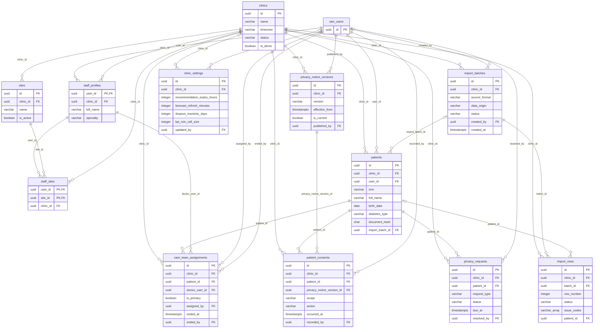
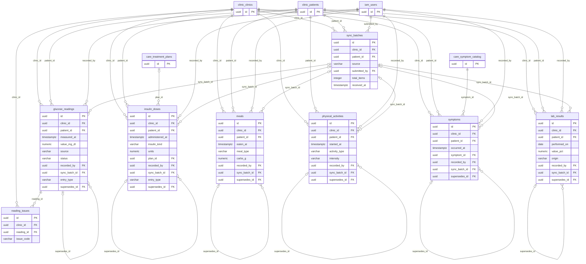
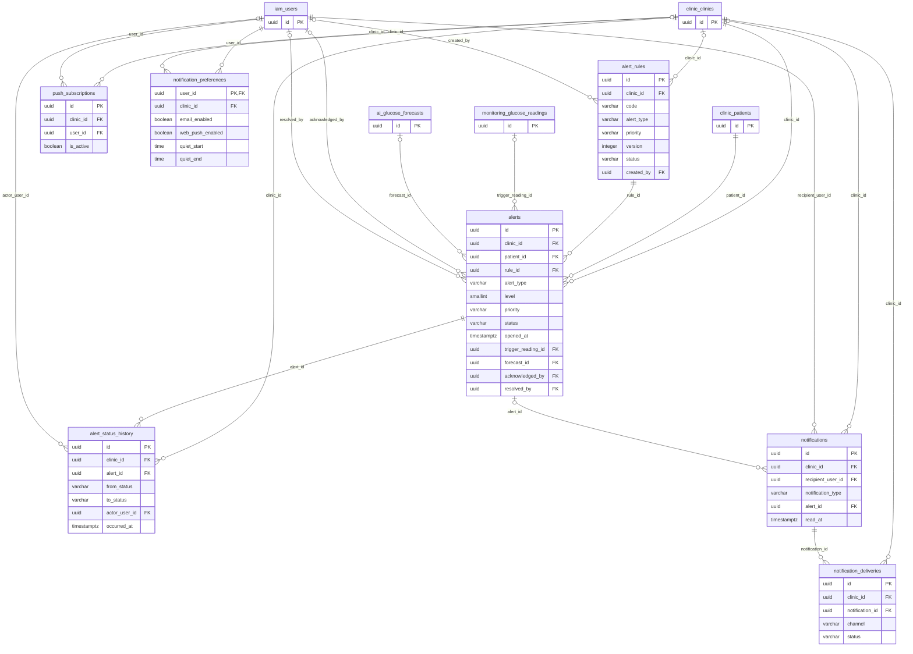
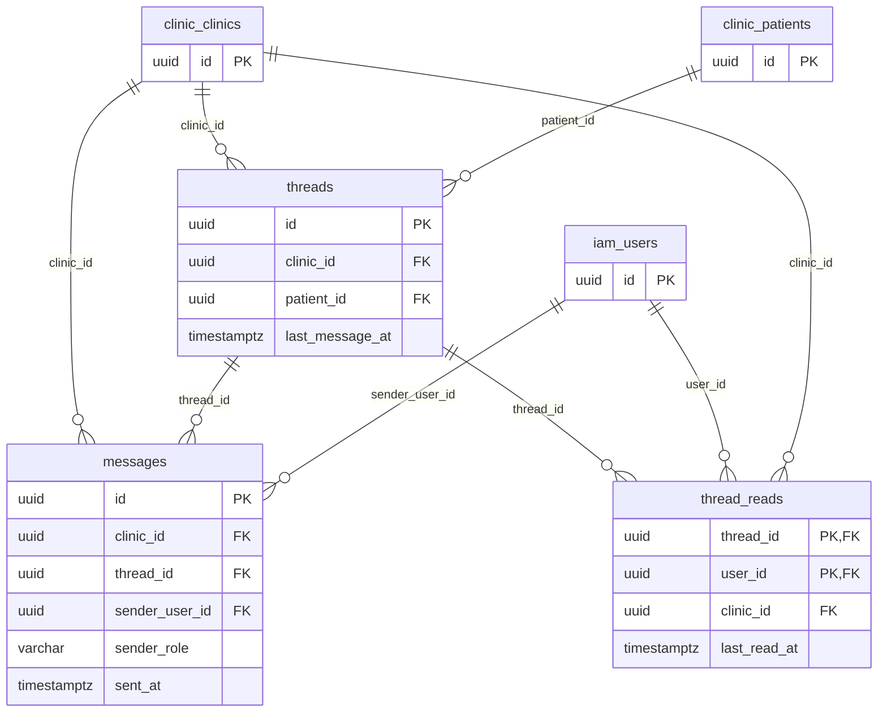
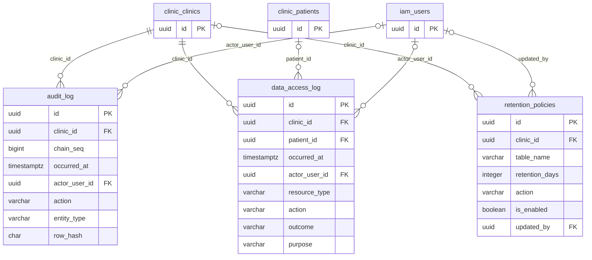

# Modelo de datos

Este documento describe el modelo de datos de Insumap: los esquemas de PostgreSQL 18, cada tabla con su propósito, sus claves, su aislamiento por clínica (RLS), sus índices, su retención y los casos de uso que la tocan. Es la especificación que implementa `insumap-database` con migraciones de Alembic en SQL escrito a mano. El detalle columna por columna está en [Diccionario-de-datos.md](Diccionario-de-datos.md).

> **Aviso:** Insumap es un proyecto académico. No es un dispositivo médico, la IA solo apoya al médico y todos los pacientes son simulados. Aun así, el modelo se diseña como si los datos fueran reales, porque los datos de salud son datos sensibles.

**Estado de cada elemento.** Lo que ya fijan otros documentos se toma tal cual. Lo que este documento agrega para cubrir un requisito, y no aparece en la lista de tablas de `insumap-database/AGENTS.md`, lleva la etiqueta **(propuesta)** y se resume en la sección 14. Donde falta una cifra legal o un valor por validar, se escribe "por definir".

## 1. Alcance y fuentes

- Esquemas y tablas base: sección 5 de [`insumap-database/AGENTS.md`](https://github.com/NicoalsD/insumap-database/blob/develop/AGENTS.md).
- Columnas, tablas y funciones de seguridad: [Seguridad.md](Seguridad.md) (secciones 2 a 8, 12, 16 y 21), que prevalece cuando otro documento difiere.
- Roles, permisos y reglas de visibilidad V1 a V10: [Actores-y-permisos.md](Actores-y-permisos.md).
- Flujos, transacciones, trabajos programados y multi-tenancy: [Arquitectura.md](Arquitectura.md).
- Requisitos y historias: [Requerimientos.md](Requerimientos.md) e [Historias-de-usuario.md](Historias-de-usuario.md).
- Metas y métricas: [Metricas-clinicas.md](Metricas-clinicas.md). IA: [Modulo-IA.md](Modulo-IA.md) y [Contrato-IA.md](Contrato-IA.md). Datos de la clínica demo: [Datos-simulados.md](Datos-simulados.md).
- Límites técnicos: `FieldLimits` en `src/insumap/shared/field_limits.py` y [`.agents/configuration.md`](../.agents/configuration.md).

El ERD completo en draw.io se agrega después como `docs/images/modelo-er.drawio` y `docs/images/modelo-er.png` (mismo nombre, fuente y exportación). Mientras tanto, los diagramas Mermaid de la sección 9 son la referencia visual de cada esquema.

## 2. Vista general

PostgreSQL 18 con ocho esquemas. Las claves foráneas cruzan esquemas, pero cada esquema agrupa un módulo funcional.

| Esquema | Contenido | Módulos | Tablas |
|---|---|---|---|
| `iam` | Identidad y acceso | M1, M2, M3 | 14 |
| `clinic` | Clínicas, personas y onboarding | M2, M3, M4, M12, M13 | 12 |
| `care` | Plan de tratamiento, metas y seguimiento | M6, M7, M10, M11 | 13 |
| `monitoring` | Registros del paciente (append-only) | M5 | 8 |
| `alerts` | Alertas y notificaciones | M8 | 7 |
| `ai` | IA y soporte a decisiones | M9 | 10 |
| `messaging` | Mensajería | M11 | 3 |
| `audit` | Auditoría y retención | M12 | 3 |
| | **Total** | | **70** |

Reglas de lectura del modelo:

- Una tabla marcada **(propuesta)** no está en la lista base de `insumap-database/AGENTS.md`. Las agrega este documento porque un requisito o [Seguridad.md](Seguridad.md) la exige.
- El esquema `monitoring` guarda solo registros clínicos append-only. Ninguna tabla configurable vive allí (el trigger cubre todo `monitoring.*`); la configuración de validación está en `care.reading_validation_settings`.
- Los parámetros clínicos y de negocio son filas (sección 8), nunca `DEFAULT` ni `CHECK` con números clínicos.

## 3. Convenciones

| Tema | Regla |
|---|---|
| Identificadores | Tablas, columnas, restricciones, índices y valores de enumeración en inglés `snake_case`. Valores de enumeración en mayúsculas. |
| Claves primarias | `id uuid DEFAULT uuidv7()` (función nativa de PostgreSQL 18). Las tablas de unión usan clave compuesta. |
| Tiempo | `timestamptz` en UTC. Los días y las noches se calculan en la zona de `clinic.clinics.timezone`. La hora de la aplicación llega por el `Clock` inyectado. |
| Glucosa | Siempre en mg/dL, `numeric(5,1)`. El mmol/L solo existe en la conversión de la API. |
| Enumeraciones | `varchar(n)` con `CHECK ... IN (...)`, no tipos `ENUM` de PostgreSQL: un valor nuevo es una migración simple y la longitud queda visible en `information_schema`. |
| Límites de longitud | Toda columna cuyo límite coincide con `FieldLimits` es `varchar(n)`: la prueba de deriva compara `information_schema.columns.character_maximum_length`. Hashes SHA-256 y HMAC: `char(64)`. Huellas de llave (`*_key_id`): `char(16)`. Hoy solo `EMAIL_MAX_LENGTH` (254) y `REQUEST_ID_MAX_LENGTH` (64) existen en `FieldLimits`; el resto son constantes propuestas (ver el diccionario). |
| `CHECK` | Solo técnicos: `> 0`, listas de enumeración, coherencia entre columnas, formatos. Ningún valor clínico. |
| Claves foráneas | `ON DELETE RESTRICT` en todas. No hay borrado en cascada y los datos clínicos nunca se borran. Una referencia circular (`care.treatment_plans` con `ai.recommendations`) se cierra con un `ALTER TABLE` posterior en la misma migración. |
| Nombres de restricciones | Explícitos: `pk_<tabla>`, `fk_<tabla>_<columna>`, `uq_<tabla>_<columnas>`, `ck_<tabla>_<regla>`, `ix_<tabla>_<columnas>` y `ux_<tabla>_<columnas>` para únicos parciales o funcionales. |
| Estados | Columna `status` con `CHECK`; el historial de cambios en tablas aparte cuando se exige (`alerts.alert_status_history`, `ai.recommendation_decisions`). |
| Correcciones | En los registros clínicos, una fila nueva con `entry_type = 'CORRECTION'` o `'VOID'`, `supersedes_id` y `correction_reason` (RF-39, ADR-08). La versión vigente es la que ninguna otra supera. |
| Optimismo | `lock_version integer` en los agregados que varios usuarios editan (`409` si no coincide). |
| Extensiones | `pg_trgm` (búsqueda en `ai.knowledge_documents`). `uuidv7()` y `sha256()` de PostgreSQL 18 no necesitan extensiones. El cifrado y los HMAC de columnas se hacen en la aplicación (Seguridad 8); la base solo guarda el resultado. |
| Clases de datos | Se usan las de Seguridad 1.2: H (clínico), C (identidad y contacto), S (secreto). Las columnas S están marcadas en el diccionario y `insumap_readonly` no las ve. |

## 4. Multi-tenancy y RLS

### 4.1 Variables de sesión

La unidad de trabajo fija tres variables al abrir cada transacción, con `set_config(..., true)` (equivale a `SET LOCAL`, funciona con el pooler de Neon en modo transacción y nunca se fija a nivel de conexión). Los valores salen solo del JWT validado.

```sql
SELECT set_config('app.clinic_id', :clinic_id, true),
       set_config('app.user_id',   :user_id,   true),
       set_config('app.role',      :role,      true);
```

| Variable | Contenido | Quién la usa |
|---|---|---|
| `app.clinic_id` | UUID de la clínica de la sesión. Vacío para `PLATFORM_ADMIN`. | Todas las políticas por clínica |
| `app.user_id` | UUID del usuario autenticado. | Filas propias (`iam.*`, notificaciones, `PATIENT`) |
| `app.role` | `PLATFORM_ADMIN`, `CLINIC_ADMIN`, `DOCTOR`, `PATIENT` o `SYSTEM`. | Políticas por rol (tercera variable: Seguridad 6.2 y 21 #7; Arquitectura 3 y 5 mencionan dos y se actualizan) |

`SYSTEM` (propuesta) es el rol del planificador: los trabajos programados abren una transacción por clínica con `app.clinic_id` de esa clínica, `app.user_id` del usuario de sistema (`iam.users.is_system = true`, sin contraseña ni membresía) y `app.role = 'SYSTEM'`. Solo el proceso del planificador lo fija; ningún JWT de usuario puede llevarlo. Sin `SYSTEM`, el triage nocturno no podría escribir en `ai.*` ni en `alerts.*`.

**Fallo cerrado.** Si la transacción no fija el valor, `current_setting('app.clinic_id', true)` devuelve `NULL` y las políticas no devuelven filas.

### 4.2 Funciones auxiliares de las políticas

| Función | Tipo | Qué hace |
|---|---|---|
| `iam.app_clinic_id()` | `STABLE`, `SECURITY INVOKER` | `NULLIF(current_setting('app.clinic_id', true), '')::uuid`. |
| `iam.app_user_id()` | `STABLE`, `SECURITY INVOKER` | Igual para `app.user_id`. |
| `iam.app_role()` | `STABLE`, `SECURITY INVOKER` | `NULLIF(current_setting('app.role', true), '')`. |
| `clinic.current_patient_id()` | `STABLE`, `SECURITY DEFINER`, `search_path` fijo | `id` del paciente cuyo `user_id = iam.app_user_id()` y `clinic_id = iam.app_clinic_id()`. Evita que cada política de las tablas clínicas haga una subconsulta sobre `clinic.patients` (que tiene su propia RLS). |

### 4.3 Plantillas de política

Toda tabla con `clinic_id` tiene `ENABLE` y `FORCE ROW LEVEL SECURITY`, con `USING` y `WITH CHECK`. Las tablas sin `clinic_id` usan la plantilla que corresponde a su caso. Cada tabla de la sección 9 indica su plantilla y sus excepciones. `PA` es `PLATFORM_ADMIN`, `CA` es `CLINIC_ADMIN`, `DR` es `DOCTOR`, `PT` es `PATIENT` y `SY` es `SYSTEM`.

| Plantilla | Condición | Uso |
|---|---|---|
| **RLS-0** Catálogo global | Sin RLS. `insumap_app` e `insumap_readonly` solo tienen `SELECT` (salvo `ai.model_versions`). Escribe el migrador. | Roles, permisos y catálogos globales |
| **RLS-1** Tenant | `clinic_id = iam.app_clinic_id()` en `USING` y `WITH CHECK`, más `iam.app_role() IN (...)` según la tabla y el comando. | Datos de clínica sin dueño paciente |
| **RLS-2** Tenant y paciente propio | RLS-1, y para `PT` además `patient_id = clinic.current_patient_id()` (`SELECT` y `INSERT`). | Datos del paciente |
| **RLS-3** Semilla global o tenant | `SELECT`: `clinic_id IS NULL OR clinic_id = iam.app_clinic_id()`. Escritura: `clinic_id = iam.app_clinic_id()` y rol `CA`. Política adicional `TO insumap_migrator USING (true) WITH CHECK (true)` para sembrar. | Perfiles de metas, plantillas, reglas, catálogos y retención |
| **RLS-4** Anterior al contexto | Sin RLS ni `clinic_id` útil: se lee o escribe antes de conocer la clínica o el usuario. Privilegios mínimos por columna y claves de alta entropía o HMAC. | `iam.login_attempts`, `iam.rate_limit_buckets`, `iam.login_lockouts`, `iam.auth_challenges` |
| **RLS-5** Solo por función | `INSERT` únicamente mediante una función `SECURITY DEFINER`; `insumap_app` no tiene `INSERT` directo. | `audit.audit_log` |
| **RLS-6** Fila propia | `user_id = iam.app_user_id()` (o `recipient_user_id`), con ramas administrativas explícitas donde la regla lo pide. | `iam.users`, `iam.mfa_factors`, `iam.refresh_tokens`, `iam.password_history`, notificaciones, suscripciones push |
| **RLS-7** Evento con clínica opcional | `INSERT` en cualquier contexto con `clinic_id IS NULL OR clinic_id = iam.app_clinic_id()`. `SELECT` por rol. | `iam.security_events` |
| **RLS-8** Raíz de tenant | `id = iam.app_clinic_id()` para `CA`, `DR`, `PT` y `SY`; `PA` ve y gestiona todas. | `clinic.clinics` |

### 4.4 Decisiones de diseño de la RLS

1. **Exclusión por rol por tabla, no por esquema.** Las tablas de datos clínicos (`monitoring.*`, `care.treatment_plans`, `care.clinical_notes`, `alerts.alerts`, `ai.*` de salida, `messaging.*`) solo admiten `app.role IN ('DOCTOR','PATIENT','SYSTEM')` según el caso, y nunca `CA` ni `PA`. Pero `care.target_profiles`, `care.protocol_templates`, `alerts.alert_rules`, `care.reading_validation_settings` y `care.symptom_catalog` los gestiona `CLINIC_ADMIN`, así que la exclusión no puede ser por esquema.
2. **La asignación médico-paciente no está en la RLS.** Para `DOCTOR`, la política exige clínica y rol; la verificación de que el paciente está asignado la hace `PatientRecordAccessProxy` (P11) con `clinic.care_team_assignments` (Arquitectura 12, defensa 3). Un error del proxy se limita a la clínica del médico, no la cruza.
3. **Filas propias del paciente** con `clinic.current_patient_id()`, no con subconsultas.
4. **Escrituras antes de conocer la clínica.** El login, la activación, el refresh y los límites de tasa corren antes de que exista contexto. Se resuelven de tres formas: (a) funciones `SECURITY DEFINER` que devuelven solo las columnas mínimas (`iam.lookup_login_identity`, `iam.lookup_invitation_by_code_hash`, `iam.lookup_refresh_token`); (b) tablas RLS-4 sin RLS que solo guardan HMAC o hashes de alta entropía, con privilegios por columna; (c) `iam.security_events`, que acepta `INSERT` con `clinic_id` nulo (RLS-7). Tras la búsqueda, el caso de uso fija `app.clinic_id` y `app.user_id` provisionales para el resto de la transacción, como pide Seguridad 3.4, paso 1.4.
5. **Planificador.** Los trabajos usan `app.role = 'SYSTEM'` (sección 4.1) y la función `clinic.list_active_clinics()` para recorrer las clínicas.
6. **`PLATFORM_ADMIN` no tiene `clinic_id` y aun así da de alta clínicas y administradores.** La política de `clinic.clinics` (RLS-8) le permite crear, suspender y reactivar clínicas, y es la única tabla de datos con rama para `PA` (Seguridad 6.2, punto 7: `patients`, `monitoring`, `care`, `alerts`, `ai`, `messaging` y `audit` no la tienen). La cuenta, la membresía, el perfil y la invitación del primer `CLINIC_ADMIN` las crea `iam.create_first_clinic_admin(...)` y las del primer `PLATFORM_ADMIN` (Seguridad 3.7, comando `insumap create-platform-admin`), `iam.create_platform_admin(...)`, ambas `SECURITY DEFINER` (propuesta). La invitación del `PLATFORM_ADMIN` no tiene clínica: `iam.credential_invitations.clinic_id` es nulo solo en ese caso y la activación corre sin `app.clinic_id`, con `app.user_id` provisional. Al suspender una clínica, el trigger `clinic.on_clinic_suspended()` revoca las sesiones de todos sus usuarios, de modo que `PA` no necesita acceso a `iam.refresh_tokens`.
7. **Agregados del administrador.** Los KPI de la clínica, `alerts.read_summary` y la lista de riesgo de abandono salen de funciones `SECURITY DEFINER` que devuelven solo conteos o columnas administrativas y suprimen las celdas menores que `clinic.clinic_settings.kpi_min_cell_size` (RF-83). Así el administrador no lee ninguna fila clínica.
8. **`FORCE` y las funciones definer.** `FORCE ROW LEVEL SECURITY` sujeta también al dueño de la tabla. Por eso las funciones `SECURITY DEFINER` pertenecen a `insumap_definer` (sección 5), un rol `NOLOGIN` y `NOBYPASSRLS` con políticas `TO insumap_definer USING (true)` solo en las tablas que esas funciones leen; el filtro lo aplica la función. Se evita `BYPASSRLS`, que en Neon hay que verificar (ver Seguridad 6.2, punto 6).
9. **Columnas S y `insumap_readonly`.** Se hacen invisibles con privilegios por columna: `iam.users.password_hash`, `iam.mfa_factors.secret_ciphertext` y `code_hash`, todos los `token_hash` y `code_hash`, `clinic.patients.document_hash` y `document_ciphertext`, y `alerts.push_subscriptions.auth_ciphertext`.

### 4.5 Acceso por rol (resumen)

Resumen de lo que permiten las políticas. `L` es lectura, `E` escritura (`INSERT` y `UPDATE` según la tabla), `propio` son las filas del usuario o del paciente, `clínica` es la clínica de la sesión y `-` es sin acceso. La asignación de `DR` a cada paciente la verifica el proxy, no la RLS.

| Grupo de tablas | `PA` | `CA` | `DR` | `PT` | `SY` |
|---|---|---|---|---|---|
| Catálogos (`iam.roles`, `iam.permissions`, `iam.role_permissions`) | L | L | L | L | L |
| `iam.users`, `iam.memberships` | propio | L/E clínica | L clínica | propio | L |
| `iam.mfa_factors`, `iam.password_history`, `iam.refresh_tokens` | propio | restablecer personal de la clínica | propio | propio | - |
| `iam.credential_invitations` | - | L/E clínica | - | - | L/E |
| `iam.security_events` | L todas (incluye `audit.read_platform`) | L clínica | - | - | E |
| `clinic.clinics` | L/E todas | L propia | L propia | L propia | L propia |
| `clinic.sites`, `clinic.staff_profiles`, `clinic.staff_sites`, `clinic.clinic_settings` | - | L/E clínica | L clínica | L (solo `clinic_settings`) | L |
| `clinic.patients`, `clinic.care_team_assignments` | - | L/E clínica (identidad y equipo) | L clínica (equipo: propias filas) | propio | L |
| `clinic.patient_consents`, `clinic.privacy_requests` | - | L estado / tramitar | L consentimiento | propio L/E | L |
| `clinic.import_batches`, `clinic.import_rows` | - | L/E clínica | - | - | - |
| `care.target_profiles`, `care.protocol_templates`, `alerts.alert_rules`, `care.reading_validation_settings`, `care.symptom_catalog` | - | L/E clínica (más semillas L) | L | L (metas y catálogo de síntomas) | L |
| `care.treatment_plans`, `care.treatment_plan_items`, `care.reminder_schedules`, `care.glycemic_metric_snapshots`, `care.clinical_notes`, `care.triage_reviews` | - | - | L/E clínica | L propio (plan, recordatorios, métricas) | L/E |
| `monitoring.*` | - | - | L clínica; E solo `lab_results` | L/E propio (inserta) | L |
| `alerts.alerts`, `alerts.alert_status_history` | - | - | L/E clínica | L propio y reconoce | L/E |
| `alerts.notifications`, `alerts.push_subscriptions`, `alerts.notification_preferences` | propio | propio | propio | propio | E |
| `ai.glucose_forecasts` | - | - | L clínica | L propio | L/E |
| `ai.risk_assessments`, `ai.pattern_findings`, `ai.recommendations`, `ai.recommendation_decisions`, `ai.clinical_summaries` | - | - | L clínica; decide recomendaciones | - | L/E |
| `ai.assistant_messages` | - | - | - | L/E propio | E respuestas |
| `ai.knowledge_documents` | - | L/E clínica | L | L aprobados | L aprobados |
| `ai.model_versions`, `ai.ai_evaluations` | L evaluaciones (por función) | L evaluaciones de la clínica | - | - | E |
| `messaging.*` | - | - | L/E clínica | L/E propio | L |
| `audit.audit_log` | - | L clínica | - | - | E (por función) |
| `audit.data_access_log` | - | L/E clínica (listados administrativos) | E | E | E |
| `audit.retention_policies` | E globales (por función) | L clínica y globales; E (por función) | - | - | L |

## 5. Roles SQL

| Rol | Login | Uso | Privilegios | RLS |
|---|---|---|---|---|
| `insumap_migrator` | Sí (conexión directa) | Dueño de los objetos. Único que corre migraciones y siembra. | DDL y DML sobre todo el esquema. Nunca lo usa la API. | Sujeto a `FORCE`; tiene política permisiva `TO insumap_migrator` solo en las tablas sembradas (perfiles, plantillas, reglas, catálogos, retención, usuario de sistema). |
| `insumap_app` | Sí (pooler) | La API y el planificador. | `USAGE` en los esquemas; DML mínimo por tabla según la sección 9; `EXECUTE` en las funciones. Sin DDL. Sin `BYPASSRLS`. Sin `UPDATE` ni `DELETE` en tablas append-only. `DELETE` solo en `iam.password_history` y `alerts.push_subscriptions`. Sin `INSERT` directo en `audit.audit_log`. | Sujeto a RLS en todo. |
| `insumap_readonly` | Sí | Diagnóstico y reportes de solo lectura. | `SELECT` por columna, sin columnas S ni las tablas RLS-4 de `iam`. | Sujeto a RLS: sin contexto ve cero filas. |
| `insumap_definer` | No | Dueño de las funciones `SECURITY DEFINER` (sección 6). | Solo los `SELECT`/`INSERT`/`UPDATE`/`DELETE` que cada función necesita; `NOBYPASSRLS`. | Políticas `TO insumap_definer` solo donde hace falta. |

Ningún rol de la aplicación es superusuario ni tiene `BYPASSRLS`. En Neon, el login dueño (`neondb_owner`) salta la RLS por diseño de la plataforma y no se usa en la aplicación (Seguridad 6.2).

**Límites de sesión por rol (propuesta, por validar en la Fase 12).** Arquitectura 5 deja estos valores a este documento:

| Parámetro | `insumap_app` | `insumap_readonly` |
|---|---|---|
| `statement_timeout` | 10 s | 30 s |
| `lock_timeout` | 3 s | 3 s |
| `idle_in_transaction_session_timeout` | 15 s | 15 s |

Los trabajos largos (triage nocturno, importación) pueden subir `statement_timeout` con `SET LOCAL` dentro de su transacción.

## 6. Funciones `SECURITY DEFINER` y triggers

Toda función `SECURITY DEFINER` fija `SET search_path = pg_catalog, <esquema>`, devuelve solo las columnas mínimas, valida sus argumentos y construye SQL dinámico solo con `format()` y `%I`/`%L`.

| Función | Para qué | Quién la llama |
|---|---|---|
| `iam.lookup_login_identity(p_email_normalized)` | Devuelve `user_id`, `status`, `password_hash`, `token_version`, rol, `clinic_id` y estado de la clínica de un correo. El login corre antes de conocer la clínica. | `LoginUseCase` |
| `iam.lookup_invitation_by_code_hash(p_code_hash)` | Devuelve `invitation_id`, `clinic_id`, `purpose`, `status`, `expires_at` y `failed_attempts` de una invitación. | `VerifyActivationUseCase` |
| `iam.lookup_refresh_token(p_token_hash)` | Devuelve `user_id`, `clinic_id`, rol, `family_id` y estado de un refresh token. | `RefreshSessionUseCase` |
| `iam.create_first_clinic_admin(...)` (propuesta) | Crea la cuenta, la membresía, el perfil y la invitación del primer `CLINIC_ADMIN` de una clínica. | `CreateFirstClinicAdminUseCase` (`PLATFORM_ADMIN`) |
| `iam.create_platform_admin(...)` (propuesta) | Crea la cuenta, la membresía sin clínica y la invitación sin clínica del primer `PLATFORM_ADMIN` (Seguridad 3.7). | Comando `insumap create-platform-admin` |
| `iam.unlock_account(p_user_id)` (propuesta) | Reinicia `login_lockouts` de una cuenta de la clínica de la sesión. | `UnlockAccountUseCase` (`CLINIC_ADMIN`) |
| `clinic.current_patient_id()` | Ver sección 4.2. | Las políticas RLS-2 |
| `clinic.list_active_clinics()` | Lista las clínicas `ACTIVE` para el planificador. | Los trabajos programados |
| `clinic.clinic_kpis()` (propuesta) | Conteos de pacientes por estado, activación, adherencia y alertas, sin detalle clínico y con supresión de celdas pequeñas. | `ClinicKpisUseCase` |
| `alerts.clinic_alert_summary()` (propuesta) | Conteos agregados de alertas (`alerts.read_summary`). | `ClinicKpisUseCase` |
| `ai.platform_ai_evaluations()` (propuesta) | Devuelve las evaluaciones de IA de toda la plataforma al `PLATFORM_ADMIN` (`ai_evaluations.read`) sin darle una rama de RLS sobre `ai`. | `ListAiEvaluationsUseCase` |
| `audit.set_retention_policy(...)` (propuesta) | Único camino de escritura de `audit.retention_policies`: valida el rol (`PLATFORM_ADMIN` para filas globales, `CLINIC_ADMIN` para las de su clínica) y registra `RETENTION_POLICY_CHANGED`. | `UpdateRetentionPolicyUseCase` |
| `ai.dropout_risk_list()` (propuesta) | Lista de pacientes en riesgo de abandono con nombre administrativo, estado y días sin registrar, sin valores clínicos. | `DropoutRiskUseCase` |
| `audit.append_audit_log(...)` | Única vía de escritura de `audit_log`; el trigger calcula la cadena. | `AuditingCommandHandler` |
| `audit.verify_chain(p_clinic_id)` | Recalcula la cadena de hashes y devuelve la primera fila rota. Si hay discrepancia, el job registra `AUDIT_CHAIN_BROKEN`. | `VerifyAuditChainJob`, pruebas de restauración |
| `audit.purge_expired(p_table, p_clinic_id)` | Aplica `audit.retention_policies`: escribe antes un `PURGE` en `audit_log` y borra las filas vencidas (en `data_access_log`, retirando particiones). | `ApplyRetentionPoliciesJob` |

Triggers:

| Trigger o función de trigger | Tablas | Efecto |
|---|---|---|
| `audit.reject_mutation()` (`BEFORE UPDATE OR DELETE`) | Las tablas append-only de la sección 7 | Lanza excepción, salvo `audit.purging = 'on'` local en `data_access_log` y `security_events` durante la purga |
| `audit.compute_chain_hash()` (`BEFORE INSERT`) | `audit.audit_log` | Toma `pg_advisory_xact_lock` por clínica, asigna `chain_seq`, lee `prev_hash` y calcula `row_hash` |
| `care.reject_active_version_update()` | `care.target_profiles`, `care.protocol_templates`, `alerts.alert_rules`, `care.reading_validation_settings` | Una versión `ACTIVE` solo admite el paso a `RETIRED` |
| `care.guard_plan_items_draft()` | `care.treatment_plan_items`, `care.treatment_plans` | Los ítems solo cambian con el plan en `DRAFT`; un plan `ACTIVE` solo pasa a `SUPERSEDED` |
| `clinic.ensure_primary_doctor()` (constraint trigger diferido) | `clinic.care_team_assignments` | Un paciente con equipo vigente tiene exactamente un principal (RF-28; `409` al retirar al único principal) |
| `clinic.on_clinic_suspended()` (`AFTER UPDATE`, `SECURITY DEFINER`) | `clinic.clinics` | Al pasar a `SUSPENDED`, revoca (`CLINIC_SUSPENDED`) todas las familias de refresh de los usuarios de la clínica |
| `clinic.reject_notice_content_update()` | `clinic.privacy_notice_versions` | El texto y su hash son inmutables; solo cambia `is_current` |
| `iam.check_membership_clinic_role()` | `iam.memberships` | `clinic_id` nulo solo para `PLATFORM_ADMIN` |

## 7. Append-only y cadena de hashes

**Tablas append-only (trigger `audit.reject_mutation()`).**

- Todo `monitoring.*`: `glucose_readings`, `reading_issues`, `insulin_doses`, `meals`, `physical_activities`, `symptoms`, `lab_results` y `sync_batches`. Una corrección es una fila nueva con `supersedes_id`. `sync_batches` se escribe una vez con los conteos finales (los registros la referencian con una FK diferida).
- `audit.audit_log` y `audit.data_access_log`.
- `alerts.alert_status_history`, `ai.recommendation_decisions`, `care.clinical_notes`, `care.treatment_plan_snapshots` y `messaging.messages`.
- Propuestas por su naturaleza de evidencia o de resultado calculado: `iam.security_events`, `clinic.patient_consents`, `clinic.privacy_notice_versions` (contenido), `care.glycemic_metric_snapshots`, `care.triage_reviews`, `ai.glucose_forecasts`, `ai.risk_assessments`, `ai.pattern_findings`, `ai.clinical_summaries` y `ai.assistant_messages`.

`audit.retention_policies` **no** es append-only: es configuración que cambia (ver sección 13, MD-12). Las tablas técnicas de `iam` (`login_attempts`, `rate_limit_buckets`) no llevan trigger: se protegen por privilegios (`insumap_app` sin `UPDATE`/`DELETE`) y se purgan por función.

**Cadena de hashes de `audit.audit_log`** (Seguridad 7.2). Es una cadena por clínica:

1. La primera fila de cada clínica usa 64 ceros como `prev_hash`.
2. El trigger `BEFORE INSERT` toma `pg_advisory_xact_lock(hashtextextended(clinic_id::text, 0))`, de modo que dos transacciones no toman el mismo `prev_hash`; lee `prev_hash` y `chain_seq` de la última fila y asigna `chain_seq + 1`.
3. `row_hash = encode(sha256(convert_to(prev_hash || contenido_canónico, 'UTF8')), 'hex')`. El contenido canónico (propuesta, lo fija `insumap-database`) une con `0x1F` los campos de la fila desde `clinic_id` hasta `ip_hmac`, con fechas en ISO-8601 UTC y nulos como cadena vacía.
4. `audit.verify_chain(p_clinic_id)` recalcula y compara. Corre en un job diario y antes de cada `release/<versión>` sobre una restauración. Una discrepancia registra `AUDIT_CHAIN_BROKEN` (crítico) en `iam.security_events`.
5. `audit_log` no copia valores clínicos: guarda `entity_type`, `entity_id`, versión, motivo y los nombres de los campos cambiados.

`audit.data_access_log` no lleva cadena por su volumen (una fila por lectura y paciente; el triage inserta por lotes). Solo `audit.purge_expired` borra de él, tras escribir el `PURGE` en `audit_log`.

## 8. Parámetros clínicos y de negocio en la BD

Ningún valor de esta tabla aparece en el código, en un `DEFAULT` ni en un `CHECK`. Son filas versionadas o configurables, con semillas de `insumap-database` que citan su fuente (Consenso Internacional de TIR, Battelino et al. 2019; ADA Standards of Care 2026).

| Parámetro | Dónde vive | Quién lo configura |
|---|---|---|
| Metas de TIR, TBR, TAR, CV, ayunas, posprandial y noche; suficiencia mínima de datos; mínimos de lecturas para CV; episodio de hipoglucemia | `care.target_profiles` (versionado) | `CLINIC_ADMIN` (`target_profiles.manage`); el médico asigna (`care.patient_target_assignments`) |
| Umbrales y duraciones de alerta, tasa de cambio, prioridad, nivel, escalamiento y espera por nivel, silencio de críticas, aviso al paciente | `alerts.alert_rules` (versionado, árbol P08) | `CLINIC_ADMIN` (`alert_rules.manage`) |
| Plantillas de protocolo y reglas de titulación (`step_units`, `max_change_units`, `min_days_between_adjustments`) | `care.protocol_templates.content` y `care.treatment_plans.titration_rules` | `CLINIC_ADMIN` (plantillas); el médico en el plan |
| Recordatorios | `care.reminder_schedules` | `DOCTOR` (`reminders.manage_assigned`) y `PATIENT` (`reminders.manage_own`) |
| Rango medible, retraso máximo, ventana de duplicado, tasa de cambio plausible y razón de unidades de la validación de lecturas | `care.reading_validation_settings` (versionado, propuesta) | `CLINIC_ADMIN` |
| Síntomas disponibles y cuáles son de alarma | `care.symptom_catalog` (propuesta) | `CLINIC_ADMIN` |
| Plazo de las recomendaciones, intervalo de pronóstico, días de inactividad, tamaño mínimo de celda de los KPI | `clinic.clinic_settings` (propuesta; fila global sembrada y fila por clínica) | `CLINIC_ADMIN` |
| Plazos de retención | `audit.retention_policies` (vía `audit.set_retention_policy`) | `PLATFORM_ADMIN` (globales) o `CLINIC_ADMIN` (ver brechas) |
| Versión del aviso de privacidad vigente | `clinic.privacy_notice_versions` (propuesta) | `CLINIC_ADMIN` |
| Material del asistente educativo | `ai.knowledge_documents` (propuesta) | `CLINIC_ADMIN` |
| Permisos por rol | `iam.role_permissions` | Migración (semilla) |
| Límites de longitud y de tamaño | `FieldLimits` (código), reflejados en `varchar(n)` | Migración y constante, con prueba de deriva |

Las constantes físicas y de unidad (`MG_DL_PER_MMOL_L`, la conversión HbA1c IFCC-NGSP, los coeficientes del GMI) son constantes con nombre del código y no filas.

## 9. Esquemas y tablas

Cada tabla indica: propósito, columnas clave, claves, unicidad, tenant y RLS, append-only, índices, retención y casos de uso. Las claves foráneas son todas `ON DELETE RESTRICT`. Los nombres de casos de uso son los del backend (`*UseCase`, `*Job`, fachadas y decoradores); los de este documento son la referencia hasta que existan las clases.

### 9.1 Esquema `iam`: Identidad y acceso

Tablas: `roles`, `permissions`, `role_permissions`, `users`, `memberships`, `credential_invitations`, `auth_challenges` (propuesta), `refresh_tokens`, `mfa_factors`, `login_attempts`, `login_lockouts` (propuesta), `password_history`, `security_events`, `rate_limit_buckets` (propuesta).

```mermaid
erDiagram
    roles {
        uuid id PK
        varchar code
        boolean requires_mfa
    }
    permissions {
        uuid id PK
        varchar code
        varchar module
    }
    role_permissions {
        uuid role_id PK, FK
        uuid permission_id PK, FK
    }
    users {
        uuid id PK
        varchar email_normalized
        integer token_version
        varchar status
    }
    memberships {
        uuid id PK
        uuid user_id FK
        uuid clinic_id FK
        uuid role_id FK
        boolean is_active
    }
    credential_invitations {
        uuid id PK
        uuid clinic_id FK
        uuid user_id FK
        uuid patient_id FK
        varchar purpose
        varchar channel
        varchar status
        char code_hash
        timestamptz expires_at
        uuid issued_by FK
        uuid revoked_by FK
        uuid replaced_by_id FK
    }
    auth_challenges {
        uuid id PK
        varchar purpose
        uuid user_id FK
        uuid clinic_id FK
        uuid invitation_id FK
        timestamptz expires_at
        timestamptz consumed_at
    }
    refresh_tokens {
        uuid id PK
        uuid user_id FK
        uuid clinic_id FK
        uuid family_id
        timestamptz expires_at
        varchar revoked_reason
        uuid replaced_by_id FK
    }
    mfa_factors {
        uuid id PK
        uuid user_id FK
        varchar factor_type
        timestamptz confirmed_at
        timestamptz used_at
    }
    login_attempts {
        uuid id PK
        timestamptz occurred_at
        uuid user_id FK
        varchar outcome
        varchar reason
    }
    login_lockouts {
        uuid id PK
        varchar scope
        smallint level
        timestamptz locked_until
    }
    password_history {
        uuid id PK
        uuid user_id FK
        timestamptz created_at
    }
    security_events {
        uuid id PK
        timestamptz occurred_at
        varchar event_type
        varchar severity
        uuid user_id FK
        uuid clinic_id FK
    }
    rate_limit_buckets {
        varchar family PK
        char key_hmac PK
        timestamptz window_start PK
        integer hits
    }
    clinic_clinics {
        uuid id PK
    }
    clinic_patients {
        uuid id PK
    }
    roles ||--o{ role_permissions : "role_id"
    permissions ||--o{ role_permissions : "permission_id"
    users ||--o{ memberships : "user_id"
    clinic_clinics |o--o{ memberships : "clinic_id"
    roles ||--o{ memberships : "role_id"
    clinic_clinics |o--o{ credential_invitations : "clinic_id"
    users ||--o{ credential_invitations : "user_id"
    clinic_patients |o--o{ credential_invitations : "patient_id"
    users ||--o{ credential_invitations : "issued_by"
    users |o--o{ credential_invitations : "revoked_by"
    credential_invitations |o--o{ credential_invitations : "replaced_by_id"
    users ||--o{ auth_challenges : "user_id"
    clinic_clinics |o--o{ auth_challenges : "clinic_id"
    credential_invitations |o--o{ auth_challenges : "invitation_id"
    users ||--o{ refresh_tokens : "user_id"
    clinic_clinics |o--o{ refresh_tokens : "clinic_id"
    refresh_tokens |o--o{ refresh_tokens : "replaced_by_id"
    users ||--o{ mfa_factors : "user_id"
    users |o--o{ login_attempts : "user_id"
    users ||--o{ password_history : "user_id"
    users |o--o{ security_events : "user_id"
    clinic_clinics |o--o{ security_events : "clinic_id"
```



En el diagrama, las entidades con prefijo de esquema (por ejemplo `iam_users`) son referencias a tablas de otro esquema. Se muestran la clave primaria, las claves foráneas y las columnas clave; todas las columnas están en el [Diccionario](Diccionario-de-datos.md).

#### `iam.roles`

Catálogo de roles del sistema (RBAC). Semilla de `insumap-database`; el código verifica permisos, nunca nombres de rol.

- **Columnas clave:** `code`, `requires_mfa`.
- **PK:** `id`.
- **FK:** ninguna.
- **Unicidad:** `code`.
- **Tenant:** sin `clinic_id`; ver la política de RLS.
- **RLS:** Plantilla RLS-0 (catálogo global). Sin RLS; `insumap_app` e `insumap_readonly` solo tienen `SELECT`. Solo el migrador escribe.
- **Índices:** solo la clave primaria y las de unicidad.
- **Retención:** Permanente (semilla).
- **Casos de uso:** LoginUseCase, GetCurrentUserUseCase (`GET /auth/me`), Verificación de permisos (`PermissionCode`).

#### `iam.permissions`

Catálogo de códigos de permiso (`dominio.accion` o `dominio.accion_alcance`). Semilla con el catálogo de `Actores-y-permisos.md`.

- **Columnas clave:** `code`, `module`.
- **PK:** `id`.
- **FK:** ninguna.
- **Unicidad:** `code`.
- **Tenant:** sin `clinic_id`; ver la política de RLS.
- **RLS:** Plantilla RLS-0 (catálogo global).
- **Índices:** solo la clave primaria y las de unicidad.
- **Retención:** Permanente (semilla). Un permiso nuevo llega por migración, nunca por código.
- **Casos de uso:** Verificación de permisos (`PermissionCode`), GetCurrentUserUseCase.

#### `iam.role_permissions`

Matriz rol por permiso. La presencia de la fila concede el permiso; lo que no está, está denegado. Cambiarla no exige despliegue (caché de 60 s).

- **Columnas clave:** .
- **PK:** `role_id`, `permission_id`.
- **FK:** `role_id` -> `iam.roles(id)`; `permission_id` -> `iam.permissions(id)`.
- **Unicidad:** PK compuesta (`role_id`, `permission_id`).
- **Tenant:** sin `clinic_id`; ver la política de RLS.
- **RLS:** Plantilla RLS-0 (catálogo global).
- **Índices:** `ix_role_permissions_permission_id` en (`permission_id`) para la consulta inversa.
- **Retención:** Permanente (semilla).
- **Casos de uso:** Verificación de permisos (`PermissionCode`).

#### `iam.users`

Identidad y credenciales de toda persona con cuenta: personal y pacientes (la cuenta `IMPORTED` ya tiene fila, sin contraseña ni correo). El estado de la cuenta del paciente (`PatientAccountState`, P18) vive aquí.

- **Columnas clave:** `email_normalized`, `status`, `token_version`.
- **PK:** `id`.
- **FK:** ninguna.
- **Unicidad:** `email_normalized` (índice único parcial `WHERE email_normalized IS NOT NULL`).
- **Tenant:** sin `clinic_id`; ver la política de RLS.
- **RLS:** Plantilla RLS-6. `SELECT`: la propia fila (`id = iam.app_user_id()`) o usuarios con membresía en la clínica de la sesión (`CA`, `DR`, `SY`). `INSERT`/`UPDATE`: `CA` sobre personal y pacientes de su clínica; cada usuario actualiza su propia fila (contraseña, MFA). El login, la activación y el refresh leen antes del contexto con `iam.lookup_login_identity`. `insumap_readonly` no ve `password_hash` (grant por columnas).
- **Índices:** `ux_users_email_normalized` (único parcial); `ix_users_status` en (`status`) para el job de invitaciones vencidas.
- **Retención:** Sin purga en el MVP. Al desactivar a un paciente la fila se conserva (la historia clínica no se borra, RF-94).
- **Casos de uso:** LoginUseCase, CompleteActivationUseCase, ChangePasswordUseCase, CompletePasswordResetUseCase, CreateStaffUserUseCase, ChangePatientStatusUseCase, DeactivateStaffUseCase, ImportPatientsUseCase (crea la cuenta `IMPORTED`), CreateFirstClinicAdminUseCase, CreatePlatformAdminCommand (`insumap create-platform-admin`).

#### `iam.memberships`

Vínculo de una persona con una clínica y un rol. Existe para todo usuario: el personal y los pacientes (la importación crea la cuenta `IMPORTED` y su membresía `PATIENT` en la misma transacción) y de ella salen el `role` y el `clinic_id` del JWT. En el MVP cada usuario tiene una sola membresía (`user_id` único): un usuario pertenece a una clínica. El `PLATFORM_ADMIN` tiene una membresía sin clínica.

- **Columnas clave:** `role_id`, `is_active`.
- **PK:** `id`.
- **FK:** `user_id` -> `iam.users(id)`; `clinic_id` -> `clinic.clinics(id)`; `role_id` -> `iam.roles(id)`.
- **Unicidad:** `user_id` (una membresía por usuario).
- **Tenant:** `clinic_id` nulo (semilla global o persona sin clínica).
- **RLS:** Plantilla RLS-1 con rama global: `clinic_id = iam.app_clinic_id()` para `CA`, `DR` y `SY`; el `PLATFORM_ADMIN` solo alcanza su propia fila. Un `CHECK` por trigger impide `clinic_id` nulo en roles distintos de `PLATFORM_ADMIN`.
- **Índices:** `ix_memberships_clinic_id_role_id` en (`clinic_id`, `role_id`) para listar personal.
- **Retención:** Sin purga. Un cambio de rol incrementa `users.token_version` y revoca las familias de refresh.
- **Casos de uso:** LoginUseCase, ImportPatientsUseCase (crea la membresía `PATIENT`), ChangePatientStatusUseCase, CreateStaffUserUseCase, DeactivateStaffUseCase, CreateFirstClinicAdminUseCase, CreatePlatformAdminCommand (`insumap create-platform-admin`), GetCurrentUserUseCase.

#### `iam.credential_invitations`

Invitaciones de un solo uso: activación de paciente, activación de personal y restablecimiento entregado en papel. El código nunca se guarda en claro.

- **Columnas clave:** `purpose`, `channel`, `status`, `expires_at`, `code_hash`.
- **PK:** `id`.
- **FK:** `clinic_id` -> `clinic.clinics(id)`; `user_id` -> `iam.users(id)`; `patient_id` -> `clinic.patients(id)`; `issued_by` -> `iam.users(id)`; `revoked_by` -> `iam.users(id)`; `replaced_by_id` -> `iam.credential_invitations(id)`.
- **Unicidad:** `code_hash`; Una invitación vigente por cuenta y propósito: único parcial (`user_id`, `purpose`) `WHERE status IN ('PENDING','VERIFIED')` (equivale a una por paciente).
- **Tenant:** `clinic_id` nulo (semilla global o persona sin clínica).
- **RLS:** Plantilla RLS-1. `CA` (`credentials.issue`, `credentials.revoke`) en su clínica; `SY` para el job de vencimiento. La activación busca por `code_hash` antes de conocer la clínica con `iam.lookup_invitation_by_code_hash` (definer), y desde ahí fija `app.clinic_id`. Sin acceso de `DR`, `PT` ni `PLATFORM_ADMIN`. Las invitaciones sin clínica (activación del `PLATFORM_ADMIN`) solo las crea `iam.create_platform_admin(...)` (definer) y, tras `lookup_invitation_by_code_hash`, la activación fija `app.user_id` provisional y una rama adicional (`clinic_id IS NULL AND user_id = iam.app_user_id()`) permite leerlas y actualizarlas; no existe `app.clinic_id` en esa transacción. La primera invitación de un `CLINIC_ADMIN` la crea `iam.create_first_clinic_admin`.
- **Índices:** `ux_credential_invitations_code_hash`; `ux_credential_invitations_open` (único parcial); `ix_credential_invitations_expiry` en (`expires_at`) `WHERE status IN ('PENDING','VERIFIED')` para `expire_invitations`; `ix_credential_invitations_patient_id` en (`patient_id`, `issued_at` DESC).
- **Retención:** 90 días después de un estado terminal (`USED`, `EXPIRED`, `REVOKED`, `LOCKED`), por `audit.retention_policies`.
- **Casos de uso:** IssueCredentialsUseCase (`IssueCredentialsCommand`), RevokeCredentialsUseCase, VerifyActivationUseCase, CompleteActivationUseCase, ExpireInvitationsJob, CreateStaffUserUseCase, CreateFirstClinicAdminUseCase, CreatePlatformAdminCommand (`insumap create-platform-admin`), ApplyRetentionPoliciesJob.

#### `iam.auth_challenges` (propuesta)

Retos y tokens de vida corta y un solo uso: sesión de activación, reto de MFA, restablecimiento de contraseña por enlace y verificación de correo (propuesta, Seguridad 21 #8). Solo guarda el SHA-256 del token.

- **Columnas clave:** `purpose`, `expires_at`, `consumed_at`.
- **PK:** `id`.
- **FK:** `user_id` -> `iam.users(id)`; `clinic_id` -> `clinic.clinics(id)`; `invitation_id` -> `iam.credential_invitations(id)`.
- **Unicidad:** `token_hash`.
- **Tenant:** `clinic_id` nulo (semilla global o persona sin clínica).
- **RLS:** Plantilla RLS-4 (anterior al contexto). Sin RLS: se localiza por un token de 256 bits antes de conocer clínica o usuario. `insumap_app` tiene `INSERT`, `SELECT` y `UPDATE` solo de `attempts` y `consumed_at`; no tiene `DELETE` (borra la función de purga). `insumap_readonly` sin acceso.
- **Índices:** `ux_auth_challenges_token_hash`; `ix_auth_challenges_expires_at` en (`expires_at`) para la purga.
- **Retención:** 1 día después de vencer o consumirse.
- **Casos de uso:** LoginUseCase (reto MFA), VerifyMfaUseCase, VerifyActivationUseCase, CompleteActivationUseCase, RequestPasswordResetUseCase, CompletePasswordResetUseCase, ConfirmEmailUseCase, ApplyRetentionPoliciesJob.

#### `iam.refresh_tokens`

Refresh tokens opacos con rotación y detección de reutilización. Se guarda solo el SHA-256; una familia (`family_id`) viaja como `sid` en el JWT.

- **Columnas clave:** `family_id`, `revoked_reason`, `expires_at`.
- **PK:** `id`.
- **FK:** `user_id` -> `iam.users(id)`; `clinic_id` -> `clinic.clinics(id)`; `replaced_by_id` -> `iam.refresh_tokens(id)`.
- **Unicidad:** `token_hash`.
- **Tenant:** `clinic_id` nulo (semilla global o persona sin clínica).
- **RLS:** Plantilla RLS-6. Con contexto: `user_id = iam.app_user_id()`; `CA` sobre su clínica (revocar al restablecer MFA o suspender personal). Al suspender una clínica, el trigger `clinic.on_clinic_suspended()` (definer) revoca las familias de todos sus usuarios, sin ramas para `PLATFORM_ADMIN`. El refresh lee antes del contexto con `iam.lookup_refresh_token` (definer); la rotación es un `UPDATE ... WHERE revoked_at IS NULL RETURNING`. `insumap_readonly` sin acceso.
- **Índices:** `ux_refresh_tokens_token_hash`; `ix_refresh_tokens_family_id` en (`family_id`); `ix_refresh_tokens_user_active` en (`user_id`) `WHERE revoked_at IS NULL`.
- **Retención:** 30 días después de vencer o ser revocado.
- **Casos de uso:** LoginUseCase, RefreshSessionUseCase, LogoutUseCase, LogoutAllUseCase, ChangePasswordUseCase, ResetMfaUseCase, SuspendClinicUseCase, ChangePatientStatusUseCase, ApplyRetentionPoliciesJob.

#### `iam.mfa_factors`

Segundo factor del personal: secreto TOTP cifrado y códigos de respaldo de un solo uso. Los códigos de respaldo van aquí con `factor_type = 'RECOVERY_CODE'` (una fila por código).

- **Columnas clave:** `factor_type`, `confirmed_at`, `used_at`.
- **PK:** `id`.
- **FK:** `user_id` -> `iam.users(id)`.
- **Unicidad:** Un TOTP activo por usuario: único parcial (`user_id`) `WHERE factor_type = 'TOTP' AND revoked_at IS NULL`; `code_hash` (único parcial `WHERE code_hash IS NOT NULL`).
- **Tenant:** sin `clinic_id`; ver la política de RLS.
- **RLS:** Plantilla RLS-6: `user_id = iam.app_user_id()` para leer y verificar. Un `CA` restablece el MFA del personal de su clínica (`UPDATE revoked_at`) y un `PLATFORM_ADMIN` el de un `CLINIC_ADMIN`; nadie restablece el suyo. Tras `iam.lookup_login_identity` el login fija `app.user_id` provisional para leer el factor. `insumap_readonly` sin acceso.
- **Índices:** `ux_mfa_factors_active_totp` (único parcial); `ix_mfa_factors_user_id` en (`user_id`).
- **Retención:** Mientras la cuenta exista. Regenerar códigos invalida (`revoked_at`) los anteriores.
- **Casos de uso:** EnrollMfaUseCase, VerifyMfaUseCase, RegenerateRecoveryCodesUseCase, ResetMfaUseCase, LoginUseCase.

#### `iam.login_attempts`

Registro de cada intento de login, exista o no la cuenta. Se escribe en una transacción propia que se confirma aunque la petición falle.

- **Columnas clave:** `occurred_at`, `outcome`, `reason`.
- **PK:** `id`.
- **FK:** `user_id` -> `iam.users(id)`.
- **Unicidad:** solo la clave primaria.
- **Tenant:** sin `clinic_id`; ver la política de RLS.
- **RLS:** Plantilla RLS-4 (anterior al contexto). Sin RLS ni `clinic_id`: se escribe antes de conocer la clínica y guarda solo HMAC. `insumap_app` tiene `INSERT` y `SELECT`; sin `UPDATE` ni `DELETE` (purga por función). `insumap_readonly` sin acceso.
- **Append-only:** Append-only por convención de privilegios (sin `UPDATE`/`DELETE` para `insumap_app`).
- **Índices:** `ix_login_attempts_pair` en (`email_hmac`, `ip_hmac`, `occurred_at` DESC) para el bloqueo por pareja; `ix_login_attempts_email` en (`email_hmac`, `occurred_at` DESC) para el bloqueo global; `ix_login_attempts_occurred_at` en (`occurred_at`) para la purga.
- **Retención:** 90 días.
- **Casos de uso:** LoginUseCase, VerifyMfaUseCase, UnlockAccountUseCase, ApplyRetentionPoliciesJob.

#### `iam.login_lockouts` (propuesta)

Estado del bloqueo escalonado: nivel y fin del bloqueo por pareja (correo, IP) y global por correo. Guarda el nivel que Seguridad 2.2 exige recordar entre bloqueos (propuesta).

- **Columnas clave:** `scope`, `level`, `locked_until`.
- **PK:** `id`.
- **FK:** ninguna.
- **Unicidad:** (`scope`, `key_hmac`).
- **Tenant:** sin `clinic_id`; ver la política de RLS.
- **RLS:** Plantilla RLS-4 (anterior al contexto). Sin RLS; `insumap_app` con `INSERT`, `SELECT` y `UPDATE`. El desbloqueo de un `CLINIC_ADMIN` (`POST /users/{id}/unlock`) pasa por la función `iam.unlock_account(p_user_id)` (definer, propuesta) que valida clínica.
- **Índices:** `ux_login_lockouts_scope_key` (único).
- **Retención:** 1 día después de `locked_until` o de `reset_at`.
- **Casos de uso:** LoginUseCase, UnlockAccountUseCase, ApplyRetentionPoliciesJob.

#### `iam.password_history`

Hashes de las últimas contraseñas para impedir su reutilización (`PASSWORD_HISTORY_SIZE` = 5).

- **Columnas clave:** `user_id`, `created_at`.
- **PK:** `id`.
- **FK:** `user_id` -> `iam.users(id)`.
- **Unicidad:** solo la clave primaria.
- **Tenant:** sin `clinic_id`; ver la política de RLS.
- **RLS:** Plantilla RLS-6: `user_id = iam.app_user_id()`. Sin acceso de ningún administrador. `insumap_readonly` sin acceso.
- **Índices:** `ix_password_history_user_id` en (`user_id`, `created_at` DESC).
- **Retención:** Se conservan las últimas 5 por usuario; el resto se borra al insertar (job o caso de uso).
- **Casos de uso:** ChangePasswordUseCase, CompletePasswordResetUseCase, CompleteActivationUseCase.

#### `iam.security_events`

Eventos de seguridad (reutilización de refresh, bloqueos, MFA, activaciones, cambios de rol, límites de tasa). Los eventos sin clínica van aquí y nunca a `audit.audit_log`.

- **Columnas clave:** `event_type`, `severity`, `occurred_at`.
- **PK:** `id`.
- **FK:** `user_id` -> `iam.users(id)`; `clinic_id` -> `clinic.clinics(id)`.
- **Unicidad:** solo la clave primaria.
- **Tenant:** `clinic_id` nulo (semilla global o persona sin clínica).
- **RLS:** Plantilla RLS-7. `INSERT`: cualquier contexto, incluso sin clínica (`WITH CHECK (clinic_id IS NULL OR clinic_id = iam.app_clinic_id())`). `SELECT`: `CA` con `audit.read` ve los de su clínica; `PLATFORM_ADMIN` (`audit.read_platform`) ve todos. Sin `UPDATE` ni `DELETE`.
- **Append-only:** Append-only por trigger (propuesta): `audit.reject_mutation()`; solo la función de purga borra por retención.
- **Índices:** `ix_security_events_clinic_occurred` en (`clinic_id`, `occurred_at` DESC); `ix_security_events_severity_occurred` en (`severity`, `occurred_at` DESC); `ix_security_events_user_id` en (`user_id`, `occurred_at` DESC).
- **Retención:** 365 días.
- **Casos de uso:** Todos los casos de uso de autenticación, PermissionDenied handler, PhiAccessAuditDecorator (`PHI_ACCESS_DENIED`), VerifyAuditChainJob, ApplyRetentionPoliciesJob, ListSecurityEventsUseCase.

#### `iam.rate_limit_buckets` (propuesta)

Contadores de ventana fija para los límites de tasa críticos (login, MFA, activación, restablecimiento, refresh, emisión, importación, IA, reportes). Un `INSERT ... ON CONFLICT DO UPDATE ... RETURNING` es atómico y compartido entre instancias (propuesta, Seguridad 12).

- **Columnas clave:** `family`, `window_start`, `hits`.
- **PK:** `family`, `key_hmac`, `window_start`.
- **FK:** ninguna.
- **Unicidad:** PK compuesta (`family`, `key_hmac`, `window_start`).
- **Tenant:** sin `clinic_id`; ver la política de RLS.
- **RLS:** Plantilla RLS-4 (anterior al contexto). Sin RLS ni `clinic_id`; `insumap_app` con `INSERT`, `SELECT` y `UPDATE` de `hits` y `limit_event_logged`. Corre en una transacción propia. `insumap_readonly` sin acceso.
- **Índices:** `ix_rate_limit_buckets_window_start` en (`window_start`) para la purga.
- **Retención:** 1 día.
- **Casos de uso:** Middleware de límite de tasa (`PostgresRateLimiter`), LoginUseCase, VerifyActivationUseCase, IssueCredentialsUseCase, ImportPatientsUseCase, AskAssistantUseCase, GenerateClinicalSummaryUseCase, GeneratePatientReportUseCase, ApplyRetentionPoliciesJob.

### 9.2 Esquema `clinic`: Clínicas, personas y onboarding

Tablas: `clinics`, `sites`, `staff_profiles`, `staff_sites` (propuesta), `patients`, `care_team_assignments`, `privacy_notice_versions` (propuesta), `patient_consents`, `privacy_requests` (propuesta), `import_batches`, `import_rows`, `clinic_settings` (propuesta).



En el diagrama, las entidades con prefijo de esquema (por ejemplo `iam_users`) son referencias a tablas de otro esquema. Se muestran la clave primaria, las claves foráneas y las columnas clave; todas las columnas están en el [Diccionario](Diccionario-de-datos.md).

#### `clinic.clinics`

Clínica contratante (tenant). La bandera `is_demo` marca la clínica de "Datos simulados". Es la raíz de todo `clinic_id`.

- **Columnas clave:** `name`, `timezone`, `status`, `is_demo`.
- **PK:** `id`.
- **FK:** ninguna.
- **Unicidad:** `lower(name)` (índice único funcional).
- **Tenant:** la tabla es la raíz (`id` es el `clinic_id` de las demás).
- **RLS:** Plantilla RLS-8. `SELECT`: `id = iam.app_clinic_id()` para `CA`, `DR`, `PT`, `SY`; `PLATFORM_ADMIN` ve todas (`clinics.manage`). `INSERT`/`UPDATE`: solo `PLATFORM_ADMIN`. Es la única tabla de datos con rama para `PLATFORM_ADMIN` fuera de `iam`.
- **Índices:** `ux_clinics_name_lower`; `ix_clinics_status` en (`status`).
- **Retención:** Sin purga.
- **Casos de uso:** CreateClinicUseCase, SuspendClinicUseCase, ReactivateClinicUseCase, LoginUseCase (estado de la clínica), GetClinicUseCase, ManageDemoClinicUseCase.

#### `clinic.sites`

Sedes de una clínica (Post-MVP, RF-15).

- **Columnas clave:** `name`, `is_active`.
- **PK:** `id`.
- **FK:** `clinic_id` -> `clinic.clinics(id)`.
- **Unicidad:** (`clinic_id`, `lower(name)`).
- **Tenant:** `clinic_id` NOT NULL.
- **RLS:** Plantilla RLS-1: `clinic_id = iam.app_clinic_id()`. `SELECT`: `CA`, `DR`. `INSERT`/`UPDATE`: `CA` (`sites.manage`).
- **Índices:** `ux_sites_clinic_name`.
- **Retención:** Sin purga.
- **Casos de uso:** ManageSitesUseCase.

#### `clinic.staff_profiles`

Perfil profesional del personal (médicos y administradores). Relación 1:1 con `iam.users`.

- **Columnas clave:** `full_name`, `specialty`.
- **PK:** `user_id`.
- **FK:** `user_id` -> `iam.users(id)`; `clinic_id` -> `clinic.clinics(id)`.
- **Unicidad:** PK (`user_id`); (`clinic_id`, `professional_license`) único parcial `WHERE professional_license IS NOT NULL`.
- **Tenant:** `clinic_id` NOT NULL.
- **RLS:** Plantilla RLS-1. `SELECT`: `CA` y `DR` de la clínica (el médico ve colegas para la asignación de equipos). `INSERT`/`UPDATE`: `CA` (`users.manage`); cada persona actualiza su propio perfil.
- **Índices:** `ix_staff_profiles_clinic_id` en (`clinic_id`).
- **Retención:** Sin purga.
- **Casos de uso:** CreateStaffUserUseCase, DeactivateStaffUseCase, ListStaffUseCase, AssignDoctorUseCase.

#### `clinic.staff_sites` (propuesta)

Asociación muchos a muchos entre personal y sedes (Post-MVP, RF-15). Un médico puede pertenecer a varias sedes de su clínica.

- **Columnas clave:** .
- **PK:** `user_id`, `site_id`.
- **FK:** `user_id` -> `clinic.staff_profiles(user_id)`; `site_id` -> `clinic.sites(id)`; `clinic_id` -> `clinic.clinics(id)`.
- **Unicidad:** PK compuesta (`user_id`, `site_id`).
- **Tenant:** `clinic_id` NOT NULL.
- **RLS:** Plantilla RLS-1. `SELECT`: `CA`, `DR`. Escritura: `CA` (`sites.manage`).
- **Índices:** `ix_staff_sites_site_id` en (`site_id`).
- **Retención:** Sin purga.
- **Casos de uso:** ManageSitesUseCase, CreateStaffUserUseCase.

#### `clinic.patients`

Paciente de una clínica: identidad (clase C), documento cifrado y con hash para búsqueda, y vínculo con su cuenta de `iam.users`. Los datos clínicos viven en `monitoring`, `care`, `alerts` y `ai`.

- **Columnas clave:** `mrn`, `full_name`, `birth_date`, `diabetes_type`, `document_hash`.
- **PK:** `id`.
- **FK:** `clinic_id` -> `clinic.clinics(id)`; `user_id` -> `iam.users(id)`; `import_batch_id` -> `clinic.import_batches(id)`.
- **Unicidad:** (`clinic_id`, `mrn`); (`clinic_id`, `document_hash`); `user_id`.
- **Tenant:** `clinic_id` NOT NULL.
- **RLS:** Plantilla RLS-2. `CA` (`patients.read_roster`): identidad de su clínica; `DR`: la clínica de la sesión (la asignación la verifica `PatientRecordAccessProxy`, no la RLS); `PT`: solo su fila (`user_id = iam.app_user_id()`); `SY` por clínica. Sin rama para `PLATFORM_ADMIN`. `INSERT`: el importador (`CA`). `UPDATE`: `CA` (datos administrativos permitidos por RF-19). El documento descifrado solo sale por casos de uso auditados (`DECRYPT`); `insumap_readonly` no ve las columnas S (`document_hash`, `document_ciphertext`).
- **Índices:** `ux_patients_clinic_mrn`; `ux_patients_clinic_document_hash`; `ux_patients_user_id`; `ix_patients_clinic_name` en (`clinic_id`, `lower(full_name)`) para el listado administrativo.
- **Retención:** La historia clínica no se borra al desactivar al paciente (RF-94); el plazo legal queda por definir en `Cumplimiento-y-privacidad.md`.
- **Casos de uso:** ImportPatientsUseCase, ListPatientRosterUseCase, ChangePatientStatusUseCase, PatientOverviewFacade, DoctorDashboardFacade, AssignDoctorUseCase, IssueCredentialsUseCase, VerifyActivationUseCase, CompleteActivationUseCase, ExportPatientDataUseCase.

#### `clinic.care_team_assignments`

Asignación médico-paciente con historial. Es la fuente de `PatientRecordAccessProxy` (P11). Un paciente puede tener varios médicos y exactamente un principal vigente.

- **Columnas clave:** `doctor_user_id`, `is_primary`, `ended_at`.
- **PK:** `id`.
- **FK:** `clinic_id` -> `clinic.clinics(id)`; `patient_id` -> `clinic.patients(id)`; `doctor_user_id` -> `clinic.staff_profiles(user_id)`; `assigned_by` -> `iam.users(id)`; `ended_by` -> `iam.users(id)`.
- **Unicidad:** Un principal vigente por paciente: único parcial (`patient_id`) `WHERE is_primary AND ended_at IS NULL`; Una asignación abierta por (`patient_id`, `doctor_user_id`) `WHERE ended_at IS NULL`.
- **Tenant:** `clinic_id` NOT NULL.
- **RLS:** Plantilla RLS-2. `CA` (`care_team.assign`, `care_team.read`): su clínica. `DR`: solo sus filas (`doctor_user_id = iam.app_user_id()`, `care_team.read`). `PT`: sus filas de equipo (`OWN`). `SY`: la clínica de la sesión (cadena de escalamiento). La asignación del médico a un paciente se verifica en la aplicación, no en la RLS. Un trigger diferido impide dejar al paciente sin principal.
- **Índices:** `ux_care_team_primary` (único parcial); `ux_care_team_open_pair` (único parcial); `ix_care_team_doctor_open` en (`doctor_user_id`, `patient_id`) `WHERE ended_at IS NULL` para el triage del médico; `ix_care_team_patient_id` en (`patient_id`, `assigned_at` DESC).
- **Retención:** Sin purga: el historial de fechas y motivo debe conservarse (HU-13).
- **Casos de uso:** AssignDoctorUseCase (`AssignDoctorCommand`), WithdrawDoctorUseCase, PatientRecordAccessProxy, DoctorDashboardFacade, AlertEscalationHandler, DeactivateStaffUseCase (pacientes sin médico).

#### `clinic.privacy_notice_versions` (propuesta)

Versiones del aviso de privacidad y del consentimiento de cada clínica (propuesta, Seguridad 3.4 y RF-90). El texto es versionado e inmutable.

- **Columnas clave:** `version`, `is_current`, `effective_from`.
- **PK:** `id`.
- **FK:** `clinic_id` -> `clinic.clinics(id)`; `published_by` -> `iam.users(id)`.
- **Unicidad:** (`clinic_id`, `version`); Una vigente por clínica: único parcial (`clinic_id`) `WHERE is_current`.
- **Tenant:** `clinic_id` NOT NULL.
- **RLS:** Plantilla RLS-1. `SELECT`: todos los roles de la clínica; la activación pública la lee tras `lookup_invitation_by_code_hash` con la clínica fijada. `INSERT`: `CA`. Sin `UPDATE` salvo `is_current`; el contenido es inmutable (trigger).
- **Append-only:** Contenido inmutable por trigger (propuesta).
- **Índices:** `ux_privacy_notice_current` (único parcial).
- **Retención:** Permanente: respalda consentimientos ya otorgados.
- **Casos de uso:** VerifyActivationUseCase, CompleteActivationUseCase, ManageConsentUseCase, PublishPrivacyNoticeUseCase.

#### `clinic.patient_consents`

Historial de consentimientos del paciente por versión y alcance. Cada aceptación o retiro es una fila nueva; el consentimiento vigente es la última fila por paciente y alcance.

- **Columnas clave:** `scope`, `action`, `occurred_at`.
- **PK:** `id`.
- **FK:** `clinic_id` -> `clinic.clinics(id)`; `patient_id` -> `clinic.patients(id)`; `privacy_notice_version_id` -> `clinic.privacy_notice_versions(id)`; `recorded_by` -> `iam.users(id)`.
- **Unicidad:** solo la clave primaria.
- **Tenant:** `clinic_id` NOT NULL.
- **RLS:** Plantilla RLS-2. `PT`: sus filas (`OWN`), `INSERT` propio (`consents.manage_own`). `CA`: `SELECT` de estado por paciente (`consents.read_status`), sin contenido adicional. `DR` y `SY`: `SELECT` en la clínica. En la activación, la inserción ocurre con la clínica fijada por la invitación.
- **Append-only:** Append-only por trigger (propuesta): evidencia legal del consentimiento.
- **Índices:** `ix_patient_consents_latest` en (`patient_id`, `scope`, `occurred_at` DESC).
- **Retención:** Según la normativa de protección de datos (`Cumplimiento-y-privacidad.md`, por definir).
- **Casos de uso:** CompleteActivationUseCase, ManageConsentUseCase, LoginUseCase (`consent_required`), AskAssistantUseCase (consentimiento de IA externa), PrivacyRequestUseCase.

#### `clinic.privacy_requests` (propuesta)

Solicitudes de acceso, rectificación, supresión o retiro del paciente, con estado y plazo (Post-MVP, RF-93). Propuesta.

- **Columnas clave:** `request_type`, `status`, `due_at`.
- **PK:** `id`.
- **FK:** `clinic_id` -> `clinic.clinics(id)`; `patient_id` -> `clinic.patients(id)`; `resolved_by` -> `iam.users(id)`.
- **Unicidad:** solo la clave primaria.
- **Tenant:** `clinic_id` NOT NULL.
- **RLS:** Plantilla RLS-2. `PT`: crea y ve las propias (`privacy_requests.create_own`). `CA`: tramita las de su clínica (`privacy_requests.manage`).
- **Índices:** `ix_privacy_requests_open` en (`clinic_id`, `due_at`) `WHERE status IN ('OPEN','IN_PROGRESS')`; `ix_privacy_requests_patient_id` en (`patient_id`).
- **Retención:** Según la normativa (por definir).
- **Casos de uso:** PrivacyRequestUseCase, ExportPatientDataUseCase, ManageConsentUseCase.

#### `clinic.import_batches`

Lote de importación de pacientes (FHIR R4 o CSV) con totales, origen y autor. El archivo original no se guarda; se conserva su huella.

- **Columnas clave:** `source_format`, `data_origin`, `status`, `created_at`.
- **PK:** `id`.
- **FK:** `clinic_id` -> `clinic.clinics(id)`; `created_by` -> `iam.users(id)`.
- **Unicidad:** solo la clave primaria.
- **Tenant:** `clinic_id` NOT NULL.
- **RLS:** Plantilla RLS-1. `CA` (`patients.import`, `import_batches.read`): su clínica. Sin acceso de `DR`, `PT` ni `PLATFORM_ADMIN`.
- **Índices:** `ix_import_batches_clinic_created` en (`clinic_id`, `created_at` DESC); `ix_import_batches_file_sha256` en (`clinic_id`, `file_sha256`).
- **Retención:** Sin purga (historial de lotes, RF-20).
- **Casos de uso:** ImportPatientsUseCase (`PatientImportPipeline`), ListImportBatchesUseCase, GetImportBatchUseCase.

#### `clinic.import_rows`

Resultado por fila de un lote: estado y códigos de incidencia. No guarda la fila cruda.

- **Columnas clave:** `row_number`, `status`, `issue_codes`.
- **PK:** `id`.
- **FK:** `clinic_id` -> `clinic.clinics(id)`; `batch_id` -> `clinic.import_batches(id)`; `patient_id` -> `clinic.patients(id)`.
- **Unicidad:** (`batch_id`, `row_number`, `resource_type`) con `NULLS NOT DISTINCT`.
- **Tenant:** `clinic_id` NOT NULL.
- **RLS:** Plantilla RLS-1. `CA`: su clínica. Sin acceso de otros roles.
- **Índices:** `ux_import_rows_batch_row`; `ix_import_rows_batch_status` en (`batch_id`, `status`) para descargar los errores.
- **Retención:** Igual que el lote.
- **Casos de uso:** ImportPatientsUseCase, GetImportBatchUseCase.

#### `clinic.clinic_settings` (propuesta)

Parámetros operativos de negocio de la clínica (propuesta). Una fila global sembrada (`clinic_id` nulo) con los valores por defecto y, opcionalmente, una fila por clínica que la sustituye. Son datos configurables, nunca constantes del código.

- **Columnas clave:** `recommendation_expiry_hours`, `forecast_refresh_minutes`, `dropout_inactivity_days`, `kpi_min_cell_size`.
- **PK:** `id`.
- **FK:** `clinic_id` -> `clinic.clinics(id)`; `updated_by` -> `iam.users(id)`.
- **Unicidad:** `clinic_id` con `NULLS NOT DISTINCT` (una fila por clínica y una global).
- **Tenant:** `clinic_id` nulo (semilla global o persona sin clínica).
- **RLS:** Plantilla RLS-3. `SELECT`: `clinic_id IS NULL OR clinic_id = iam.app_clinic_id()` para todos los roles de la clínica y `SY`. `INSERT`/`UPDATE`: `CA` sobre su fila de clínica; cada cambio queda en `audit.audit_log`. La fila global la siembra el migrador. Sin rama para `PLATFORM_ADMIN`.
- **Índices:** `ux_clinic_settings_clinic`.
- **Retención:** Sin purga.
- **Casos de uso:** ExpireRecommendationsJob, RefreshForecastOnReadingRecorded, ClinicKpisUseCase, DropoutRiskUseCase, UpdateClinicSettingsUseCase.

### 9.3 Esquema `care`: Plan de tratamiento, metas y seguimiento

Tablas: `target_profiles`, `patient_target_assignments` (propuesta), `protocol_templates`, `treatment_plans`, `treatment_plan_items`, `treatment_plan_snapshots`, `reminder_schedules`, `follow_ups`, `clinical_notes`, `triage_reviews` (propuesta), `reading_validation_settings` (propuesta), `symptom_catalog` (propuesta), `glycemic_metric_snapshots` (propuesta).

```mermaid
erDiagram
    target_profiles {
        uuid id PK
        uuid clinic_id FK
        varchar code
        integer version
        varchar status
        numeric range_low_mg_dl
        numeric range_high_mg_dl
        numeric tir_min_pct
        uuid created_by FK
    }
    patient_target_assignments {
        uuid id PK
        uuid clinic_id FK
        uuid patient_id FK
        uuid target_profile_id FK
        uuid assigned_by FK
        timestamptz assigned_at
        timestamptz ended_at
    }
    protocol_templates {
        uuid id PK
        uuid clinic_id FK
        varchar code
        varchar diabetes_type
        integer version
        varchar status
        uuid default_target_profile_id FK
        uuid created_by FK
    }
    treatment_plans {
        uuid id PK
        uuid clinic_id FK
        uuid patient_id FK
        integer version
        varchar status
        uuid template_id FK
        uuid previous_plan_id FK
        uuid source_recommendation_id FK
        uuid target_profile_id FK
        uuid created_by FK
        uuid activated_by FK
    }
    treatment_plan_items {
        uuid id PK
        uuid clinic_id FK
        uuid plan_id FK
        varchar item_type
        varchar insulin_kind
        numeric dose_units
    }
    treatment_plan_snapshots {
        uuid id PK
        uuid clinic_id FK
        uuid plan_id FK
        integer snapshot_no
        uuid taken_by FK
        timestamptz taken_at
    }
    reminder_schedules {
        uuid id PK
        uuid clinic_id FK
        uuid patient_id FK
        uuid plan_id FK
        varchar reminder_type
        time local_time
        boolean is_active
        uuid set_by FK
    }
    follow_ups {
        uuid id PK
        uuid clinic_id FK
        uuid patient_id FK
        varchar kind
        varchar status
        timestamptz scheduled_for
        uuid assigned_to FK
        uuid risk_assessment_id FK
        uuid created_by FK
    }
    clinical_notes {
        uuid id PK
        uuid clinic_id FK
        uuid patient_id FK
        uuid author_user_id FK
        uuid supersedes_id FK
        timestamptz created_at
    }
    triage_reviews {
        uuid id PK
        uuid clinic_id FK
        uuid patient_id FK
        uuid reviewed_by FK
        uuid risk_assessment_id FK
        smallint window_days
        timestamptz reviewed_at
    }
    reading_validation_settings {
        uuid id PK
        uuid clinic_id FK
        integer version
        varchar status
        numeric min_measurable_mg_dl
        numeric max_measurable_mg_dl
        uuid created_by FK
    }
    symptom_catalog {
        uuid id PK
        uuid clinic_id FK
        varchar code
        boolean is_alarm
        boolean is_active
    }
    glycemic_metric_snapshots {
        uuid id PK
        uuid clinic_id FK
        uuid patient_id FK
        uuid target_profile_id FK
        smallint window_days
        timestamptz computed_at
        varchar confidence
        numeric tir_pct
    }
    ai_recommendations {
        uuid id PK
    }
    ai_risk_assessments {
        uuid id PK
    }
    clinic_clinics {
        uuid id PK
    }
    clinic_patients {
        uuid id PK
    }
    iam_users {
        uuid id PK
    }
    clinic_clinics |o--o{ target_profiles : "clinic_id"
    iam_users |o--o{ target_profiles : "created_by"
    clinic_clinics ||--o{ patient_target_assignments : "clinic_id"
    clinic_patients ||--o{ patient_target_assignments : "patient_id"
    target_profiles ||--o{ patient_target_assignments : "target_profile_id"
    iam_users ||--o{ patient_target_assignments : "assigned_by"
    clinic_clinics |o--o{ protocol_templates : "clinic_id"
    target_profiles |o--o{ protocol_templates : "default_target_profile_id"
    iam_users |o--o{ protocol_templates : "created_by"
    clinic_clinics ||--o{ treatment_plans : "clinic_id"
    clinic_patients ||--o{ treatment_plans : "patient_id"
    protocol_templates |o--o{ treatment_plans : "template_id"
    treatment_plans |o--o{ treatment_plans : "previous_plan_id"
    ai_recommendations |o--o{ treatment_plans : "source_recommendation_id"
    target_profiles ||--o{ treatment_plans : "target_profile_id"
    iam_users ||--o{ treatment_plans : "created_by"
    iam_users |o--o{ treatment_plans : "activated_by"
    clinic_clinics ||--o{ treatment_plan_items : "clinic_id"
    treatment_plans ||--o{ treatment_plan_items : "plan_id"
    clinic_clinics ||--o{ treatment_plan_snapshots : "clinic_id"
    treatment_plans ||--o{ treatment_plan_snapshots : "plan_id"
    iam_users ||--o{ treatment_plan_snapshots : "taken_by"
    clinic_clinics ||--o{ reminder_schedules : "clinic_id"
    clinic_patients ||--o{ reminder_schedules : "patient_id"
    treatment_plans |o--o{ reminder_schedules : "plan_id"
    iam_users ||--o{ reminder_schedules : "set_by"
    clinic_clinics ||--o{ follow_ups : "clinic_id"
    clinic_patients ||--o{ follow_ups : "patient_id"
    iam_users |o--o{ follow_ups : "assigned_to"
    ai_risk_assessments |o--o{ follow_ups : "risk_assessment_id"
    iam_users ||--o{ follow_ups : "created_by"
    clinic_clinics ||--o{ clinical_notes : "clinic_id"
    clinic_patients ||--o{ clinical_notes : "patient_id"
    iam_users ||--o{ clinical_notes : "author_user_id"
    clinical_notes |o--o{ clinical_notes : "supersedes_id"
    clinic_clinics ||--o{ triage_reviews : "clinic_id"
    clinic_patients ||--o{ triage_reviews : "patient_id"
    iam_users ||--o{ triage_reviews : "reviewed_by"
    ai_risk_assessments |o--o{ triage_reviews : "risk_assessment_id"
    clinic_clinics |o--o{ reading_validation_settings : "clinic_id"
    iam_users |o--o{ reading_validation_settings : "created_by"
    clinic_clinics |o--o{ symptom_catalog : "clinic_id"
    clinic_clinics ||--o{ glycemic_metric_snapshots : "clinic_id"
    clinic_patients ||--o{ glycemic_metric_snapshots : "patient_id"
    target_profiles ||--o{ glycemic_metric_snapshots : "target_profile_id"
```



En el diagrama, las entidades con prefijo de esquema (por ejemplo `iam_users`) son referencias a tablas de otro esquema. Se muestran la clave primaria, las claves foráneas y las columnas clave; todas las columnas están en el [Diccionario](Diccionario-de-datos.md).

#### `care.target_profiles`

Perfiles de metas glucémicas versionados (TIR, TBR, TAR, CV, ayunas, posprandial, noche). Las semillas (`ADULT_STANDARD`, `OLDER_OR_HIGH_RISK`, `PREGNANCY_T1D`, `PREGNANCY_T2D_GDM`) traen `clinic_id` nulo; el `CLINIC_ADMIN` crea versiones propias. Ningún valor clínico es `DEFAULT` ni `CHECK`.

- **Columnas clave:** `code`, `version`, `status`, `tir_min_pct`, `range_low_mg_dl`, `range_high_mg_dl`.
- **PK:** `id`.
- **FK:** `clinic_id` -> `clinic.clinics(id)`; `created_by` -> `iam.users(id)`.
- **Unicidad:** (`clinic_id`, `code`, `version`) con `NULLS NOT DISTINCT`; Una `ACTIVE` por (`clinic_id`, `code`): único parcial `WHERE status = 'ACTIVE'` con `NULLS NOT DISTINCT`.
- **Tenant:** `clinic_id` nulo (semilla global o persona sin clínica).
- **RLS:** Plantilla RLS-3 (semilla global o clínica). `SELECT`: `clinic_id IS NULL OR clinic_id = iam.app_clinic_id()` para `CA`, `DR`, `PT` (metas propias), `SY`. `INSERT`/`UPDATE`: solo `CA` con `clinic_id = iam.app_clinic_id()` (`target_profiles.manage`); las semillas las escribe el migrador (política `TO insumap_migrator`). Una versión `ACTIVE` solo admite el cambio a `RETIRED`.
- **Append-only:** Versión `ACTIVE` inmutable por trigger `care.reject_active_version_update()` (propuesta).
- **Índices:** `ux_target_profiles_version`; `ux_target_profiles_active`; `ix_target_profiles_population_default` en (`population`) `WHERE is_default AND status = 'ACTIVE'`.
- **Retención:** Permanente: las métricas y recomendaciones históricas conservan la versión usada.
- **Casos de uso:** ManageTargetProfileUseCase, AssignTargetProfileUseCase, ComputeGlycemicMetricsUseCase, GlycemicTargetStrategy (P19), NightlyTriageJob, GetPatientReportUseCase.

#### `care.patient_target_assignments` (propuesta)

Historial del perfil de metas asignado a cada paciente (propuesta). Sin asignación vigente aplica el perfil por defecto de su población.

- **Columnas clave:** `target_profile_id`, `assigned_at`, `ended_at`.
- **PK:** `id`.
- **FK:** `clinic_id` -> `clinic.clinics(id)`; `patient_id` -> `clinic.patients(id)`; `target_profile_id` -> `care.target_profiles(id)`; `assigned_by` -> `iam.users(id)`.
- **Unicidad:** Una vigente por paciente: único parcial (`patient_id`) `WHERE ended_at IS NULL`.
- **Tenant:** `clinic_id` NOT NULL.
- **RLS:** Plantilla RLS-2. `DR` y `SY`: clínica de la sesión; `PT`: lectura propia (`OWN`). `INSERT`/`UPDATE`: `DR` (la asignación al paciente la verifica el proxy). `CA` sin acceso.
- **Índices:** `ux_patient_target_open` (único parcial).
- **Retención:** Permanente.
- **Casos de uso:** AssignTargetProfileUseCase, ComputeGlycemicMetricsUseCase, PatientOverviewFacade.

#### `care.protocol_templates`

Plantillas de protocolo versionadas (prototipo P05 del contenido del plan). Las semillas traen `clinic_id` nulo; el `CLINIC_ADMIN` crea versiones propias.

- **Columnas clave:** `code`, `version`, `status`, `diabetes_type`.
- **PK:** `id`.
- **FK:** `clinic_id` -> `clinic.clinics(id)`; `default_target_profile_id` -> `care.target_profiles(id)`; `created_by` -> `iam.users(id)`.
- **Unicidad:** (`clinic_id`, `code`, `version`) con `NULLS NOT DISTINCT`.
- **Tenant:** `clinic_id` nulo (semilla global o persona sin clínica).
- **RLS:** Plantilla RLS-3. `SELECT`: `clinic_id IS NULL OR clinic_id = iam.app_clinic_id()` para `CA` y `DR` (`protocol_templates.read`). `INSERT`/`UPDATE`: solo `CA` (`protocol_templates.manage`); migrador para semillas. Sin acceso de `PT`.
- **Append-only:** Versión `ACTIVE` inmutable por trigger (propuesta): se versiona, no se edita.
- **Índices:** `ux_protocol_templates_version`; `ix_protocol_templates_active` en (`clinic_id`, `code`) `WHERE status = 'ACTIVE'`.
- **Retención:** Permanente (los planes referencian la versión).
- **Casos de uso:** ManageProtocolTemplateUseCase, CreatePlanFromTemplateUseCase (`ProtocolTemplate.clone_for_patient`, P05).

#### `care.treatment_plans`

Plan de tratamiento versionado de un paciente. Un paciente tiene un solo plan `ACTIVE`; cada cambio crea una versión nueva copiada de la anterior (P05).

- **Columnas clave:** `version`, `status`, `template_id`, `target_profile_id`.
- **PK:** `id`.
- **FK:** `clinic_id` -> `clinic.clinics(id)`; `patient_id` -> `clinic.patients(id)`; `template_id` -> `care.protocol_templates(id)`; `previous_plan_id` -> `care.treatment_plans(id)`; `source_recommendation_id` -> `ai.recommendations(id)`; `target_profile_id` -> `care.target_profiles(id)`; `created_by` -> `iam.users(id)`; `activated_by` -> `iam.users(id)`.
- **Unicidad:** (`patient_id`, `version`); Un plan activo por paciente: único parcial (`patient_id`) `WHERE status = 'ACTIVE'`.
- **Tenant:** `clinic_id` NOT NULL.
- **RLS:** Plantilla RLS-2. `DR` (`treatment_plans.manage`) y `SY`: clínica de la sesión, asignación por proxy; `PT`: solo `SELECT` del plan activo propio (`treatment_plans.read_own`); sin acceso de `CA`. El plan `ACTIVE` solo admite el paso a `SUPERSEDED`; los ítems solo cambian en `DRAFT` (trigger).
- **Nota:** FK circular con `ai.recommendations.plan_id`: la migración crea ambas tablas sin esa clave y agrega `fk_treatment_plans_source_recommendation_id` con un `ALTER TABLE` posterior a la creación de `ai.recommendations`.
- **Índices:** `ux_treatment_plans_version`; `ux_treatment_plans_active` (único parcial); `ix_treatment_plans_patient_status` en (`patient_id`, `status`).
- **Retención:** Permanente (historial clínico).
- **Casos de uso:** CreatePlanFromTemplateUseCase, ActivateTreatmentPlanUseCase (`ActivateTreatmentPlanCommand`), RestorePlanVersionUseCase, DecideRecommendationUseCase (aplicar), PatientOverviewFacade, RecordInsulinDoseUseCase (liga la dosis al plan), GetMyPlanUseCase.

#### `care.treatment_plan_items`

Ítems del plan: insulinas, medicamentos y mediciones con su horario. Solo se editan mientras el plan está en `DRAFT`.

- **Columnas clave:** `plan_id`, `item_type`, `insulin_kind`, `dose_units`.
- **PK:** `id`.
- **FK:** `clinic_id` -> `clinic.clinics(id)`; `plan_id` -> `care.treatment_plans(id)`.
- **Unicidad:** solo la clave primaria.
- **Tenant:** `clinic_id` NOT NULL.
- **RLS:** Plantilla RLS-2 heredada del plan: `DR` y `SY` en la clínica; `PT` solo `SELECT` de los ítems de su plan activo (`OWN` vía `plan_id`). Trigger: `INSERT`/`UPDATE`/`DELETE` solo si el plan está en `DRAFT`.
- **Índices:** `ix_treatment_plan_items_plan_id` en (`plan_id`, `sort_order`).
- **Retención:** Permanente.
- **Casos de uso:** CreatePlanFromTemplateUseCase, ActivateTreatmentPlanUseCase (invariantes de `TreatmentPlanBuilder`, P04), GetMyPlanUseCase.

#### `care.treatment_plan_snapshots`

Foto jsonb del plan antes de cada cambio (`TreatmentPlanMemento`, P16). Permite restaurar una versión anterior como `DRAFT`.

- **Columnas clave:** `plan_id`, `snapshot_no`, `taken_at`.
- **PK:** `id`.
- **FK:** `clinic_id` -> `clinic.clinics(id)`; `plan_id` -> `care.treatment_plans(id)`; `taken_by` -> `iam.users(id)`.
- **Unicidad:** (`plan_id`, `snapshot_no`).
- **Tenant:** `clinic_id` NOT NULL.
- **RLS:** Plantilla RLS-1 con rol: `DR` y `SY` en la clínica (`SELECT`, `INSERT`). Sin acceso de `CA`, `PT` ni `PLATFORM_ADMIN`.
- **Append-only:** Append-only por trigger `audit.reject_mutation()`.
- **Índices:** `ux_treatment_plan_snapshots_no`.
- **Retención:** Permanente.
- **Casos de uso:** ActivateTreatmentPlanUseCase, RestorePlanVersionUseCase, CreatePlanFromTemplateUseCase, DecideRecommendationUseCase.

#### `care.reminder_schedules`

Recordatorios programados (medición, dosis, control, registro) con hora local y días. El job `send_due_reminders` los evalúa cada minuto.

- **Columnas clave:** `reminder_type`, `local_time`, `is_active`.
- **PK:** `id`.
- **FK:** `clinic_id` -> `clinic.clinics(id)`; `patient_id` -> `clinic.patients(id)`; `plan_id` -> `care.treatment_plans(id)`; `set_by` -> `iam.users(id)`.
- **Unicidad:** solo la clave primaria.
- **Tenant:** `clinic_id` NOT NULL.
- **RLS:** Plantilla RLS-2. `DR`: clínica de la sesión, asignación por proxy; `PT`: `SELECT` y `UPDATE` de los propios dentro de lo que permite el plan; `SY`: lectura y `UPDATE` de `last_sent_at`. Sin acceso de `CA`.
- **Índices:** `ix_reminder_schedules_due` en (`local_time`) `WHERE is_active`; `ix_reminder_schedules_patient_id` en (`patient_id`).
- **Retención:** Mientras el paciente esté activo.
- **Casos de uso:** ManageRemindersUseCase, SendDueRemindersJob, GetMyPlanUseCase.

#### `care.follow_ups`

Controles de seguimiento (citas) y tareas de contacto por riesgo de abandono (Post-MVP, RF-86 y RF-87).

- **Columnas clave:** `kind`, `status`, `scheduled_for`.
- **PK:** `id`.
- **FK:** `clinic_id` -> `clinic.clinics(id)`; `patient_id` -> `clinic.patients(id)`; `assigned_to` -> `iam.users(id)`; `risk_assessment_id` -> `ai.risk_assessments(id)`; `created_by` -> `iam.users(id)`.
- **Unicidad:** solo la clave primaria.
- **Tenant:** `clinic_id` NOT NULL.
- **RLS:** Plantilla RLS-2. `DR`: controles de la clínica, asignación por proxy (`follow_ups.manage`); `PT`: `SELECT` de los propios de tipo `CONTROL` (`follow_ups.read_own`); `CA`: tareas `OUTREACH` sin detalle clínico (permiso por definir, ver brechas); `SY`.
- **Índices:** `ix_follow_ups_patient_status` en (`patient_id`, `status`); `ix_follow_ups_due` en (`scheduled_for`) `WHERE status = 'SCHEDULED'`.
- **Retención:** Mientras el paciente esté activo.
- **Casos de uso:** ScheduleFollowUpUseCase, DropoutRiskUseCase, NightlyTriageJob, SendDueRemindersJob.

#### `care.clinical_notes`

Notas clínicas del médico, append-only: una nota equivocada se corrige con otra que la referencia.

- **Columnas clave:** `author_user_id`, `supersedes_id`, `created_at`.
- **PK:** `id`.
- **FK:** `clinic_id` -> `clinic.clinics(id)`; `patient_id` -> `clinic.patients(id)`; `author_user_id` -> `iam.users(id)`; `supersedes_id` -> `care.clinical_notes(id)`.
- **Unicidad:** solo la clave primaria.
- **Tenant:** `clinic_id` NOT NULL.
- **RLS:** Plantilla RLS-1 con rol: `DR` y `SY` en la clínica (`clinical_notes.manage`), asignación por proxy. Sin acceso de `CA`, `PT` ni `PLATFORM_ADMIN` (RF-81; ver contradicción con V8).
- **Append-only:** Append-only por trigger `audit.reject_mutation()`.
- **Índices:** `ix_clinical_notes_patient_created` en (`patient_id`, `created_at` DESC).
- **Retención:** Según la normativa de historia clínica (por definir).
- **Casos de uso:** WriteClinicalNoteUseCase, PatientOverviewFacade, GeneratePatientReportUseCase, ExportPatientDataUseCase.

#### `care.triage_reviews` (propuesta)

Marcas de "revisado" del dashboard de triage (RF-79). Un paciente revisado baja de prioridad hasta que cambie su situación. Propuesta.

- **Columnas clave:** `reviewed_by`, `reviewed_at`, `window_days`.
- **PK:** `id`.
- **FK:** `clinic_id` -> `clinic.clinics(id)`; `patient_id` -> `clinic.patients(id)`; `reviewed_by` -> `iam.users(id)`; `risk_assessment_id` -> `ai.risk_assessments(id)`.
- **Unicidad:** solo la clave primaria.
- **Tenant:** `clinic_id` NOT NULL.
- **RLS:** Plantilla RLS-1 con rol: `DR` y `SY` (`dashboard.read_assigned`); asignación por proxy.
- **Append-only:** Append-only por trigger (propuesta): la última fila manda.
- **Índices:** `ix_triage_reviews_latest` en (`patient_id`, `reviewed_by`, `reviewed_at` DESC).
- **Retención:** 90 días (propuesta, por definir).
- **Casos de uso:** DoctorDashboardFacade, MarkPatientReviewedUseCase.

#### `care.reading_validation_settings` (propuesta)

Parámetros de validación de lecturas de glucosa por clínica (rango medible, retraso máximo, ventana de duplicado, tasa de cambio, razón de unidades). Versionados y sembrados; ningún umbral vive en el código (propuesta).

- **Columnas clave:** `version`, `status`, `min_measurable_mg_dl`, `max_measurable_mg_dl`.
- **PK:** `id`.
- **FK:** `clinic_id` -> `clinic.clinics(id)`; `created_by` -> `iam.users(id)`.
- **Unicidad:** (`clinic_id`, `version`) con `NULLS NOT DISTINCT`; Una `ACTIVE` por clínica: único parcial `WHERE status = 'ACTIVE'` con `NULLS NOT DISTINCT`.
- **Tenant:** `clinic_id` nulo (semilla global o persona sin clínica).
- **RLS:** Plantilla RLS-3. `SELECT`: `clinic_id IS NULL OR clinic_id = iam.app_clinic_id()` para `PT`, `DR`, `CA`, `SY`. `INSERT`/`UPDATE`: `CA`; migrador para la semilla. Versión `ACTIVE` inmutable.
- **Append-only:** Versión `ACTIVE` inmutable por trigger (propuesta).
- **Índices:** `ux_reading_validation_version`; `ux_reading_validation_active`.
- **Retención:** Permanente (las lecturas no guardan los parámetros; la versión vigente al registrar queda en la auditoría de configuración).
- **Casos de uso:** RecordGlucoseReadingUseCase (`GlucoseReadingValidationHandler`, P12), SyncRecordsBatchUseCase, ImportCgmCsvUseCase, UpdateReadingValidationSettingsUseCase.

#### `care.symptom_catalog` (propuesta)

Catálogo de síntomas que el paciente puede registrar, con la marca de síntoma de alarma (propuesta). Incluye el evento de hipoglucemia nivel 3 reportado.

- **Columnas clave:** `code`, `is_alarm`, `is_active`.
- **PK:** `id`.
- **FK:** `clinic_id` -> `clinic.clinics(id)`.
- **Unicidad:** (`clinic_id`, `code`) con `NULLS NOT DISTINCT`.
- **Tenant:** `clinic_id` nulo (semilla global o persona sin clínica).
- **RLS:** Plantilla RLS-3. `SELECT`: `clinic_id IS NULL OR clinic_id = iam.app_clinic_id()` para `PT`, `DR`, `SY`, `CA`. `INSERT`/`UPDATE`: `CA`; migrador para la semilla.
- **Índices:** `ux_symptom_catalog_code`.
- **Retención:** Permanente.
- **Casos de uso:** RecordSymptomUseCase, EvaluateAlertsOnReadingRecorded (síntomas de alarma), ManageSymptomCatalogUseCase.

#### `care.glycemic_metric_snapshots` (propuesta)

Métricas glucémicas calculadas por ventana, con la versión del perfil de metas con que se calcularon (propuesta, Metricas 1). Las llena el triage nocturno y el cálculo bajo demanda.

- **Columnas clave:** `window_days`, `computed_at`, `tir_pct`, `confidence`.
- **PK:** `id`.
- **FK:** `clinic_id` -> `clinic.clinics(id)`; `patient_id` -> `clinic.patients(id)`; `target_profile_id` -> `care.target_profiles(id)`.
- **Unicidad:** solo la clave primaria.
- **Tenant:** `clinic_id` NOT NULL.
- **RLS:** Plantilla RLS-2. `DR` y `SY` en la clínica (`metrics.read_assigned`), asignación por proxy; `PT`: `SELECT` propio (`metrics.read_own`). Sin acceso de `CA`.
- **Append-only:** Append-only por trigger (propuesta): cada cálculo es una fila.
- **Índices:** `ix_glycemic_metrics_latest` en (`patient_id`, `window_days`, `computed_at` DESC).
- **Retención:** 90 días (propuesta, por definir); la última de cada ventana se conserva.
- **Casos de uso:** ComputeGlycemicMetricsUseCase, NightlyTriageJob, PatientOverviewFacade, GeneratePatientReportUseCase, DoctorDashboardFacade.

### 9.4 Esquema `monitoring`: Registros del paciente (append-only)

Tablas: `sync_batches`, `glucose_readings`, `reading_issues`, `insulin_doses`, `meals`, `physical_activities`, `symptoms`, `lab_results`.



En el diagrama, las entidades con prefijo de esquema (por ejemplo `iam_users`) son referencias a tablas de otro esquema. Se muestran la clave primaria, las claves foráneas y las columnas clave; todas las columnas están en el [Diccionario](Diccionario-de-datos.md).

#### `monitoring.sync_batches`

Lote de registros enviado por el paciente (cola sin conexión, CSV de CGM o simulador `live`). Se escribe una sola vez con los conteos finales, en la misma transacción que sus registros.

- **Columnas clave:** `source`, `total_items`, `received_at`.
- **PK:** `id`.
- **FK:** `clinic_id` -> `clinic.clinics(id)`; `patient_id` -> `clinic.patients(id)`; `submitted_by` -> `iam.users(id)`.
- **Unicidad:** solo la clave primaria.
- **Tenant:** `clinic_id` NOT NULL.
- **RLS:** Plantilla RLS-2 (registro del paciente). `SELECT`: `PT` solo sus filas (`patient_id = clinic.current_patient_id()`); `DR` y `SY` en la clínica de la sesión (la asignación la verifica `PatientRecordAccessProxy`). `INSERT`: `PT` con `WITH CHECK` propio. Sin `UPDATE` ni `DELETE`. Sin rama para `CA` ni `PLATFORM_ADMIN`.
- **Append-only:** Append-only por trigger `audit.reject_mutation()` (`BEFORE UPDATE OR DELETE`). Las correcciones son filas nuevas con `supersedes_id`; sin `UPDATE`/`DELETE` para `insumap_app`. Los registros lo referencian con una FK `DEFERRABLE INITIALLY DEFERRED` para insertarlo al final con los conteos definitivos.
- **Índices:** `ix_sync_batches_patient_received` en (`patient_id`, `received_at` DESC).
- **Retención:** Según la normativa de historia clínica (por definir).
- **Casos de uso:** SyncRecordsBatchUseCase, ImportCgmCsvUseCase, SimulatorLiveIngest (cliente de la API).

#### `monitoring.glucose_readings`

Lecturas de glucosa en mg/dL (CGM, glucómetro o manual). Append-only con correcciones; ninguna lectura sospechosa se oculta, se marca.

- **Columnas clave:** `measured_at`, `value_mg_dl`, `source`, `status`, `entry_type`.
- **PK:** `id`.
- **FK:** `clinic_id` -> `clinic.clinics(id)`; `patient_id` -> `clinic.patients(id)`; `recorded_by` -> `iam.users(id)`; `sync_batch_id` -> `monitoring.sync_batches(id)`; `supersedes_id` -> `monitoring.glucose_readings(id)`.
- **Unicidad:** (`patient_id`, `client_reading_id`); CHECK ((entry_type = 'ORIGINAL') = (supersedes_id IS NULL AND correction_reason IS NULL)).
- **Tenant:** `clinic_id` NOT NULL.
- **RLS:** Plantilla RLS-2 (registro del paciente). `SELECT`: `PT` solo sus filas (`patient_id = clinic.current_patient_id()`); `DR` y `SY` en la clínica de la sesión (la asignación la verifica `PatientRecordAccessProxy`). `INSERT`: `PT` con `WITH CHECK` propio. Sin `UPDATE` ni `DELETE`. Sin rama para `CA` ni `PLATFORM_ADMIN`.
- **Append-only:** Append-only por trigger `audit.reject_mutation()` (`BEFORE UPDATE OR DELETE`). Las correcciones son filas nuevas con `supersedes_id`; sin `UPDATE`/`DELETE` para `insumap_app`. La versión vigente de cada registro sale de la vista `monitoring.current_glucose_readings` (propuesta): filas sin otra que las supere ni anulación. Sin particionado en el MVP: la unicidad (`patient_id`, `client_reading_id`) no admite una clave de partición por tiempo; con 150 pacientes a 288 lecturas por día son unos 16 millones de filas por año, cubiertas por el índice compuesto (RNF-21).
- **Índices:** `ux_glucose_readings_client_id` (único); `ix_glucose_readings_patient_measured` en (`patient_id`, `measured_at` DESC) `INCLUDE (value_mg_dl, source, status, entry_type)` para métricas, AGP y línea de tiempo; `ix_glucose_readings_supersedes` en (`supersedes_id`) `WHERE supersedes_id IS NOT NULL` para resolver la versión vigente; `ix_glucose_readings_clinic_measured` en (`clinic_id`, `measured_at`) para el triage nocturno por clínica.
- **Retención:** Según la normativa de historia clínica (por definir). Nunca se borra por retención técnica.
- **Casos de uso:** RecordGlucoseReadingUseCase, SyncRecordsBatchUseCase, ImportCgmCsvUseCase, CorrectRecordUseCase, GetTimelineUseCase, ComputeGlycemicMetricsUseCase, EvaluateAlertsOnReadingRecorded, NightlyTriageJob, RefreshForecastOnReadingRecorded, ExportPatientDataUseCase.

#### `monitoring.reading_issues`

Incidencias que la cadena de validación (P12) dejó sobre una lectura. Una fila por bandera.

- **Columnas clave:** `reading_id`, `issue_code`.
- **PK:** `id`.
- **FK:** `clinic_id` -> `clinic.clinics(id)`; `reading_id` -> `monitoring.glucose_readings(id)`.
- **Unicidad:** (`reading_id`, `issue_code`).
- **Tenant:** `clinic_id` NOT NULL.
- **RLS:** Plantilla RLS-2 heredada de la lectura: `DR` y `SY` en la clínica; `PT` solo `SELECT` de las incidencias de sus lecturas (`reading_id` en `OWN`); `INSERT` junto con la lectura.
- **Append-only:** Append-only por trigger `audit.reject_mutation()` (`BEFORE UPDATE OR DELETE`). Las correcciones son filas nuevas con `supersedes_id`; sin `UPDATE`/`DELETE` para `insumap_app`.
- **Índices:** `ux_reading_issues_reading_code`.
- **Retención:** Igual que la lectura.
- **Casos de uso:** RecordGlucoseReadingUseCase, SyncRecordsBatchUseCase, GetTimelineUseCase.

#### `monitoring.insulin_doses`

Dosis de insulina registradas por el paciente (nunca sugeridas por la app). Append-only con correcciones.

- **Columnas clave:** `administered_at`, `insulin_kind`, `units`, `entry_type`.
- **PK:** `id`.
- **FK:** `clinic_id` -> `clinic.clinics(id)`; `patient_id` -> `clinic.patients(id)`; `plan_id` -> `care.treatment_plans(id)`; `recorded_by` -> `iam.users(id)`; `sync_batch_id` -> `monitoring.sync_batches(id)`; `supersedes_id` -> `monitoring.insulin_doses(id)`.
- **Unicidad:** (`patient_id`, `client_record_id`); CHECK ((entry_type = 'ORIGINAL') = (supersedes_id IS NULL AND correction_reason IS NULL)).
- **Tenant:** `clinic_id` NOT NULL.
- **RLS:** Plantilla RLS-2 (registro del paciente). `SELECT`: `PT` solo sus filas (`patient_id = clinic.current_patient_id()`); `DR` y `SY` en la clínica de la sesión (la asignación la verifica `PatientRecordAccessProxy`). `INSERT`: `PT` con `WITH CHECK` propio. Sin `UPDATE` ni `DELETE`. Sin rama para `CA` ni `PLATFORM_ADMIN`.
- **Append-only:** Append-only por trigger `audit.reject_mutation()` (`BEFORE UPDATE OR DELETE`). Las correcciones son filas nuevas con `supersedes_id`; sin `UPDATE`/`DELETE` para `insumap_app`.
- **Índices:** `ux_insulin_doses_client_id`; `ix_insulin_doses_patient_time` en (`patient_id`, `administered_at` DESC); `ix_insulin_doses_supersedes` en (`supersedes_id`) `WHERE supersedes_id IS NOT NULL`.
- **Retención:** Según la normativa de historia clínica (por definir).
- **Casos de uso:** RecordInsulinDoseUseCase, SyncRecordsBatchUseCase, CorrectRecordUseCase, GetTimelineUseCase, NightlyTriageJob (IA3: dosis omitidas).

#### `monitoring.meals`

Comidas con carbohidratos estimados. Append-only con correcciones.

- **Columnas clave:** `eaten_at`, `meal_type`, `carbs_g`.
- **PK:** `id`.
- **FK:** `clinic_id` -> `clinic.clinics(id)`; `patient_id` -> `clinic.patients(id)`; `recorded_by` -> `iam.users(id)`; `sync_batch_id` -> `monitoring.sync_batches(id)`; `supersedes_id` -> `monitoring.meals(id)`.
- **Unicidad:** (`patient_id`, `client_record_id`); CHECK ((entry_type = 'ORIGINAL') = (supersedes_id IS NULL AND correction_reason IS NULL)).
- **Tenant:** `clinic_id` NOT NULL.
- **RLS:** Plantilla RLS-2 (registro del paciente). `SELECT`: `PT` solo sus filas (`patient_id = clinic.current_patient_id()`); `DR` y `SY` en la clínica de la sesión (la asignación la verifica `PatientRecordAccessProxy`). `INSERT`: `PT` con `WITH CHECK` propio. Sin `UPDATE` ni `DELETE`. Sin rama para `CA` ni `PLATFORM_ADMIN`.
- **Append-only:** Append-only por trigger `audit.reject_mutation()` (`BEFORE UPDATE OR DELETE`). Las correcciones son filas nuevas con `supersedes_id`; sin `UPDATE`/`DELETE` para `insumap_app`.
- **Índices:** `ux_meals_client_id`; `ix_meals_patient_time` en (`patient_id`, `eaten_at` DESC); `ix_meals_supersedes` en (`supersedes_id`) `WHERE supersedes_id IS NOT NULL`.
- **Retención:** Según la normativa de historia clínica (por definir).
- **Casos de uso:** RecordMealUseCase, SyncRecordsBatchUseCase, CorrectRecordUseCase, GetTimelineUseCase.

#### `monitoring.physical_activities`

Actividad física registrada. Append-only con correcciones.

- **Columnas clave:** `started_at`, `activity_type`, `intensity`.
- **PK:** `id`.
- **FK:** `clinic_id` -> `clinic.clinics(id)`; `patient_id` -> `clinic.patients(id)`; `recorded_by` -> `iam.users(id)`; `sync_batch_id` -> `monitoring.sync_batches(id)`; `supersedes_id` -> `monitoring.physical_activities(id)`.
- **Unicidad:** (`patient_id`, `client_record_id`); CHECK ((entry_type = 'ORIGINAL') = (supersedes_id IS NULL AND correction_reason IS NULL)).
- **Tenant:** `clinic_id` NOT NULL.
- **RLS:** Plantilla RLS-2 (registro del paciente). `SELECT`: `PT` solo sus filas (`patient_id = clinic.current_patient_id()`); `DR` y `SY` en la clínica de la sesión (la asignación la verifica `PatientRecordAccessProxy`). `INSERT`: `PT` con `WITH CHECK` propio. Sin `UPDATE` ni `DELETE`. Sin rama para `CA` ni `PLATFORM_ADMIN`.
- **Append-only:** Append-only por trigger `audit.reject_mutation()` (`BEFORE UPDATE OR DELETE`). Las correcciones son filas nuevas con `supersedes_id`; sin `UPDATE`/`DELETE` para `insumap_app`.
- **Índices:** `ux_physical_activities_client_id`; `ix_physical_activities_patient_time` en (`patient_id`, `started_at` DESC); `ix_physical_activities_supersedes` en (`supersedes_id`) `WHERE supersedes_id IS NOT NULL`.
- **Retención:** Según la normativa de historia clínica (por definir).
- **Casos de uso:** RecordPhysicalActivityUseCase, SyncRecordsBatchUseCase, CorrectRecordUseCase, GetTimelineUseCase.

#### `monitoring.symptoms`

Síntomas registrados desde el catálogo. Append-only con correcciones.

- **Columnas clave:** `occurred_at`, `symptom_id`.
- **PK:** `id`.
- **FK:** `clinic_id` -> `clinic.clinics(id)`; `patient_id` -> `clinic.patients(id)`; `symptom_id` -> `care.symptom_catalog(id)`; `recorded_by` -> `iam.users(id)`; `sync_batch_id` -> `monitoring.sync_batches(id)`; `supersedes_id` -> `monitoring.symptoms(id)`.
- **Unicidad:** (`patient_id`, `client_record_id`); CHECK ((entry_type = 'ORIGINAL') = (supersedes_id IS NULL AND correction_reason IS NULL)).
- **Tenant:** `clinic_id` NOT NULL.
- **RLS:** Plantilla RLS-2 (registro del paciente). `SELECT`: `PT` solo sus filas (`patient_id = clinic.current_patient_id()`); `DR` y `SY` en la clínica de la sesión (la asignación la verifica `PatientRecordAccessProxy`). `INSERT`: `PT` con `WITH CHECK` propio. Sin `UPDATE` ni `DELETE`. Sin rama para `CA` ni `PLATFORM_ADMIN`.
- **Append-only:** Append-only por trigger `audit.reject_mutation()` (`BEFORE UPDATE OR DELETE`). Las correcciones son filas nuevas con `supersedes_id`; sin `UPDATE`/`DELETE` para `insumap_app`.
- **Índices:** `ux_symptoms_client_id`; `ix_symptoms_patient_time` en (`patient_id`, `occurred_at` DESC); `ix_symptoms_supersedes` en (`supersedes_id`) `WHERE supersedes_id IS NOT NULL`.
- **Retención:** Según la normativa de historia clínica (por definir).
- **Casos de uso:** RecordSymptomUseCase, SyncRecordsBatchUseCase, CorrectRecordUseCase, GetTimelineUseCase, EvaluateAlertsOnReadingRecorded.

#### `monitoring.lab_results`

Resultados de laboratorio (HbA1c, LOINC 4548-4), autorreportados por el paciente o confirmados por el médico. Append-only con correcciones.

- **Columnas clave:** `performed_on`, `value_pct`, `origin`.
- **PK:** `id`.
- **FK:** `clinic_id` -> `clinic.clinics(id)`; `patient_id` -> `clinic.patients(id)`; `recorded_by` -> `iam.users(id)`; `sync_batch_id` -> `monitoring.sync_batches(id)`; `supersedes_id` -> `monitoring.lab_results(id)`.
- **Unicidad:** (`patient_id`, `client_record_id`); CHECK ((entry_type = 'ORIGINAL') = (supersedes_id IS NULL AND correction_reason IS NULL)).
- **Tenant:** `clinic_id` NOT NULL.
- **RLS:** Plantilla RLS-2 (registro del paciente). `SELECT`: `PT` solo sus filas (`patient_id = clinic.current_patient_id()`); `DR` y `SY` en la clínica de la sesión (la asignación la verifica `PatientRecordAccessProxy`). `INSERT`: `PT` con `WITH CHECK` propio y `DR` (`labs.write_assigned`; la asignación por proxy). Sin `UPDATE` ni `DELETE`. Sin rama para `CA` ni `PLATFORM_ADMIN`.
- **Append-only:** Append-only por trigger `audit.reject_mutation()` (`BEFORE UPDATE OR DELETE`). Las correcciones son filas nuevas con `supersedes_id`; sin `UPDATE`/`DELETE` para `insumap_app`.
- **Índices:** `ux_lab_results_client_id`; `ix_lab_results_patient_date` en (`patient_id`, `performed_on` DESC); `ix_lab_results_supersedes` en (`supersedes_id`) `WHERE supersedes_id IS NOT NULL`.
- **Retención:** Según la normativa de historia clínica (por definir).
- **Casos de uso:** RecordLabResultUseCase, CorrectRecordUseCase, GetTimelineUseCase, GeneratePatientReportUseCase, ImportPatientsUseCase (Observation FHIR).

### 9.5 Esquema `alerts`: Alertas y notificaciones

Tablas: `alert_rules`, `alerts`, `alert_status_history`, `notifications`, `notification_deliveries`, `push_subscriptions`, `notification_preferences` (propuesta).



En el diagrama, las entidades con prefijo de esquema (por ejemplo `iam_users`) son referencias a tablas de otro esquema. Se muestran la clave primaria, las claves foráneas y las columnas clave; todas las columnas están en el [Diccionario](Diccionario-de-datos.md).

#### `alerts.alert_rules`

Reglas de alerta versionadas como árbol (Composite, P08): hojas de umbral, duración y tasa de cambio, y nodos Y/O. Los umbrales, duraciones y tiempos de escalamiento son datos. Las semillas traen `clinic_id` nulo.

- **Columnas clave:** `code`, `alert_type`, `priority`, `version`, `status`.
- **PK:** `id`.
- **FK:** `clinic_id` -> `clinic.clinics(id)`; `created_by` -> `iam.users(id)`.
- **Unicidad:** (`clinic_id`, `code`, `version`) con `NULLS NOT DISTINCT`; Una `ACTIVE` por (`clinic_id`, `code`): único parcial `WHERE status = 'ACTIVE'`.
- **Tenant:** `clinic_id` nulo (semilla global o persona sin clínica).
- **RLS:** Plantilla RLS-3. `SELECT`: `clinic_id IS NULL OR clinic_id = iam.app_clinic_id()` para `CA`, `DR` (`alert_rules.read`) y `SY`. `INSERT`/`UPDATE`: solo `CA` (`alert_rules.manage`); migrador para semillas. Sin acceso de `PT`. Esta tabla queda fuera de la exclusión por rol de los esquemas clínicos.
- **Append-only:** Versión `ACTIVE` inmutable por trigger (propuesta).
- **Índices:** `ux_alert_rules_version`; `ux_alert_rules_active`; `ix_alert_rules_type_active` en (`alert_type`) `WHERE status = 'ACTIVE'`.
- **Retención:** Permanente (cada alerta referencia su versión).
- **Casos de uso:** ManageAlertRuleUseCase, EvaluateAlertsOnReadingRecorded, EvaluateAlertsJob, EscalateUnacknowledgedAlertsJob, NightlyTriageJob (`RuleBasedRiskStrategy`).

#### `alerts.alerts`

Alertas generadas por una regla, un pronóstico o un síntoma de alarma. Estado `OPEN`, `ACKNOWLEDGED`, `ESCALATED`, `RESOLVED` (P18); cada cambio queda en `alert_status_history`.

- **Columnas clave:** `alert_type`, `level`, `priority`, `status`, `opened_at`.
- **PK:** `id`.
- **FK:** `clinic_id` -> `clinic.clinics(id)`; `patient_id` -> `clinic.patients(id)`; `rule_id` -> `alerts.alert_rules(id)`; `trigger_reading_id` -> `monitoring.glucose_readings(id)`; `forecast_id` -> `ai.glucose_forecasts(id)`; `acknowledged_by` -> `iam.users(id)`; `resolved_by` -> `iam.users(id)`.
- **Unicidad:** Sin duplicar una alerta abierta: único parcial (`patient_id`, `rule_id`) `WHERE status IN ('OPEN','ESCALATED')`.
- **Tenant:** `clinic_id` NOT NULL.
- **RLS:** Plantilla RLS-2 con exclusión por rol: `DR` (`alerts.read_assigned`, `alerts.acknowledge`, `alerts.resolve`) y `SY` en la clínica (asignación por proxy); `PT`: `SELECT` y reconocimiento propio (`alerts.read_own`, `alerts.acknowledge_own`). Sin rama para `CA` ni `PLATFORM_ADMIN`: el resumen del administrador sale de `alerts.clinic_alert_summary()` (definer). `INSERT`: `SY`.
- **Índices:** `ux_alerts_open_per_rule` (único parcial); `ix_alerts_patient_status` en (`patient_id`, `status`, `opened_at` DESC); `ix_alerts_escalation_due` en (`next_escalation_at`) `WHERE status IN ('OPEN','ESCALATED')` para el job; `ix_alerts_clinic_opened` en (`clinic_id`, `opened_at` DESC).
- **Retención:** Según la normativa de historia clínica (por definir).
- **Casos de uso:** EvaluateAlertsOnReadingRecorded, EvaluateAlertsJob, AcknowledgeAlertUseCase, ResolveAlertUseCase, EscalateUnacknowledgedAlertsJob, RefreshForecastOnReadingRecorded (`PREDICTIVE`), RecordSymptomUseCase (`SYMPTOM_ALARM`), DoctorDashboardFacade, PatientOverviewFacade, ClinicKpisUseCase (agregado).

#### `alerts.alert_status_history`

Historial de transiciones de cada alerta: quién, cuándo y nota. Append-only.

- **Columnas clave:** `alert_id`, `from_status`, `to_status`, `occurred_at`.
- **PK:** `id`.
- **FK:** `clinic_id` -> `clinic.clinics(id)`; `alert_id` -> `alerts.alerts(id)`; `actor_user_id` -> `iam.users(id)`.
- **Unicidad:** solo la clave primaria.
- **Tenant:** `clinic_id` NOT NULL.
- **RLS:** Plantilla RLS-2 heredada de la alerta: `DR` y `SY` en la clínica; `PT` `SELECT` de sus alertas. `INSERT` junto al cambio de estado.
- **Append-only:** Append-only por trigger `audit.reject_mutation()`.
- **Índices:** `ix_alert_status_history_alert` en (`alert_id`, `occurred_at`).
- **Retención:** Igual que la alerta.
- **Casos de uso:** AcknowledgeAlertUseCase, ResolveAlertUseCase, EscalateUnacknowledgedAlertsJob, EvaluateAlertsOnReadingRecorded, ListAlertHistoryUseCase.

#### `alerts.notifications`

Notificaciones in-app para una persona. El contenido guarda solo una clave de texto y referencias, nunca valores clínicos ni nombres (el correo y el push dicen solo "Tienes una alerta nueva en Insumap").

- **Columnas clave:** `recipient_user_id`, `notification_type`, `read_at`.
- **PK:** `id`.
- **FK:** `clinic_id` -> `clinic.clinics(id)`; `recipient_user_id` -> `iam.users(id)`; `alert_id` -> `alerts.alerts(id)`.
- **Unicidad:** solo la clave primaria.
- **Tenant:** `clinic_id` nulo (semilla global o persona sin clínica).
- **RLS:** Plantilla RLS-6 con tenant: `recipient_user_id = iam.app_user_id()` para leer y marcar leída (`notifications.read_own`); `SY` inserta en la clínica de la sesión. Todos los roles, incluido `PLATFORM_ADMIN`, ven solo las suyas.
- **Índices:** `ix_notifications_unread` en (`recipient_user_id`, `created_at` DESC) `WHERE read_at IS NULL`.
- **Retención:** 180 días (propuesta, por definir).
- **Casos de uso:** NotifyAlertOpened (`Notification` × `NotificationChannel`, P07), SendDueRemindersJob, EscalateUnacknowledgedAlertsJob, ListNotificationsUseCase, MarkNotificationReadUseCase.

#### `alerts.notification_deliveries`

Entrega de cada notificación por canal (correo, Web Push, in-app). Un canal caído no bloquea a los demás y el fallo queda registrado.

- **Columnas clave:** `notification_id`, `channel`, `status`.
- **PK:** `id`.
- **FK:** `clinic_id` -> `clinic.clinics(id)`; `notification_id` -> `alerts.notifications(id)`.
- **Unicidad:** (`notification_id`, `channel`).
- **Tenant:** `clinic_id` NOT NULL.
- **RLS:** Plantilla RLS-1 con rol: `SY` (`SELECT`, `INSERT`, `UPDATE`); el destinatario solo ve las suyas vía `notification_id`. Sin acceso de `CA` ni `PLATFORM_ADMIN`.
- **Índices:** `ux_notification_deliveries_channel`; `ix_notification_deliveries_pending` en (`created_at`) `WHERE status = 'PENDING'`.
- **Retención:** 180 días (propuesta, por definir).
- **Casos de uso:** NotifyAlertOpened, SendDueRemindersJob, EscalateUnacknowledgedAlertsJob.

#### `alerts.push_subscriptions`

Suscripciones Web Push de un usuario. El endpoint se valida contra una lista de proveedores permitidos (`PUSH_ENDPOINT_REJECTED`).

- **Columnas clave:** `user_id`, `is_active`.
- **PK:** `id`.
- **FK:** `clinic_id` -> `clinic.clinics(id)`; `user_id` -> `iam.users(id)`.
- **Unicidad:** `endpoint_hash`.
- **Tenant:** `clinic_id` nulo (semilla global o persona sin clínica).
- **RLS:** Plantilla RLS-6 con tenant: `user_id = iam.app_user_id()` para crear y borrar las propias; `SY` lee las activas del destinatario para enviar. `insumap_readonly` sin acceso.
- **Índices:** `ux_push_subscriptions_endpoint_hash`; `ix_push_subscriptions_user_active` en (`user_id`) `WHERE is_active`.
- **Retención:** Mientras `is_active`; las inactivas, 90 días (propuesta).
- **Casos de uso:** RegisterPushSubscriptionUseCase, NotifyAlertOpened, SendDueRemindersJob.

#### `alerts.notification_preferences` (propuesta)

Canales habilitados y horario de silencio de cada persona (propuesta, HU-35). Las alertas críticas ignoran el silencio.

- **Columnas clave:** `email_enabled`, `web_push_enabled`, `quiet_start`, `quiet_end`.
- **PK:** `user_id`.
- **FK:** `user_id` -> `iam.users(id)`; `clinic_id` -> `clinic.clinics(id)`.
- **Unicidad:** PK (`user_id`).
- **Tenant:** `clinic_id` nulo (semilla global o persona sin clínica).
- **RLS:** Plantilla RLS-6 con tenant: `user_id = iam.app_user_id()` (`notification_preferences.manage_own`); `SY` lee para decidir canales y silencio.
- **Índices:** solo la clave primaria y las de unicidad.
- **Retención:** Mientras la cuenta exista.
- **Casos de uso:** ManageNotificationPreferencesUseCase, NotifyAlertOpened, SendDueRemindersJob.

### 9.6 Esquema `ai`: IA y soporte a decisiones

Tablas: `model_versions`, `glucose_forecasts`, `risk_assessments`, `pattern_findings`, `recommendations`, `recommendation_decisions`, `clinical_summaries`, `assistant_messages`, `knowledge_documents` (propuesta), `ai_evaluations`.

```mermaid
erDiagram
    model_versions {
        uuid id PK
        varchar use_case
        varchar model_name
        varchar model_version
        varchar status
    }
    glucose_forecasts {
        uuid id PK
        uuid clinic_id FK
        uuid patient_id FK
        varchar mode
        uuid based_on_reading_id FK
        uuid target_profile_id FK
        varchar model_version
        boolean is_fallback
        timestamptz generated_at
    }
    risk_assessments {
        uuid id PK
        uuid clinic_id FK
        uuid patient_id FK
        varchar assessment_type
        varchar risk_tier
        uuid metric_snapshot_id FK
        uuid target_profile_id FK
        boolean is_fallback
        timestamptz generated_at
    }
    pattern_findings {
        uuid id PK
        uuid clinic_id FK
        uuid patient_id FK
        varchar pattern_type
        timestamptz window_start
        numeric confidence
    }
    recommendations {
        uuid id PK
        uuid clinic_id FK
        uuid patient_id FK
        uuid plan_id FK
        uuid applied_plan_id FK
        varchar status
        varchar action
        uuid target_profile_id FK
        timestamptz proposed_at
        timestamptz expires_at
    }
    recommendation_decisions {
        uuid id PK
        uuid clinic_id FK
        uuid recommendation_id FK
        varchar decision
        uuid decided_by FK
        timestamptz decided_at
        uuid applied_plan_id FK
    }
    clinical_summaries {
        uuid id PK
        uuid clinic_id FK
        uuid patient_id FK
        timestamptz period_start
        timestamptz period_end
        uuid requested_by FK
        boolean is_fallback
    }
    assistant_messages {
        uuid id PK
        uuid clinic_id FK
        uuid patient_id FK
        uuid conversation_id
        varchar sender
        varchar escalation_level
        uuid external_consent_id FK
        timestamptz sent_at
    }
    knowledge_documents {
        uuid id PK
        uuid clinic_id FK
        varchar title
        integer version
        varchar status
        uuid approved_by FK
    }
    ai_evaluations {
        uuid id PK
        uuid clinic_id FK
        varchar use_case
        varchar model_version
        timestamptz evaluated_at
    }
    care_glycemic_metric_snapshots {
        uuid id PK
    }
    care_target_profiles {
        uuid id PK
    }
    care_treatment_plans {
        uuid id PK
    }
    clinic_clinics {
        uuid id PK
    }
    clinic_patient_consents {
        uuid id PK
    }
    clinic_patients {
        uuid id PK
    }
    iam_users {
        uuid id PK
    }
    monitoring_glucose_readings {
        uuid id PK
    }
    clinic_clinics ||--o{ glucose_forecasts : "clinic_id"
    clinic_patients ||--o{ glucose_forecasts : "patient_id"
    monitoring_glucose_readings |o--o{ glucose_forecasts : "based_on_reading_id"
    care_target_profiles ||--o{ glucose_forecasts : "target_profile_id"
    clinic_clinics ||--o{ risk_assessments : "clinic_id"
    clinic_patients ||--o{ risk_assessments : "patient_id"
    care_glycemic_metric_snapshots |o--o{ risk_assessments : "metric_snapshot_id"
    care_target_profiles ||--o{ risk_assessments : "target_profile_id"
    clinic_clinics ||--o{ pattern_findings : "clinic_id"
    clinic_patients ||--o{ pattern_findings : "patient_id"
    clinic_clinics ||--o{ recommendations : "clinic_id"
    clinic_patients ||--o{ recommendations : "patient_id"
    care_treatment_plans ||--o{ recommendations : "plan_id"
    care_treatment_plans |o--o{ recommendations : "applied_plan_id"
    care_target_profiles ||--o{ recommendations : "target_profile_id"
    clinic_clinics ||--o{ recommendation_decisions : "clinic_id"
    recommendations ||--o{ recommendation_decisions : "recommendation_id"
    iam_users |o--o{ recommendation_decisions : "decided_by"
    care_treatment_plans |o--o{ recommendation_decisions : "applied_plan_id"
    clinic_clinics ||--o{ clinical_summaries : "clinic_id"
    clinic_patients ||--o{ clinical_summaries : "patient_id"
    iam_users ||--o{ clinical_summaries : "requested_by"
    clinic_clinics ||--o{ assistant_messages : "clinic_id"
    clinic_patients ||--o{ assistant_messages : "patient_id"
    clinic_patient_consents |o--o{ assistant_messages : "external_consent_id"
    clinic_clinics ||--o{ knowledge_documents : "clinic_id"
    iam_users |o--o{ knowledge_documents : "approved_by"
    clinic_clinics |o--o{ ai_evaluations : "clinic_id"
```



En el diagrama, las entidades con prefijo de esquema (por ejemplo `iam_users`) son referencias a tablas de otro esquema. Se muestran la clave primaria, las claves foráneas y las columnas clave; todas las columnas están en el [Diccionario](Diccionario-de-datos.md).

#### `ai.model_versions`

Registro de cada modelo desplegado: versión, semilla y versión del simulador con que se entrenó, métricas de validación y activación. Catálogo global sin datos de pacientes.

- **Columnas clave:** `use_case`, `model_name`, `model_version`, `status`.
- **PK:** `id`.
- **FK:** ninguna.
- **Unicidad:** (`model_name`, `model_version`).
- **Tenant:** sin `clinic_id`; ver la política de RLS.
- **RLS:** Plantilla RLS-0 con escritura. Sin `clinic_id` ni RLS. `SELECT`: `insumap_app`; `INSERT`/`UPDATE` de `status` y `activated_at`: `insumap_app` (registro al ver una versión nueva). Sin datos personales.
- **Índices:** `ux_model_versions_name_version`.
- **Retención:** Permanente.
- **Casos de uso:** RegisterModelVersionUseCase, EvaluateAiUseCase, NightlyTriageJob.

#### `ai.glucose_forecasts`

Pronósticos de glucosa de IA1 con cuantiles p10, p50 y p90 y riesgo de hipo e hiperglucemia, a corto plazo o hasta el fin de la noche.

- **Columnas clave:** `mode`, `generated_at`, `is_fallback`, `model_version`.
- **PK:** `id`.
- **FK:** `clinic_id` -> `clinic.clinics(id)`; `patient_id` -> `clinic.patients(id)`; `based_on_reading_id` -> `monitoring.glucose_readings(id)`; `target_profile_id` -> `care.target_profiles(id)`.
- **Unicidad:** solo la clave primaria.
- **Tenant:** `clinic_id` NOT NULL.
- **RLS:** Plantilla RLS-2 con exclusión por rol: `DR` (`ai.forecasts.read_assigned`) y `SY` en la clínica; `PT`: `SELECT` propio (`ai.forecasts.read_own`). `INSERT`: `SY`. Sin rama para `CA` ni `PLATFORM_ADMIN`.
- **Append-only:** Append-only por trigger (propuesta): cada inferencia es una fila.
- **Índices:** `ix_glucose_forecasts_latest` en (`patient_id`, `generated_at` DESC) `WHERE NOT is_shadow`; `ix_glucose_forecasts_input_hash` en (`patient_id`, `input_hash`) para reutilizar la salida.
- **Retención:** 90 días (propuesta, por definir); el último pronóstico por paciente se conserva.
- **Casos de uso:** RefreshForecastOnReadingRecorded, NightlyTriageJob, PatientOverviewFacade, EvaluateAiUseCase, GetMyForecastUseCase.

#### `ai.risk_assessments`

Evaluaciones de riesgo: deterioro glucémico para el triage (IA2) y riesgo de abandono (IA7).

- **Columnas clave:** `assessment_type`, `risk_tier`, `generated_at`, `is_fallback`.
- **PK:** `id`.
- **FK:** `clinic_id` -> `clinic.clinics(id)`; `patient_id` -> `clinic.patients(id)`; `metric_snapshot_id` -> `care.glycemic_metric_snapshots(id)`; `target_profile_id` -> `care.target_profiles(id)`.
- **Unicidad:** solo la clave primaria.
- **Tenant:** `clinic_id` NOT NULL.
- **RLS:** Plantilla RLS-2 con exclusión por rol: `DR` (`ai.risk.read_assigned`, `ai.dropout_risk.read`) y `SY` en la clínica. `CA` no lee filas: la lista de riesgo de abandono sale de `ai.dropout_risk_list()` (definer) sin valores clínicos. Sin acceso de `PT` ni `PLATFORM_ADMIN`.
- **Append-only:** Append-only por trigger (propuesta).
- **Índices:** `ix_risk_assessments_latest` en (`patient_id`, `assessment_type`, `generated_at` DESC) `WHERE NOT is_shadow`; `ix_risk_assessments_triage` en (`clinic_id`, `assessment_type`, `risk_tier`, `generated_at` DESC) para el orden del triage.
- **Retención:** 90 días (propuesta, por definir); la última por paciente y tipo se conserva.
- **Casos de uso:** NightlyTriageJob, DoctorDashboardFacade (`RiskScoringStrategy`, P19), DropoutRiskUseCase, EvaluateAiUseCase.

#### `ai.pattern_findings`

Hallazgos de patrones y anomalías de IA3 con ventana, evidencia y confianza.

- **Columnas clave:** `pattern_type`, `window_start`, `confidence`.
- **PK:** `id`.
- **FK:** `clinic_id` -> `clinic.clinics(id)`; `patient_id` -> `clinic.patients(id)`.
- **Unicidad:** solo la clave primaria.
- **Tenant:** `clinic_id` NOT NULL.
- **RLS:** Plantilla RLS-2 con exclusión por rol: `DR` (`ai.risk.read_assigned`) y `SY`. Sin acceso de `CA`, `PT` ni `PLATFORM_ADMIN`.
- **Append-only:** Append-only por trigger (propuesta).
- **Índices:** `ix_pattern_findings_patient` en (`patient_id`, `generated_at` DESC) `WHERE NOT is_shadow`.
- **Retención:** 180 días (propuesta, por definir).
- **Casos de uso:** NightlyTriageJob, PatientOverviewFacade, GenerateClinicalSummaryUseCase.

#### `ai.recommendations`

Propuestas de ajuste de tratamiento de IA4. Nacen `PROPOSED`, nunca se aplican solas y el paciente no las ve hasta `APPLIED`.

- **Columnas clave:** `status`, `action`, `proposed_at`, `expires_at`.
- **PK:** `id`.
- **FK:** `clinic_id` -> `clinic.clinics(id)`; `patient_id` -> `clinic.patients(id)`; `plan_id` -> `care.treatment_plans(id)`; `applied_plan_id` -> `care.treatment_plans(id)`; `target_profile_id` -> `care.target_profiles(id)`.
- **Unicidad:** Una pendiente por plan y acción: único parcial (`plan_id`, `action`) `WHERE status = 'PROPOSED'`.
- **Tenant:** `clinic_id` NOT NULL.
- **RLS:** Plantilla RLS-2 con exclusión por rol: `DR` (`recommendations.read_assigned`, `recommendations.decide`) y `SY` en la clínica, asignación por proxy. Sin rama para `PT`, `CA` ni `PLATFORM_ADMIN`. `UPDATE` de `status`: `DR` (decisión) y `SY` (expiración, aplicación).
- **Índices:** `ux_recommendations_pending` (único parcial); `ix_recommendations_patient_status` en (`patient_id`, `status`, `proposed_at` DESC); `ix_recommendations_expiry` en (`expires_at`) `WHERE status = 'PROPOSED'` para `expire_recommendations`.
- **Retención:** Según la normativa de historia clínica (por definir).
- **Casos de uso:** NightlyTriageJob (IA4), DecideRecommendationUseCase (`ApproveRecommendationCommand`, `ModifyRecommendationCommand`, `RejectRecommendationCommand`), ExpireRecommendationsJob, PatientOverviewFacade, EvaluateAiUseCase.

#### `ai.recommendation_decisions`

Cada transición de una recomendación con quién, cuándo, motivo y valor modificado. Append-only.

- **Columnas clave:** `recommendation_id`, `decision`, `decided_by`, `decided_at`.
- **PK:** `id`.
- **FK:** `clinic_id` -> `clinic.clinics(id)`; `recommendation_id` -> `ai.recommendations(id)`; `decided_by` -> `iam.users(id)`; `applied_plan_id` -> `care.treatment_plans(id)`.
- **Unicidad:** solo la clave primaria.
- **Tenant:** `clinic_id` NOT NULL.
- **RLS:** Plantilla RLS-2 con exclusión por rol: `DR` y `SY` en la clínica (`SELECT`, `INSERT`). Sin acceso de `PT`, `CA` ni `PLATFORM_ADMIN`.
- **Append-only:** Append-only por trigger `audit.reject_mutation()`.
- **Índices:** `ix_recommendation_decisions_rec` en (`recommendation_id`, `decided_at`).
- **Retención:** Según la normativa de historia clínica (por definir).
- **Casos de uso:** DecideRecommendationUseCase, ExpireRecommendationsJob, EvaluateAiUseCase, PatientOverviewFacade.

#### `ai.clinical_summaries`

Resumen previo a la consulta de IA5 (con LLM o plantilla determinista) con referencias a sus datos.

- **Columnas clave:** `period_start`, `period_end`, `is_fallback`, `requested_by`.
- **PK:** `id`.
- **FK:** `clinic_id` -> `clinic.clinics(id)`; `patient_id` -> `clinic.patients(id)`; `requested_by` -> `iam.users(id)`.
- **Unicidad:** solo la clave primaria.
- **Tenant:** `clinic_id` NOT NULL.
- **RLS:** Plantilla RLS-2 con exclusión por rol: `DR` y `SY` en la clínica, asignación por proxy. Sin acceso de `PT`, `CA` ni `PLATFORM_ADMIN`.
- **Append-only:** Append-only por trigger (propuesta).
- **Índices:** `ix_clinical_summaries_patient` en (`patient_id`, `generated_at` DESC).
- **Retención:** 180 días (propuesta, por definir).
- **Casos de uso:** GenerateClinicalSummaryUseCase, GeneratePatientReportUseCase.

#### `ai.assistant_messages`

Conversación del paciente con el asistente educativo (IA6): sus preguntas y las respuestas. Las respuestas nunca contienen dosis ni diagnósticos (guardrails).

- **Columnas clave:** `conversation_id`, `sender`, `escalation_level`, `sent_at`.
- **PK:** `id`.
- **FK:** `clinic_id` -> `clinic.clinics(id)`; `patient_id` -> `clinic.patients(id)`; `external_consent_id` -> `clinic.patient_consents(id)`.
- **Unicidad:** solo la clave primaria.
- **Tenant:** `clinic_id` NOT NULL.
- **RLS:** Plantilla RLS-2 con exclusión por rol: `PT`: sus filas (`OWN`, `assistant.use`); `SY` inserta las respuestas. `DR` solo lee las conversaciones con escalamiento hacia su equipo vía el caso de uso. Sin acceso de `CA` ni `PLATFORM_ADMIN`.
- **Append-only:** Append-only por trigger (propuesta).
- **Índices:** `ix_assistant_messages_conversation` en (`patient_id`, `conversation_id`, `sent_at`).
- **Retención:** 180 días (propuesta, por definir).
- **Casos de uso:** AskAssistantUseCase, ListAssistantConversationUseCase.

#### `ai.knowledge_documents` (propuesta)

Material educativo aprobado por la clínica que alimenta el RAG sin estado de IA6 (propuesta). Búsqueda por palabras clave o `pg_trgm`.

- **Columnas clave:** `title`, `version`, `status`.
- **PK:** `id`.
- **FK:** `clinic_id` -> `clinic.clinics(id)`; `approved_by` -> `iam.users(id)`.
- **Unicidad:** solo la clave primaria.
- **Tenant:** `clinic_id` NOT NULL.
- **RLS:** Plantilla RLS-1. `SELECT`: `PT` y `SY` solo `APPROVED`; `CA` y `DR` todos. `INSERT`/`UPDATE`: `CA` (permiso por definir, ver brechas).
- **Índices:** `ix_knowledge_documents_trgm` GIN (`title` `gin_trgm_ops`, `body` `gin_trgm_ops`) `WHERE status = 'APPROVED'` (extensión `pg_trgm`); `ix_knowledge_documents_clinic_status` en (`clinic_id`, `status`).
- **Retención:** Permanente.
- **Casos de uso:** AskAssistantUseCase (recuperación de contexto), ManageKnowledgeDocumentUseCase.

#### `ai.ai_evaluations`

Comparaciones de cada caso de IA contra su respaldo (MAE, RMSE, Clarke, AUROC, calibración, etc.) sobre cohortes simuladas. Sin datos de pacientes.

- **Columnas clave:** `use_case`, `model_version`, `evaluated_at`.
- **PK:** `id`.
- **FK:** `clinic_id` -> `clinic.clinics(id)`.
- **Unicidad:** solo la clave primaria.
- **Tenant:** `clinic_id` nulo (semilla global o persona sin clínica).
- **RLS:** Plantilla RLS-3. `SELECT`: `clinic_id IS NULL OR clinic_id = iam.app_clinic_id()` para `CA`. Sin rama para `PLATFORM_ADMIN` (Seguridad 6.2, punto 7): la evaluación de plataforma (`ai_evaluations.read`) sale de `ai.platform_ai_evaluations()` (definer, propuesta; ver MD-15). `INSERT`: `SY`. Sin acceso de `DR` ni `PT`.
- **Índices:** `ix_ai_evaluations_use_case` en (`use_case`, `evaluated_at` DESC).
- **Retención:** Permanente.
- **Casos de uso:** EvaluateAiUseCase, ListAiEvaluationsUseCase (`ai.platform_ai_evaluations` para `PLATFORM_ADMIN`).

### 9.7 Esquema `messaging`: Mensajería

Tablas: `threads`, `messages`, `thread_reads` (propuesta).



En el diagrama, las entidades con prefijo de esquema (por ejemplo `iam_users`) son referencias a tablas de otro esquema. Se muestran la clave primaria, las claves foráneas y las columnas clave; todas las columnas están en el [Diccionario](Diccionario-de-datos.md).

#### `messaging.threads`

Hilo de mensajes entre el paciente y su equipo de atención asignado. Un hilo por paciente (Post-MVP, RF-84).

- **Columnas clave:** `patient_id`, `last_message_at`.
- **PK:** `id`.
- **FK:** `clinic_id` -> `clinic.clinics(id)`; `patient_id` -> `clinic.patients(id)`.
- **Unicidad:** `patient_id` (un hilo por paciente).
- **Tenant:** `clinic_id` NOT NULL.
- **RLS:** Plantilla RLS-2 con exclusión por rol: `PT`: su hilo (`OWN`, `messages.use_own`); `DR` y `SY` en la clínica, asignación por proxy (`messages.use_assigned`). Sin acceso de `CA` ni `PLATFORM_ADMIN` (V8).
- **Índices:** `ux_threads_patient_id`; `ix_threads_clinic_last_message` en (`clinic_id`, `last_message_at` DESC).
- **Retención:** Según la normativa (por definir).
- **Casos de uso:** SendMessageUseCase, ListThreadsUseCase.

#### `messaging.messages`

Mensajes del hilo, append-only. El hilo muestra un aviso permanente de que no es un canal de emergencias.

- **Columnas clave:** `thread_id`, `sender_role`, `sent_at`.
- **PK:** `id`.
- **FK:** `clinic_id` -> `clinic.clinics(id)`; `thread_id` -> `messaging.threads(id)`; `sender_user_id` -> `iam.users(id)`.
- **Unicidad:** solo la clave primaria.
- **Tenant:** `clinic_id` NOT NULL.
- **RLS:** Plantilla RLS-2 con exclusión por rol: `PT` lee y escribe en su hilo; `DR` y `SY` en la clínica, asignación por proxy. Sin acceso de `CA` ni `PLATFORM_ADMIN`.
- **Append-only:** Append-only por trigger `audit.reject_mutation()`.
- **Índices:** `ix_messages_thread_sent` en (`thread_id`, `sent_at` DESC).
- **Retención:** Según la normativa (por definir).
- **Casos de uso:** SendMessageUseCase, ListMessagesUseCase, ExportPatientDataUseCase.

#### `messaging.thread_reads` (propuesta)

Última lectura de cada participante en un hilo, para el contador de no leídos (propuesta). Mantiene `messages` append-only.

- **Columnas clave:** `thread_id`, `user_id`, `last_read_at`.
- **PK:** `thread_id`, `user_id`.
- **FK:** `thread_id` -> `messaging.threads(id)`; `user_id` -> `iam.users(id)`; `clinic_id` -> `clinic.clinics(id)`.
- **Unicidad:** PK compuesta (`thread_id`, `user_id`).
- **Tenant:** `clinic_id` NOT NULL.
- **RLS:** Plantilla RLS-6 con tenant: `user_id = iam.app_user_id()`; roles `PT` y `DR`.
- **Índices:** solo la clave primaria y las de unicidad.
- **Retención:** Mientras exista el hilo.
- **Casos de uso:** ListMessagesUseCase, MarkThreadReadUseCase.

### 9.8 Esquema `audit`: Auditoría y retención

Tablas: `audit_log`, `data_access_log`, `retention_policies`.



En el diagrama, las entidades con prefijo de esquema (por ejemplo `iam_users`) son referencias a tablas de otro esquema. Se muestran la clave primaria, las claves foráneas y las columnas clave; todas las columnas están en el [Diccionario](Diccionario-de-datos.md).

#### `audit.audit_log`

Auditoría de acciones que cambian datos de seguridad o decisiones clínicas, con cadena de hashes por clínica. Se escribe solo con `audit.append_audit_log(...)` en la misma transacción de la acción; no guarda valores clínicos.

- **Columnas clave:** `chain_seq`, `action`, `entity_type`, `occurred_at`, `row_hash`.
- **PK:** `id`.
- **FK:** `clinic_id` -> `clinic.clinics(id)`; `actor_user_id` -> `iam.users(id)`.
- **Unicidad:** (`clinic_id`, `chain_seq`).
- **Tenant:** `clinic_id` NOT NULL.
- **RLS:** Plantilla RLS-5 (solo por función). `INSERT`: únicamente `audit.append_audit_log(...)` (definer); `insumap_app` no tiene `INSERT` directo. `SELECT`: solo `CA` de su clínica (`audit.read`). Sin rama para `PLATFORM_ADMIN` (Seguridad 6.2, punto 7): `audit.read_platform` se atiende con `iam.security_events` (ver MD-15). Sin `UPDATE` ni `DELETE`.
- **Append-only:** Append-only por trigger `audit.reject_mutation()` para todos los roles. Cadena de hashes: `audit.compute_chain_hash()` (`BEFORE INSERT`) toma `pg_advisory_xact_lock(hashtextextended(clinic_id::text, 0))`, lee `prev_hash` de la última fila y calcula `row_hash`. Contenido canónico (propuesta, lo fija `insumap-database`): campos separados por `0x1F` en el orden de las columnas desde `clinic_id` hasta `ip_hmac`, con fechas en ISO-8601 UTC. `audit.verify_chain(p_clinic_id)` la recalcula y señala la primera fila rota.
- **Índices:** `ux_audit_log_clinic_seq`; `ix_audit_log_clinic_occurred` en (`clinic_id`, `occurred_at` DESC); `ix_audit_log_actor` en (`clinic_id`, `actor_user_id`, `occurred_at` DESC); `ix_audit_log_entity` en (`clinic_id`, `entity_type`, `entity_id`).
- **Retención:** Según la normativa de historia clínica y protección de datos (por definir). Ninguna purga borra sin escribir antes un `PURGE` aquí.
- **Casos de uso:** AuditingCommandHandler (P09), IssueCredentialsUseCase, CompleteActivationUseCase, AssignDoctorUseCase, ActivateTreatmentPlanUseCase, DecideRecommendationUseCase, ManageConsentUseCase, ResetMfaUseCase, ManageTargetProfileUseCase, ManageAlertRuleUseCase, ApplyRetentionPoliciesJob, VerifyAuditChainJob, ListAuditLogUseCase.

#### `audit.data_access_log`

Registro de cada lectura de datos clínicos (`PhiAccessAuditDecorator`, P09): quién, a qué paciente, qué recurso, con qué propósito y con qué resultado. Fallo cerrado: si no se escribe, la lectura no responde.

- **Columnas clave:** `patient_id`, `resource_type`, `action`, `outcome`, `purpose`, `occurred_at`.
- **PK:** `id`.
- **FK:** `clinic_id` -> `clinic.clinics(id)`; `patient_id` -> `clinic.patients(id)`; `actor_user_id` -> `iam.users(id)`.
- **Unicidad:** solo la clave primaria.
- **Tenant:** `clinic_id` NOT NULL.
- **RLS:** Plantilla RLS-1 con escritura abierta al contexto. `INSERT`: cualquier rol de la clínica con `WITH CHECK (clinic_id = iam.app_clinic_id())`; las filas `DENIED` se escriben en una transacción corta e independiente con el mismo contexto. `SELECT`: `CA` su clínica (`audit.read`). Sin `UPDATE` ni `DELETE`. Sin rama para `PLATFORM_ADMIN`.
- **Append-only:** Append-only por trigger `audit.reject_mutation()`; solo la función de purga (`audit.purge_expired`) borra, activando un indicador local (`SET LOCAL audit.purging = 'on'`) que el trigger respeta. Sin cadena de hashes por su volumen. Propuesta: particionado por rango mensual sobre `occurred_at` (PK compuesta con `occurred_at`) para retirar particiones completas en la purga.
- **Índices:** `ix_data_access_log_clinic_occurred` en (`clinic_id`, `occurred_at` DESC); `ix_data_access_log_patient` en (`clinic_id`, `patient_id`, `occurred_at` DESC); `ix_data_access_log_actor` en (`clinic_id`, `actor_user_id`, `occurred_at` DESC).
- **Retención:** Según la normativa de historia clínica y protección de datos (por definir).
- **Casos de uso:** PhiAccessAuditDecorator (todas las lecturas clínicas), DoctorDashboardFacade (inserción por lotes), PatientOverviewFacade, GeneratePatientReportUseCase, ExportPatientDataUseCase (`EXPORT`, `DECRYPT`), ListPatientRosterUseCase (`PATIENT_LIST`), AiServiceClientAdapter (`AI_PROCESSING`), ListAuditLogUseCase.

#### `audit.retention_policies`

Plazo de retención por tipo de dato. Los plazos son parámetros de la BD, no del código. Los valores legales de los datos clínicos quedan nulos hasta que `Cumplimiento-y-privacidad.md` los fije.

- **Columnas clave:** `table_name`, `retention_days`, `action`, `is_enabled`.
- **PK:** `id`.
- **FK:** `clinic_id` -> `clinic.clinics(id)`; `updated_by` -> `iam.users(id)`.
- **Unicidad:** (`clinic_id`, `table_name`) con `NULLS NOT DISTINCT`.
- **Tenant:** `clinic_id` nulo (semilla global o persona sin clínica).
- **RLS:** Plantilla RLS-3. `SELECT`: `clinic_id IS NULL OR clinic_id = iam.app_clinic_id()` para `CA` y `SY`. Sin rama para `PLATFORM_ADMIN` (Seguridad 6.2, punto 7). `insumap_app` no escribe directo: los cambios pasan por `audit.set_retention_policy(...)` (definer, propuesta), que acepta `PLATFORM_ADMIN` para las filas globales y `CA` para las de su clínica (el permiso `retention.manage` no existe en el catálogo; ver brechas) y escribe `RETENTION_POLICY_CHANGED` en `audit_log`. Las semillas las escribe el migrador.
- **Índices:** `ux_retention_policies_table`.
- **Retención:** Permanente.
- **Casos de uso:** ApplyRetentionPoliciesJob, UpdateRetentionPolicyUseCase (`audit.set_retention_policy`), PrivacyRequestUseCase.

## 10. Consultas principales e índices

| Consulta | Tablas | Índice que la sirve |
|---|---|---|
| Login por correo (antes del contexto) | `iam.users` | `ux_users_email_normalized` (vía `iam.lookup_login_identity`) |
| Bloqueo por pareja y global | `iam.login_attempts`, `iam.login_lockouts` | `ix_login_attempts_pair`, `ix_login_attempts_email`, `ux_login_lockouts_scope_key` |
| Activación por código | `iam.credential_invitations` | `ux_credential_invitations_code_hash` |
| Rotación del refresh | `iam.refresh_tokens` | `ux_refresh_tokens_token_hash`, `ix_refresh_tokens_family_id` |
| Verificación del proxy (¿está asignado?) | `clinic.care_team_assignments` | `ux_care_team_open_pair`, `ix_care_team_doctor_open` |
| Pacientes asignados al médico (triage) | `clinic.care_team_assignments`, `ai.risk_assessments`, `alerts.alerts`, `ai.recommendations` | `ix_care_team_doctor_open`, `ix_risk_assessments_latest`, `ix_alerts_patient_status`, `ix_recommendations_patient_status` |
| Deduplicación en la importación | `clinic.patients` | `ux_patients_clinic_mrn`, `ux_patients_clinic_document_hash` |
| Idempotencia de una lectura | `monitoring.glucose_readings` | `ux_glucose_readings_client_id` |
| Ventana de lecturas (métricas, AGP, línea de tiempo) | `monitoring.glucose_readings` | `ix_glucose_readings_patient_measured` con `INCLUDE` |
| Línea de tiempo unificada | las cinco tablas de registros | `ix_*_patient_time` de cada una (unión ordenada por hora) |
| Versión vigente de un registro | `monitoring.*` | `ix_*_supersedes` y la vista `monitoring.current_glucose_readings` (propuesta) |
| Evaluación de reglas de alerta | `alerts.alert_rules`, `monitoring.glucose_readings` | `ix_alert_rules_type_active`, `ix_glucose_readings_patient_measured` |
| Alertas por escalar | `alerts.alerts` | `ix_alerts_escalation_due` |
| Última predicción o riesgo de un paciente | `ai.glucose_forecasts`, `ai.risk_assessments` | `ix_glucose_forecasts_latest`, `ix_risk_assessments_latest` |
| Recomendaciones por vencer | `ai.recommendations` | `ix_recommendations_expiry` |
| Recordatorios que vencen | `care.reminder_schedules` | `ix_reminder_schedules_due` |
| Notificaciones no leídas | `alerts.notifications` | `ix_notifications_unread` |
| Verificación de la cadena de auditoría | `audit.audit_log` | `ux_audit_log_clinic_seq` |
| Consulta de auditoría por clínica, usuario o entidad | `audit.audit_log`, `audit.data_access_log` | `ix_audit_log_*`, `ix_data_access_log_*` |

Decisión sobre el particionado (RNF-21): `monitoring.glucose_readings` no se particiona en el MVP. La unicidad `(patient_id, client_reading_id)` que da la idempotencia no admite una clave de partición por tiempo, y con 150 pacientes a 288 lecturas por día son unos 16 millones de filas por año, atendidas por el índice compuesto. Se revisa con las mediciones de la Fase 12. `audit.data_access_log` sí propone particionado mensual, porque su purga retira particiones completas.

## 11. Retención

Cada plazo es una fila de `audit.retention_policies`. Valores iniciales de Seguridad 16 para las tablas técnicas; los datos clínicos y legales quedan por definir hasta que exista [`Cumplimiento-y-privacidad.md`](Cumplimiento-y-privacidad.md).

| Tabla | Retención | Estado |
|---|---|---|
| `iam.login_attempts` | 90 días | Seguridad 16 |
| `iam.security_events` | 365 días | Seguridad 16 |
| `iam.refresh_tokens` | 30 días después de vencer o ser revocado | Seguridad 16 |
| `iam.credential_invitations` | 90 días después de un estado terminal | Seguridad 16 |
| `iam.auth_challenges`, `iam.rate_limit_buckets` | 1 día | Seguridad 16 |
| `iam.login_lockouts` | 1 día después del fin del bloqueo | Propuesta |
| `iam.password_history` | Las últimas 5 por usuario | Seguridad 2.1 |
| `alerts.notifications`, `alerts.notification_deliveries` | 180 días | Propuesta, por definir |
| `alerts.push_subscriptions` inactivas | 90 días | Propuesta, por definir |
| `care.glycemic_metric_snapshots`, `ai.glucose_forecasts`, `ai.risk_assessments`, `care.triage_reviews` | 90 días (se conserva la última por paciente) | Propuesta, por definir |
| `ai.pattern_findings`, `ai.clinical_summaries`, `ai.assistant_messages` | 180 días | Propuesta, por definir |
| `monitoring.*`, `care.treatment_plans`, `care.clinical_notes`, `alerts.alerts`, `ai.recommendations`, `ai.recommendation_decisions`, `messaging.*` | Según la normativa de historia clínica | Por definir (Cumplimiento) |
| `audit.audit_log`, `audit.data_access_log`, `clinic.patient_consents`, `clinic.privacy_requests` | Según la normativa de historia clínica y protección de datos | Por definir (Cumplimiento) |
| Semillas y catálogos (`iam.roles`, `care.target_profiles`, etc.) | Permanente | |

Reglas: ninguna purga borra sin escribir antes un `PURGE` en `audit.audit_log`; un cambio de plazo queda como `RETENTION_POLICY_CHANGED`; desactivar a un paciente no borra su historia (RF-94); las tablas clínicas nunca usan la acción `DELETE` de la política (solo `ANONYMIZE`, si la normativa lo exige).

## 12. Casos de uso y tablas

Vista inversa de la sección 9: qué tablas toca cada caso de uso. Los nombres son los previstos para el backend.

| Caso de uso | Tablas |
|---|---|
| AcknowledgeAlertUseCase | `alerts.alerts`, `alerts.alert_status_history` |
| ActivateTreatmentPlanUseCase | `care.treatment_plans`, `care.treatment_plan_items`, `care.treatment_plan_snapshots`, `audit.audit_log` |
| AiServiceClientAdapter | `audit.data_access_log` |
| AlertEscalationHandler | `clinic.care_team_assignments` |
| ApplyRetentionPoliciesJob | `iam.credential_invitations`, `iam.auth_challenges`, `iam.refresh_tokens`, `iam.login_attempts`, `iam.login_lockouts`, `iam.security_events`, `iam.rate_limit_buckets`, `audit.audit_log`, `audit.retention_policies` |
| AskAssistantUseCase | `iam.rate_limit_buckets`, `clinic.patient_consents`, `ai.assistant_messages`, `ai.knowledge_documents` |
| AssignDoctorUseCase | `clinic.staff_profiles`, `clinic.patients`, `clinic.care_team_assignments`, `audit.audit_log` |
| AssignTargetProfileUseCase | `care.target_profiles`, `care.patient_target_assignments` |
| AuditingCommandHandler | `audit.audit_log` |
| ChangePasswordUseCase | `iam.users`, `iam.refresh_tokens`, `iam.password_history` |
| ChangePatientStatusUseCase | `iam.users`, `iam.memberships`, `iam.refresh_tokens`, `clinic.patients` |
| ClinicKpisUseCase | `clinic.clinic_settings`, `alerts.alerts` |
| CompleteActivationUseCase | `iam.users`, `iam.credential_invitations`, `iam.auth_challenges`, `iam.password_history`, `clinic.patients`, `clinic.privacy_notice_versions`, `clinic.patient_consents`, `audit.audit_log` |
| CompletePasswordResetUseCase | `iam.users`, `iam.auth_challenges`, `iam.password_history` |
| ComputeGlycemicMetricsUseCase | `care.target_profiles`, `care.patient_target_assignments`, `care.glycemic_metric_snapshots`, `monitoring.glucose_readings` |
| ConfirmEmailUseCase | `iam.auth_challenges` |
| CorrectRecordUseCase | `monitoring.glucose_readings`, `monitoring.insulin_doses`, `monitoring.meals`, `monitoring.physical_activities`, `monitoring.symptoms`, `monitoring.lab_results` |
| CreateClinicUseCase | `clinic.clinics` |
| CreateFirstClinicAdminUseCase | `iam.users`, `iam.memberships`, `iam.credential_invitations` |
| CreatePlanFromTemplateUseCase | `care.protocol_templates`, `care.treatment_plans`, `care.treatment_plan_items`, `care.treatment_plan_snapshots` |
| CreatePlatformAdminCommand | `iam.users`, `iam.memberships`, `iam.credential_invitations` |
| CreateStaffUserUseCase | `iam.users`, `iam.memberships`, `iam.credential_invitations`, `clinic.staff_profiles`, `clinic.staff_sites` |
| DeactivateStaffUseCase | `iam.users`, `iam.memberships`, `clinic.staff_profiles`, `clinic.care_team_assignments` |
| DecideRecommendationUseCase | `care.treatment_plans`, `care.treatment_plan_snapshots`, `ai.recommendations`, `ai.recommendation_decisions`, `audit.audit_log` |
| DoctorDashboardFacade | `clinic.patients`, `clinic.care_team_assignments`, `care.triage_reviews`, `care.glycemic_metric_snapshots`, `alerts.alerts`, `ai.risk_assessments`, `audit.data_access_log` |
| DropoutRiskUseCase | `clinic.clinic_settings`, `care.follow_ups`, `ai.risk_assessments` |
| EnrollMfaUseCase | `iam.mfa_factors` |
| EscalateUnacknowledgedAlertsJob | `alerts.alert_rules`, `alerts.alerts`, `alerts.alert_status_history`, `alerts.notifications`, `alerts.notification_deliveries` |
| EvaluateAiUseCase | `ai.model_versions`, `ai.glucose_forecasts`, `ai.risk_assessments`, `ai.recommendations`, `ai.recommendation_decisions`, `ai.ai_evaluations` |
| EvaluateAlertsJob | `alerts.alert_rules`, `alerts.alerts` |
| EvaluateAlertsOnReadingRecorded | `care.symptom_catalog`, `monitoring.glucose_readings`, `monitoring.symptoms`, `alerts.alert_rules`, `alerts.alerts`, `alerts.alert_status_history` |
| ExpireInvitationsJob | `iam.credential_invitations` |
| ExpireRecommendationsJob | `clinic.clinic_settings`, `ai.recommendations`, `ai.recommendation_decisions` |
| ExportPatientDataUseCase | `clinic.patients`, `clinic.privacy_requests`, `care.clinical_notes`, `monitoring.glucose_readings`, `messaging.messages`, `audit.data_access_log` |
| GenerateClinicalSummaryUseCase | `iam.rate_limit_buckets`, `ai.pattern_findings`, `ai.clinical_summaries` |
| GeneratePatientReportUseCase | `iam.rate_limit_buckets`, `care.clinical_notes`, `care.glycemic_metric_snapshots`, `monitoring.lab_results`, `ai.clinical_summaries`, `audit.data_access_log` |
| GetClinicUseCase | `clinic.clinics` |
| GetCurrentUserUseCase | `iam.roles`, `iam.permissions`, `iam.memberships` |
| GetImportBatchUseCase | `clinic.import_batches`, `clinic.import_rows` |
| GetMyForecastUseCase | `ai.glucose_forecasts` |
| GetMyPlanUseCase | `care.treatment_plans`, `care.treatment_plan_items`, `care.reminder_schedules` |
| GetPatientReportUseCase | `care.target_profiles` |
| GetTimelineUseCase | `monitoring.glucose_readings`, `monitoring.reading_issues`, `monitoring.insulin_doses`, `monitoring.meals`, `monitoring.physical_activities`, `monitoring.symptoms`, `monitoring.lab_results` |
| GlycemicTargetStrategy | `care.target_profiles` |
| ImportCgmCsvUseCase | `care.reading_validation_settings`, `monitoring.sync_batches`, `monitoring.glucose_readings` |
| ImportPatientsUseCase | `iam.users`, `iam.memberships`, `iam.rate_limit_buckets`, `clinic.patients`, `clinic.import_batches`, `clinic.import_rows`, `monitoring.lab_results` |
| IssueCredentialsUseCase | `iam.credential_invitations`, `iam.rate_limit_buckets`, `clinic.patients`, `audit.audit_log` |
| ListAiEvaluationsUseCase | `ai.ai_evaluations` |
| ListAlertHistoryUseCase | `alerts.alert_status_history` |
| ListAssistantConversationUseCase | `ai.assistant_messages` |
| ListAuditLogUseCase | `audit.audit_log`, `audit.data_access_log` |
| ListImportBatchesUseCase | `clinic.import_batches` |
| ListMessagesUseCase | `messaging.messages`, `messaging.thread_reads` |
| ListNotificationsUseCase | `alerts.notifications` |
| ListPatientRosterUseCase | `clinic.patients`, `audit.data_access_log` |
| ListSecurityEventsUseCase | `iam.security_events` |
| ListStaffUseCase | `clinic.staff_profiles` |
| ListThreadsUseCase | `messaging.threads` |
| LoginUseCase | `iam.roles`, `iam.users`, `iam.memberships`, `iam.auth_challenges`, `iam.refresh_tokens`, `iam.mfa_factors`, `iam.login_attempts`, `iam.login_lockouts`, `iam.rate_limit_buckets`, `clinic.clinics`, `clinic.patient_consents` |
| LogoutAllUseCase | `iam.refresh_tokens` |
| LogoutUseCase | `iam.refresh_tokens` |
| ManageAlertRuleUseCase | `alerts.alert_rules`, `audit.audit_log` |
| ManageConsentUseCase | `clinic.privacy_notice_versions`, `clinic.patient_consents`, `clinic.privacy_requests`, `audit.audit_log` |
| ManageDemoClinicUseCase | `clinic.clinics` |
| ManageKnowledgeDocumentUseCase | `ai.knowledge_documents` |
| ManageNotificationPreferencesUseCase | `alerts.notification_preferences` |
| ManageProtocolTemplateUseCase | `care.protocol_templates` |
| ManageRemindersUseCase | `care.reminder_schedules` |
| ManageSitesUseCase | `clinic.sites`, `clinic.staff_sites` |
| ManageSymptomCatalogUseCase | `care.symptom_catalog` |
| ManageTargetProfileUseCase | `care.target_profiles`, `audit.audit_log` |
| MarkNotificationReadUseCase | `alerts.notifications` |
| MarkPatientReviewedUseCase | `care.triage_reviews` |
| MarkThreadReadUseCase | `messaging.thread_reads` |
| Middleware de límite de tasa (`PostgresRateLimiter`) | `iam.rate_limit_buckets` |
| NightlyTriageJob | `care.target_profiles`, `care.follow_ups`, `care.glycemic_metric_snapshots`, `monitoring.glucose_readings`, `monitoring.insulin_doses`, `alerts.alert_rules`, `ai.model_versions`, `ai.glucose_forecasts`, `ai.risk_assessments`, `ai.pattern_findings`, `ai.recommendations` |
| NotifyAlertOpened | `alerts.notifications`, `alerts.notification_deliveries`, `alerts.push_subscriptions`, `alerts.notification_preferences` |
| PatientOverviewFacade | `clinic.patients`, `care.patient_target_assignments`, `care.treatment_plans`, `care.clinical_notes`, `care.glycemic_metric_snapshots`, `alerts.alerts`, `ai.glucose_forecasts`, `ai.pattern_findings`, `ai.recommendations`, `ai.recommendation_decisions`, `audit.data_access_log` |
| PatientRecordAccessProxy | `clinic.care_team_assignments` |
| PermissionDenied handler | `iam.security_events` |
| PhiAccessAuditDecorator | `iam.security_events`, `audit.data_access_log` |
| PrivacyRequestUseCase | `clinic.patient_consents`, `clinic.privacy_requests`, `audit.retention_policies` |
| PublishPrivacyNoticeUseCase | `clinic.privacy_notice_versions` |
| ReactivateClinicUseCase | `clinic.clinics` |
| RecordGlucoseReadingUseCase | `care.reading_validation_settings`, `monitoring.glucose_readings`, `monitoring.reading_issues` |
| RecordInsulinDoseUseCase | `care.treatment_plans`, `monitoring.insulin_doses` |
| RecordLabResultUseCase | `monitoring.lab_results` |
| RecordMealUseCase | `monitoring.meals` |
| RecordPhysicalActivityUseCase | `monitoring.physical_activities` |
| RecordSymptomUseCase | `care.symptom_catalog`, `monitoring.symptoms`, `alerts.alerts` |
| RefreshForecastOnReadingRecorded | `clinic.clinic_settings`, `monitoring.glucose_readings`, `alerts.alerts`, `ai.glucose_forecasts` |
| RefreshSessionUseCase | `iam.refresh_tokens` |
| RegenerateRecoveryCodesUseCase | `iam.mfa_factors` |
| RegisterModelVersionUseCase | `ai.model_versions` |
| RegisterPushSubscriptionUseCase | `alerts.push_subscriptions` |
| RequestPasswordResetUseCase | `iam.auth_challenges` |
| ResetMfaUseCase | `iam.refresh_tokens`, `iam.mfa_factors`, `audit.audit_log` |
| ResolveAlertUseCase | `alerts.alerts`, `alerts.alert_status_history` |
| RestorePlanVersionUseCase | `care.treatment_plans`, `care.treatment_plan_snapshots` |
| RevokeCredentialsUseCase | `iam.credential_invitations` |
| ScheduleFollowUpUseCase | `care.follow_ups` |
| SendDueRemindersJob | `care.reminder_schedules`, `care.follow_ups`, `alerts.notifications`, `alerts.notification_deliveries`, `alerts.push_subscriptions`, `alerts.notification_preferences` |
| SendMessageUseCase | `messaging.threads`, `messaging.messages` |
| SimulatorLiveIngest | `monitoring.sync_batches` |
| SuspendClinicUseCase | `iam.refresh_tokens`, `clinic.clinics` |
| SyncRecordsBatchUseCase | `care.reading_validation_settings`, `monitoring.sync_batches`, `monitoring.glucose_readings`, `monitoring.reading_issues`, `monitoring.insulin_doses`, `monitoring.meals`, `monitoring.physical_activities`, `monitoring.symptoms` |
| Todos los casos de uso de autenticación | `iam.security_events` |
| UnlockAccountUseCase | `iam.login_attempts`, `iam.login_lockouts` |
| UpdateClinicSettingsUseCase | `clinic.clinic_settings` |
| UpdateReadingValidationSettingsUseCase | `care.reading_validation_settings` |
| UpdateRetentionPolicyUseCase | `audit.retention_policies` |
| Verificación de permisos (`PermissionCode`) | `iam.roles`, `iam.permissions`, `iam.role_permissions` |
| VerifyActivationUseCase | `iam.credential_invitations`, `iam.auth_challenges`, `iam.rate_limit_buckets`, `clinic.patients`, `clinic.privacy_notice_versions` |
| VerifyAuditChainJob | `iam.security_events`, `audit.audit_log` |
| VerifyMfaUseCase | `iam.auth_challenges`, `iam.mfa_factors`, `iam.login_attempts` |
| WithdrawDoctorUseCase | `clinic.care_team_assignments` |
| WriteClinicalNoteUseCase | `care.clinical_notes` |

## 13. Decisiones ante documentos que difieren

Cuando dos documentos se contradicen se toma el de [Seguridad.md](Seguridad.md) o [Arquitectura.md](Arquitectura.md), con preferencia por el que coincide con [Actores-y-permisos.md](Actores-y-permisos.md). Los demás documentos no se editan; la lista completa está en el reporte de esta fase.

| # | Tema | Decisión en este modelo | Documento que difiere |
|---|---|---|---|
| MD-1 | Clínicas por usuario | Una sola (`iam.memberships.user_id` único). Seguridad 5 y Actores 1.3 | Arquitectura 12 permite varias membresías y cambiar de clínica con un token nuevo |
| MD-2 | Invitación vencida | La cuenta vuelve a `IMPORTED` (Seguridad 3.1 y Actores 5) | Arquitectura 11 (`expire_invitations`) dice que la cuenta sigue `INVITED` |
| MD-3 | Variables de sesión | Tres: `app.clinic_id`, `app.user_id` y `app.role` (Seguridad 6.2) | Arquitectura 3 y 5 y AGENTS de la base mencionan dos |
| MD-4 | Trabajo de retención | Aplica `audit.retention_policies` a datos técnicos y, por función y con `PURGE`, a `data_access_log` (Seguridad 7.1 y 16) | Arquitectura 11 dice que nunca toca auditoría |
| MD-5 | Filas `DENIED` | Se escriben en una transacción corta e independiente (Arquitectura 4); Seguridad 7.1 solo fija la misma transacción para los accesos concedidos | Ambigüedad menor |
| MD-6 | Fin de una asignación | Vigente si `ended_at IS NULL` o está en el futuro (Seguridad 6.3); el MVP solo escribe `now()` al retirar | Ninguno, pero la regla es más amplia que el índice único parcial |
| MD-7 | Tipos de insulina | `BASAL`, `BOLUS`, `CORRECTION` y `MIXED` (unión) | RF-34 lista basal, bolo y corrección; Datos-simulados lista `BASAL`, `BOLUS` y `MIXED` |
| MD-8 | Quién programa recordatorios | El médico por paciente y el paciente los suyos (RF-49, Actores) | AGENTS del backend 3.2 dice que `care.reminder_schedules` lo configura el `CLINIC_ADMIN` |
| MD-9 | Filas de auditoría de fallos | Sin fila si la acción falla (Seguridad 7.2); `audit_log` no tiene columna `outcome` | Patrones P09 dice que `AuditingCommandHandler` registra éxito o fallo |
| MD-10 | Visibilidad de notas clínicas | Solo el equipo asignado (RF-81) | Actores V8 dice que paciente y equipo ven mensajes y notas |
| MD-11 | Correo de contacto | `clinic.patients.contact_email` (de la importación, sin verificar) y `iam.users.email` (login, se fija al activar) | Seguridad 21 #4 solo habla del correo de login |
| MD-12 | Append-only en `audit.*` | Solo `audit_log` y `data_access_log`; `retention_policies` es configuración editable | AGENTS de la base dice que `audit.*` rechaza `UPDATE` y `DELETE` |
| MD-13 | Estado de cuenta del personal | `iam.users.status` para todos; `is_active` del personal equivale a `status = 'ACTIVE'` | Seguridad 2.3 y Actores 5.1 hablan de `is_active` para el personal |
| MD-14 | Importación en dos pasos | `import_batches.status` `PREVIEWED` y la huella `file_sha256`; el archivo no se guarda (Seguridad 13.3), así que confirmar vuelve a enviar el archivo | RF-18 pide previsualizar y luego confirmar el lote |
| MD-15 | `PLATFORM_ADMIN` en `audit` y `ai` | Sin rama de RLS en `audit` ni `ai` (Seguridad 6.2, punto 7). `audit.read_platform` se atiende con `iam.security_events` y `ai_evaluations.read` con `ai.platform_ai_evaluations()`; los plazos globales de retención con `audit.set_retention_policy` | Actores 3.2 y 3.3 conceden `audit.read_platform` y `ai_evaluations.read` a `PLATFORM_ADMIN`, lo que parece pedir lectura directa |

## 14. Brechas y propuestas para `insumap-database`

**Tablas propuestas** (no están en la lista base): `iam.auth_challenges`, `iam.login_lockouts`, `iam.rate_limit_buckets`, `clinic.staff_sites`, `clinic.privacy_notice_versions`, `clinic.privacy_requests`, `clinic.clinic_settings`, `care.patient_target_assignments`, `care.triage_reviews`, `care.reading_validation_settings`, `care.symptom_catalog`, `care.glycemic_metric_snapshots`, `alerts.notification_preferences`, `ai.knowledge_documents` y `messaging.thread_reads`. Las tres primeras de `iam` salen de Seguridad 12 y 21 #8; las demás cubren requisitos sin tabla (RF-15, RF-48, RF-79, RF-90, RF-93, Metricas 1, HU-35 y IA6).

**Funciones y triggers propuestos:** las de las secciones 4.2 y 6 (incluidas `iam.create_platform_admin`, `audit.set_retention_policy`, `ai.platform_ai_evaluations` y `clinic.on_clinic_suspended`) y la vista `monitoring.current_glucose_readings`.

**Brechas abiertas:**

1. **Histórico clínico importado.** La importación FHIR (`Observation`) y los CSV de backfill del simulador traen lecturas y laboratorios, pero `CLINIC_ADMIN` no tiene acceso a `monitoring.*`. Hace falta decidir el camino: una función `SECURITY DEFINER` de ingesta (`monitoring.ingest_imported_records`) o ejecutar esa etapa con `app.role = 'SYSTEM'`.
2. **Permisos nuevos** para el catálogo de [Actores-y-permisos.md](Actores-y-permisos.md): `clinic_settings.manage`, `reading_validation.manage`, `symptom_catalog.manage`, `knowledge_documents.manage`, `privacy_notices.manage`, `retention.manage` y el de tareas de contacto (`follow_ups.manage_outreach`, RF-87).
3. **Valores del documento de identidad.** El `CHECK` de `clinic.patients.document_type` (`CC`, `TI`, `RC`, `CE`, `PA`, `PEP`, `PPT`) es una propuesta hasta que exista `.agents/input-validation.md`.
4. **Constantes de `FieldLimits`.** Las longitudes del diccionario que no son `EMAIL_MAX_LENGTH` ni `REQUEST_ID_MAX_LENGTH` deben agregarse a `FieldLimits` con su prueba de deriva (sección 2 del diccionario).
5. **Plazos legales** de retención y de respuesta a solicitudes de privacidad: por definir en `Cumplimiento-y-privacidad.md`.
6. **Neon.** Verificar que las políticas `TO insumap_definer` funcionan sin `BYPASSRLS`, la compatibilidad de `set_config` con el pooler y los límites de sesión de la sección 5.
7. **Cadena de hashes.** La fórmula exacta del contenido canónico la fija `insumap-database` a partir del diseño de CAUDAL.

## Documentos relacionados

[Diccionario-de-datos.md](Diccionario-de-datos.md) · [Arquitectura.md](Arquitectura.md) · [Seguridad.md](Seguridad.md) · [Actores-y-permisos.md](Actores-y-permisos.md) · [Requerimientos.md](Requerimientos.md) · [Historias-de-usuario.md](Historias-de-usuario.md) · [Metricas-clinicas.md](Metricas-clinicas.md) · [Modulo-IA.md](Modulo-IA.md) · [Contrato-IA.md](Contrato-IA.md) · [Datos-simulados.md](Datos-simulados.md) · [Patrones-de-diseno.md](Patrones-de-diseno.md)
