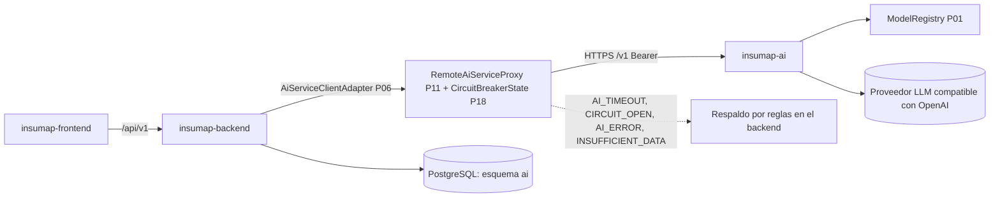
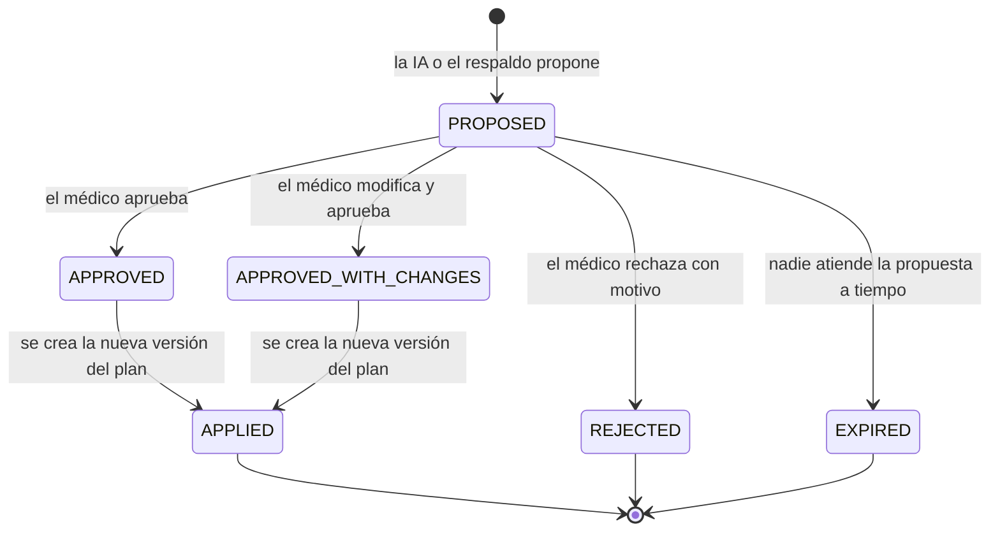
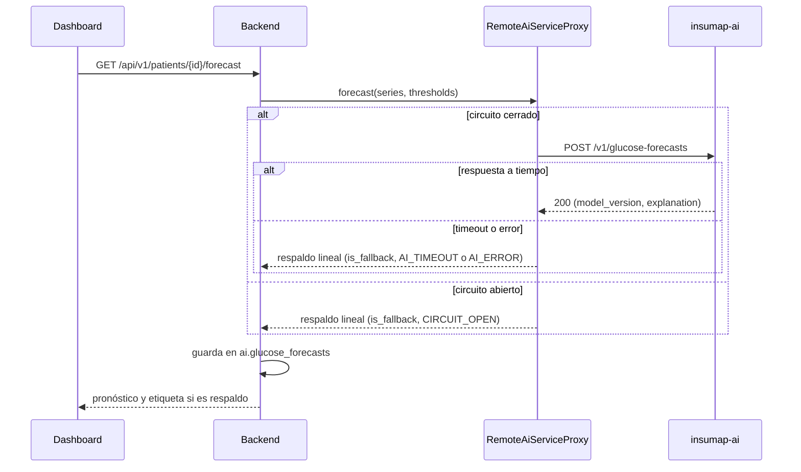

# Módulo de IA y soporte a decisiones (M9)

Este documento describe el módulo de IA de Insumap desde el sistema: qué decisiones apoya, qué modelo responde cada una, qué ve el médico, qué pasa cuando algo falla y cómo se decide si la IA de verdad ayuda. El servicio vive en `insumap-ai`, el cliente en `insumap-backend` y los datos de entrenamiento en `insumap-simulator`. El contrato HTTP está en [Contrato-IA.md](Contrato-IA.md); los datos, en [Datos-simulados.md](Datos-simulados.md); las métricas y las metas, en [Metricas-clinicas.md](Metricas-clinicas.md).

> **Aviso fijo:** Insumap es un proyecto académico. **No es un dispositivo médico**, no reemplaza el criterio clínico y la IA solo apoya al médico, que toma todas las decisiones. Todos los pacientes son simulados.

## 1. Principios

| # | Principio | Consecuencia |
|---|---|---|
| 1 | **El médico decide** (*human in the loop*). | Toda recomendación nace en `PROPOSED`. Nada se aplica solo. |
| 2 | **Nada con dosis llega al paciente antes de la aprobación.** | El paciente nunca ve una sugerencia de insulina. Solo ve un plan `ACTIVE` que su médico aprobó. |
| 3 | **Toda salida es trazable.** | Se guarda la versión del modelo, el hash de la entrada, la explicación y la decisión del médico. |
| 4 | **Toda capacidad tiene respaldo determinista.** | Si la IA falla, el sistema responde con reglas y lo marca (`is_fallback`). |
| 5 | **Minimización de datos.** | Al servicio de IA y al LLM solo llega un seudónimo (`subject_ref`), nunca nombres, documentos, número de historia ni contacto. |
| 6 | **Sin valores clínicos quemados.** | Metas, umbrales y límites de titulación llegan en la petición, leídos de la BD por el backend. El servicio nunca tiene un `70` o un `180` en el código. |
| 7 | **Sin estado.** | `insumap-ai` no accede a la BD ni guarda peticiones. El backend guarda las salidas en el esquema `ai`. |

## 2. Resumen de casos de uso

| # | Decisión que apoya | Quién la usa | Modelo | Respaldo | Endpoint |
|---|---|---|---|---|---|
| IA1 | Pronóstico de glucosa a 30 a 120 min y nocturno, con riesgo de hipo o hiperglucemia | Paciente (aviso preventivo) y médico | Chronos-Bolt (CPU) con cuantiles | Tendencia lineal o tasa de cambio | `POST /v1/glucose-forecasts` |
| IA2 | Triage y estratificación de riesgo con factores explicados | Médico | Gradient boosting calibrado (scikit-learn) | Reglas tipo TIDE | `POST /v1/risk-assessments` |
| IA3 | Patrones y anomalías | Médico | Isolation Forest y detectores de patrón | Reglas | `POST /v1/pattern-detections` |
| IA4 | Sugerencia de ajuste de insulina basal | Médico | Reglas de titulación y ML | No se sugiere nada | `POST /v1/titration-suggestions` |
| IA5 | Resumen clínico previo a la consulta | Médico | LLM con datos seudonimizados | Plantilla determinista | `POST /v1/clinical-summaries` |
| IA6 | Asistente educativo del paciente con guardrails | Paciente | LLM, RAG y cadena de guardrails | Respuestas predefinidas | `POST /v1/assistant-replies` |
| IA7 | Riesgo de abandono o no adherencia | Admin de clínica y médico | Clasificador (scikit-learn) | Reglas de inactividad | `POST /v1/risk-assessments` (`assessment_type = DROPOUT`) |
| Futuro | Estimación de carbohidratos por foto | Paciente | LLM con visión | Sin respaldo | Fuera de alcance |

El administrador de la clínica (`CLINIC_ADMIN`) solo ve IA7 y agregados; **no ve datos clínicos detallados** ni las salidas de IA1 a IA6.

## 3. Arquitectura

El diagrama definitivo se exporta con draw.io en `docs/images/` por quien mantiene la documentación global; este boceto es la referencia textual.

### 3.1 Patrones

| Repo | Pieza | Patrón | Responsable |
|---|---|---|---|
| `insumap-ai` | `ModelRegistry`: carga una sola vez Chronos-Bolt y los modelos de scikit-learn y expone su versión | P01 Singleton | `nicomora70` |
| `insumap-ai` | `ForecasterCreator`: elige la variante de pronosticador dentro de la familia (Chronos-Bolt tiny o small, o respaldo lineal) | P02 Factory Method | `nicomora70` |
| `insumap-ai` | `AiProviderFactory`: `OpenAiCompatibleProviderFactory` (LLM remoto, Chronos real) y `OfflineProviderFactory` (determinista, pruebas y CI). Cada familia crea `TextGenerator`, `Forecaster` y `RiskModel` | P03 Abstract Factory | `nicomora70` |
| `insumap-ai` | `PromptBuilder`: arma el prompt de IA5 e IA6 paso a paso | P04 Builder | `nicomora70` |
| `insumap-ai` | `OpenAiCompatibleTextGeneratorAdapter` y `ChronosForecasterAdapter` | P06 Adapter | `nicomora70` |
| `insumap-ai` | `PhiRedactingTextGenerator` y `CachingForecaster` | P09 Decorator | `nicomora70` |
| `insumap-ai` | `GuardrailHandler`: cadena de guardrails del asistente | P12 Chain of Responsibility | `nicomora70` |
| `insumap-ai` | `SlidingWindowIterator`: ventanas de contexto y de evaluación | P14 Iterator | `nicomora70` |
| `insumap-ai` | `InferencePipeline`: validar, ventanear, inferir, aplicar guardrails, explicar, responder | P20 Template Method | `nicomora70` |
| `insumap-backend` | `AiServiceClientAdapter`: cliente HTTP del contrato | P06 Adapter | `nicomora70` |
| `insumap-backend` | `RemoteAiServiceProxy`: servicio remoto más respaldo por reglas | P11 Proxy | `nicomora70` |
| `insumap-backend` | `CircuitBreakerState` (`CLOSED`, `OPEN`, `HALF_OPEN`) | P18 State | `nicomora70` |
| `insumap-backend` | `RiskScoringStrategy` (IA o reglas tipo TIDE), `TitrationStrategy` | P19 Strategy | `Drako2305` |
| `insumap-backend` | `RecommendationState` (`PROPOSED`, `APPROVED`, `APPROVED_WITH_CHANGES`, `REJECTED`, `APPLIED`, `EXPIRED`) | P18 State | `Drako2305` y `nicomora70` |
| `insumap-backend` | `ApproveRecommendationCommand`, `ModifyRecommendationCommand`, `RejectRecommendationCommand` | P13 Command | `Drako2305` |

El servicio **no tiene estado** y **no accede a la base de datos**. Todo lo que el sistema necesita para decidir (series, metas, reglas, respaldo) vive en el backend.

### 3.2 Flujo humano en el circuito (recomendaciones)

Aplica a IA4 (titulación) y a toda propuesta que cambie el plan de tratamiento. Los estados son los de `RecommendationState`.

Reglas:

1. Solo el `DOCTOR` asignado al paciente (verificado por `PatientRecordAccessProxy`) puede aprobar, modificar o rechazar. El `CLINIC_ADMIN` no.
2. Rechazar exige un motivo (texto y, si existe, un código del catálogo). Modificar exige guardar el valor original y el modificado.
3. `APPLIED` crea una nueva versión del plan (`TreatmentPlan.copy_for_new_version()`, P05) y un snapshot (`TreatmentPlanMemento`, P16). Antes de `APPLIED` el plan activo del paciente no cambia.
4. `EXPIRED` ocurre si la propuesta sigue en `PROPOSED` pasado el plazo configurado (`care`/`ai` en BD, no en código). Una propuesta vencida no se aplica nunca.
5. **El paciente no ve nada con dosis hasta `APPLIED`.** Su app solo muestra el plan activo. Los avisos preventivos de IA1 son mensajes sin dosis ("tu glucosa podría bajar de tu meta en la próxima hora; consulta tu plan o contacta a tu equipo").
6. Cada transición queda en `ai.recommendation_decisions` con el actor, la hora (por el `Clock` inyectado), el motivo y, si cambió, el valor modificado. La auditoría (M12) registra además la lectura.

## 4. Trazabilidad y versionado de modelos

### 4.1 Qué se guarda con cada salida

Todas las tablas de salida del esquema `ai` (`glucose_forecasts`, `risk_assessments`, `pattern_findings`, `recommendations`, `clinical_summaries`, `assistant_messages`) guardan estas columnas comunes, que provienen de la respuesta del servicio:

| Campo | Origen | Para qué |
|---|---|---|
| `model_name` y `model_version` | Respuesta de la IA | Saber qué modelo produjo la salida y poder reproducirla. |
| `input_hash` | Respuesta de la IA (SHA-256 de la entrada canónica) | Detectar la misma entrada y probar que no se alteró. |
| `explanation` (jsonb) | Respuesta de la IA | Lo que ve el médico (sección 5). |
| `is_fallback` y `fallback_reason` | Backend o servicio | Medir cuánto se usa el respaldo (sección 12). |
| `generated_at` | Respuesta | Momento de la inferencia. |
| `decision` y `decided_by` | Solo recomendaciones | Decisión del médico (`recommendation_decisions`). |

`ai.model_versions` registra cada modelo desplegado: nombre, versión, semilla y versión del simulador con que se entrenó, métricas de validación y fecha de activación. `ai.ai_evaluations` guarda las comparaciones IA contra respaldo (sección 12).

### 4.2 Esquema de versión

`model_version` es un texto `<semver>+<huella>`, por ejemplo `1.2.0+sim1.0.0.seed42`. La huella nombra el dataset de entrenamiento: versión del simulador y semilla. Reglas:

- Un cambio de hiperparámetros, de datos o de pesos incrementa la versión; nunca se sobrescribe una versión publicada.
- El artefacto del modelo se guarda junto a su archivo `model_card.json` (versión, semilla, versión del simulador, métricas, fecha, límites conocidos). Sin `model_card.json` el `ModelRegistry` no lo carga.
- Chronos-Bolt es preentrenado (*zero-shot*): su versión es `<versión de chronos-forecasting>+<id del modelo>`, por ejemplo `2.3.2+chronos-bolt-small`. No se afina en el MVP.
- Un modelo nuevo entra en **modo sombra** primero: corre en paralelo, se guarda su salida, pero el sistema usa la anterior hasta que la evaluación (sección 12) lo apruebe.

## 5. Explicaciones para el médico

Cada salida trae un objeto `explanation` con la misma forma (ver el contrato):

- `summary`: una frase en español, sin jerga de modelo, por ejemplo "Riesgo alto por 3 episodios de hipoglucemia nocturna en 14 días y TIR de 48 %".
- `factors[]`: los factores principales con `name`, `direction` (`INCREASES_RISK`, `DECREASES_RISK`, `NEUTRAL`), `value`, `unit` y `contribution` (peso relativo de 0 a 1).
- `data_refs[]`: referencias a los datos que sustentan la salida (ventana de fechas, número de lecturas), para que el dashboard enlace a la gráfica o al AGP.

Los factores de IA2 salen de contribuciones tipo SHAP del modelo de árboles (`TreeExplainer`, valores agregados por característica); los de IA3 salen de la regla o el detector que disparó; los de IA1 son la tendencia reciente y el ancho del rango; los de IA4, la regla de titulación aplicada. La explicación no sustituye al criterio clínico: es una ayuda para revisar.

## 6. Casos de uso

Convenciones de esta sección: "entradas" son las características que el backend envía (todas de datos simulados o seudonimizados). Los umbrales (`low_mg_dl`, `high_mg_dl`, `target_*`) vienen de `care.target_profiles` y no se fijan aquí.

### 6.1 IA1: pronóstico de glucosa y riesgo de hipo o hiperglucemia

| Aspecto | Descripción |
|---|---|
| **Objetivo** | Estimar la glucosa a 30, 60 y 120 minutos (modo `SHORT_TERM`) y durante la noche (modo `OVERNIGHT`, hasta 8 h), con rango de incertidumbre, y la probabilidad de cruzar los umbrales del paciente. |
| **Quién decide** | Paciente: recibe un aviso preventivo sin dosis. Médico: ve el pronóstico y los avisos en el detalle del paciente. Nadie toma una decisión de tratamiento solo por IA1. |
| **Entradas** | Serie de glucosa en mg/dL con marcas de tiempo con zona (CGM cada 5 o 15 min), intervalo de muestreo, umbrales `low_mg_dl` y `high_mg_dl` del perfil de metas, zona horaria de la clínica y ventana nocturna. IA1 aplica a pacientes con CGM; para SMBG hay pocos puntos y se usa el respaldo (`INSUFFICIENT_DATA`). |
| **Modelo** | Chronos-Bolt (`chronos-forecasting`, CPU) en modo *zero-shot*, con cuantiles de 0.1, 0.5 y 0.9. Variante `tiny` (9M parámetros) o `small` (48M) elegida con `ForecasterCreator` según configuración y memoria disponible. En modo `OVERNIGHT` la serie se remuestrea a pasos de 15 minutos para no superar el horizonte máximo del modelo (a verificar al implementar). |
| **Salida** | Por horizonte: `p10`, `p50` y `p90` en mg/dL; probabilidad de hipoglucemia y de hiperglucemia por horizonte (aproximada a partir de los cuantiles, documentado como estimación); tendencia (`FALLING`, `STABLE`, `RISING`). |
| **Explicación al médico** | "Glucosa actual 112 mg/dL, bajando 1,4 mg/dL por minuto; en 60 min el rango probable es 68 a 104 mg/dL". Factores: pendiente reciente, último valor, ancho del rango. |
| **Respaldo** | Extrapolación lineal de la tasa de cambio de los últimos 30 minutos, con rango fijo calculado de la dispersión histórica de la serie (`is_fallback = true`). Si hay menos puntos que el mínimo, `INSUFFICIENT_DATA` y no se emite pronóstico. |
| **Flujo humano** | El aviso al paciente es informativo y no contiene dosis. El médico solo lo consulta. Si el aviso dispara una alerta (M8), la alerta sigue su propio flujo de reconocimiento. No genera recomendaciones. |
| **Métricas** | MAE y RMSE por horizonte contra la lectura real, comparados con el respaldo lineal; **Clarke Error Grid** (zonas A a E; se reporta el porcentaje en A y en A+B); cobertura del intervalo p10 a p90 (se espera cercana a 80 %); sensibilidad y precisión de la predicción de hipo (<70 mg/dL) a 30 y 60 min. |
| **Limitaciones** | Zero-shot: no conoce la insulina ni las comidas. No anticipa hipoglucemia causada por una dosis o ejercicio recientes que no se reflejan aún en la serie. La probabilidad es aproximada. El rendimiento sobre datos simulados puede no trasladarse a pacientes reales. Los huecos y artefactos de sensor degradan el pronóstico. |

### 6.2 IA2: triage y estratificación de riesgo

| Aspecto | Descripción |
|---|---|
| **Objetivo** | Ordenar el dashboard del médico ("a quién ver hoy") con una probabilidad calibrada de deterioro glucémico en los próximos días y los factores que la explican. |
| **Quién decide** | El médico decide a quién contactar o a quién ver. La IA solo ordena y explica. |
| **Entradas** | Características agregadas por ventana de 14 días (más cambio frente al periodo anterior): TIR, TBR de nivel 1 y 2, TAR de nivel 1 y 2, glucosa media, CV, GMI, porcentaje de datos disponibles, eventos de hipoglucemia, última HbA1c y su cambio, adherencia al registro, días sin lectura, alertas abiertas, tipo de diabetes y meta del perfil. Todas calculadas por el backend (M7). |
| **Modelo** | Gradient boosting (`HistGradientBoostingClassifier` de scikit-learn) con calibración isotónica o de Platt, entrenado con cohortes del simulador. La etiqueta es el escenario inyectado y los eventos de los siguientes 7 días (hipoglucemia de nivel 2, TIR por debajo de la meta de forma sostenida). |
| **Salida** | `risk_probability` (0 a 1, calibrada), `risk_tier` (`LOW`, `MEDIUM`, `HIGH`, `CRITICAL`) con los cortes guardados en la ficha del modelo, y `factors[]` con contribución. |
| **Explicación al médico** | Lista de los 3 a 5 factores con valor y dirección, más la comparación con el periodo anterior. |
| **Respaldo** | `RuleBasedRiskStrategy` en el backend, tipo Tidepool TIDE: banderas como "el TIR cayó más de 15 puntos frente al periodo anterior" o "más del 25 % del tiempo sobre 180 mg/dL" (los números son configuración, de `alerts.alert_rules`). |
| **Flujo humano** | El orden del dashboard es una sugerencia; el médico puede reordenar o marcar "revisado". No genera recomendaciones de tratamiento. |
| **Métricas** | **AUROC** y AUPRC contra las etiquetas simuladas; **calibración** (curva de confiabilidad y **puntaje de Brier**); concordancia de orden con el respaldo (correlación de Spearman); fracción de pacientes con evento real que quedaron en el 20 % superior. |
| **Limitaciones** | Etiquetas derivadas de escenarios sintéticos: el modelo aprende el simulador. No hay validación con pacientes reales. Puede reflejar sesgos de los arquetipos. La calibración se degrada si cambia la población. |

### 6.3 IA3: patrones y anomalías

| Aspecto | Descripción |
|---|---|
| **Objetivo** | Detectar hipoglucemias nocturnas, fenómeno del alba, picos posprandiales, dosis omitidas o duplicadas, caída de adherencia y lecturas inverosímiles. |
| **Quién decide** | El médico revisa cada hallazgo y decide si actúa; puede descartarlo. |
| **Entradas** | Serie de glucosa (hasta 14 días), dosis registradas y esperadas por día, comidas, zona horaria y ventana nocturna de la clínica, y la definición de umbrales del perfil de metas. |
| **Modelo** | Detectores de patrón explicables (reglas parametrizadas sobre ventanas nocturnas y matutinas, detección de picos tras comidas) más **Isolation Forest** para lecturas atípicas y saltos fisiológicamente improbables. |
| **Salida** | `findings[]` con `pattern_type` (`NOCTURNAL_HYPOGLYCEMIA`, `DAWN_PHENOMENON`, `POSTPRANDIAL_SPIKE`, `MISSED_DOSE`, `DUPLICATE_DOSE`, `ADHERENCE_DROP`, `IMPLAUSIBLE_READING`), ventana de tiempo, `confidence` y evidencia. |
| **Explicación al médico** | "4 de 7 noches con glucosa por debajo de 70 mg/dL entre las 02:00 y las 05:00; la más baja, 58 mg/dL" con enlace a las noches. |
| **Respaldo** | Las mismas reglas deterministas sin el Isolation Forest; la evidencia es la regla que disparó. |
| **Flujo humano** | Un hallazgo puede originar una alerta (M8) o una nota; si sugiere cambiar el tratamiento, el médico lo hace desde el plan y, si usa IA4, pasa por el flujo de aprobación. |
| **Métricas** | **Precisión y exhaustividad (*recall*)** por tipo de patrón sobre escenarios simulados con etiqueta de verdad de terreno (ventana inyectada); F1 por tipo; tasa de falsos positivos por paciente-semana; tasa de anomalías marcadas en pacientes sin escenario. |
| **Limitaciones** | El fenómeno del alba y el efecto Somogyi son difíciles de separar sin datos de insulina fiables. Los umbrales de detección son parámetros: cambiarlos mueve el balance entre precisión y exhaustividad. Un sensor con ruido genera falsos positivos. |

### 6.4 IA4: sugerencia de ajuste de insulina basal

| Aspecto | Descripción |
|---|---|
| **Objetivo** | Proponer al médico un ajuste de la dosis basal según la glucosa en ayunas, como ayuda para una decisión que él toma. |
| **Quién decide** | **Solo el médico**: aprueba, modifica o rechaza con motivo. |
| **Entradas** | Dosis basal actual y unidad, glucosas en ayunas de los últimos N días, eventos de hipoglucemia recientes, y los **parámetros del protocolo del plan** (rango objetivo en ayunas, tamaño del paso, cambio máximo, intervalo mínimo entre ajustes) que vienen de la plantilla de protocolo o del plan en BD. |
| **Modelo** | `TitrationStrategy` (P19): reglas de titulación parametrizadas por el protocolo (la regla decide si sube, baja o mantiene), más un modelo de ML opcional que estima la probabilidad de que el ajuste lleve el ayuno al rango sin hipoglucemia. Un ajuste nunca supera el cambio máximo del protocolo. |
| **Salida** | `action` (`INCREASE`, `DECREASE`, `MAINTAIN`, `NO_SUGGESTION`), dosis actual, dosis propuesta, `delta_units`, motivo y `requires_doctor_approval = true` (constante). |
| **Explicación al médico** | "Ayunos de los últimos 3 días: 168, 172 y 160 mg/dL (meta 80 a 130). Sin hipoglucemias. Regla: subir 2 unidades si la mediana está sobre la meta y no hay hipo". |
| **Respaldo** | **No se sugiere nada** (`action = NO_SUGGESTION`). El médico ajusta manualmente. |
| **Flujo humano** | Se crea una `Recommendation` en `PROPOSED`. Aprobar crea una nueva versión del plan en `DRAFT` que el médico activa; modificar guarda el valor original y el cambiado; rechazar exige motivo. Pasado el plazo sin decisión, `EXPIRED`. **No se muestra nada al paciente antes de `APPLIED`.** |
| **Métricas** | Tasa de aprobación, de aprobación con cambios y de rechazo, y los motivos de rechazo (señal de calidad en el piloto simulado); en simulación: porcentaje de ayunos en rango y de hipoglucemias tras aplicar la sugerencia contra no aplicarla, usando el simulador como entorno. |
| **Limitaciones** | La titulación es un acto médico: la IA no ve comorbilidades, función renal ni otros fármacos. Un ayuno alto puede deberse a una cena, a una dosis omitida o a un sensor erróneo. El MVP solo cubre insulina basal. |

### 6.5 IA5: resumen clínico previo a la consulta

| Aspecto | Descripción |
|---|---|
| **Objetivo** | Dar al médico una narrativa breve del periodo antes de la cita: AGP, eventos, adherencia y cambios del plan, con referencias a los datos. |
| **Quién decide** | El médico lee y verifica; el resumen no entra a la historia clínica sin que él lo guarde como nota. |
| **Entradas** | Seudónimo, periodo, métricas ya calculadas por el backend (TIR, TBR, TAR, GMI, CV, percentiles del AGP), lista de eventos (hipoglucemias, hallazgos de IA3, alertas), adherencia, cambios de plan y la última HbA1c. **Sin nombres ni documentos.** |
| **Modelo** | LLM por API compatible con OpenAI (`LLM_BASE_URL`, `LLM_MODEL`, `LLM_API_KEY`), con `PromptBuilder` (P04) y `PhiRedactingTextGenerator` (P09). El LLM **no calcula métricas**: solo redacta con las cifras recibidas. |
| **Salida** | `summary_text` en texto plano en español, `sections[]` (resumen del periodo, eventos, adherencia, cambios del plan) y `references[]` (cada afirmación apunta a un dato recibido). |
| **Explicación al médico** | Cada sección enlaza a su referencia (`data_ref`) para verificar. Se valida que todas las cifras del texto aparezcan en la entrada. |
| **Respaldo** | Plantilla determinista (`ClinicalSummaryTemplate`) que rellena las mismas secciones con las cifras, sin narrativa. |
| **Flujo humano** | El resumen se muestra con la etiqueta "Generado por IA, verifique". El médico puede copiarlo a una nota. |
| **Métricas** | Fidelidad numérica: porcentaje de cifras del resumen que coinciden con la entrada (meta: 100 %, medido de forma automática); revisión manual de un muestreo con una rúbrica (exactitud, omisión, utilidad); tasa de uso del respaldo; latencia. |
| **Limitaciones** | El LLM puede resumir de forma incorrecta o añadir juicios. Por eso se valida la salida contra el esquema y las cifras. La capa gratuita de un proveedor puede entrenar con los datos: por eso solo salen datos simulados o seudonimizados. |

### 6.6 IA6: asistente educativo del paciente

| Aspecto | Descripción |
|---|---|
| **Objetivo** | Responder dudas educativas del paciente (qué es una hipoglucemia, cómo medir, cómo leer su gráfica) con material aprobado por la clínica. |
| **Quién decide** | Nadie decide tratamiento: el asistente **no da dosis ni diagnósticos**. Ante síntomas de alarma escala. |
| **Entradas** | Seudónimo, mensaje del paciente, los últimos turnos, y los fragmentos de **material aprobado por la clínica** que el backend recupera (RAG, ver "RAG sin estado" abajo). |
| **Modelo** | LLM por API compatible con OpenAI, con la cadena de guardrails (sección 7). |
| **Salida** | `reply_text` en texto plano, `citations[]` (documentos usados), `escalation` (`NONE`, `CONTACT_DOCTOR`, `EMERGENCY`) y `guardrails_triggered[]`. |
| **Explicación** | Al paciente se muestra de qué material sale la respuesta. Al médico, en la revisión de mensajes, qué guardrail actuó. |
| **Respaldo** | Respuestas predefinidas por tema (catálogo de la clínica) y un mensaje fijo de "contacta a tu equipo" cuando no hay tema. |
| **Flujo humano** | Una escalación `CONTACT_DOCTOR` o `EMERGENCY` genera un aviso al médico (M8/M11). El asistente no modifica ningún dato del paciente. |
| **Métricas** | Conjunto de prueba adversarial automatizado: 0 respuestas con dosis o diagnóstico (criterio de aceptación); 100 % de los casos de síntomas de alarma escalados; 0 fugas de datos personales hacia el generador (prueba con trampas); fundamentación: porcentaje de respuestas que citan material aprobado; tasa de uso del respaldo. |
| **Limitaciones** | Ningún filtro es perfecto: la cadena reduce el riesgo, no lo elimina. El asistente solo es tan bueno como el material aprobado. El idioma de los guardrails es español. |

#### RAG sin estado (IA6)

El servicio no guarda documentos. El backend busca los fragmentos relevantes del material aprobado por la clínica (búsqueda por palabras clave o `pg_trgm`, sin vector en el MVP) y los envía en `context_documents[]` con `doc_id`, `title` y `text`. El prompt solo puede responder con ese contexto; sin contexto relevante, la respuesta es "no tengo información aprobada sobre eso; consulta a tu equipo".

### 6.7 IA7: riesgo de abandono o no adherencia

| Aspecto | Descripción |
|---|---|
| **Objetivo** | Señalar a los pacientes con riesgo de dejar de registrar para que la clínica los contacte. |
| **Quién decide** | El médico o el admin de la clínica decide si contacta al paciente. |
| **Entradas** | Frecuencia de registro por semana (últimas 8), días desde la última lectura, tendencia de la frecuencia, porcentaje de dosis registradas, aperturas de la app, mensajes sin respuesta, tipo de diabetes, antigüedad de la cuenta. Sin datos clínicos finos. |
| **Modelo** | Clasificador de scikit-learn (regresión logística o gradient boosting) calibrado; etiqueta: escenario de abandono inyectado en el simulador. |
| **Salida** | `risk_probability` y `risk_tier` con `assessment_type = DROPOUT` y factores. |
| **Explicación al médico** | "Pasó de 4 registros diarios a 1 en tres semanas; 6 días sin lectura". |
| **Respaldo** | Reglas de inactividad: días sin registro sobre un umbral configurable. |
| **Flujo humano** | Crea una sugerencia de seguimiento (`follow_ups`) que alguien de la clínica atiende o descarta. No toca el tratamiento. |
| **Métricas** | AUROC y AUPRC, calibración y Brier, antelación media con que se detecta el abandono (días antes del último registro) frente a las reglas. |
| **Limitaciones** | En el simulador el abandono es una regla del escenario; el modelo puede memorizarla. Un paciente puede dejar de registrar por buenas razones (alta, viaje). |

## 7. Guardrails del LLM (IA5 e IA6)

Se implementan con `GuardrailHandler` (P12). La cadena se aplica **antes** de llamar al LLM (entrada) y **después** (salida). Cada eslabón decide: continuar, modificar o bloquear. Un bloqueo **reemplaza** la respuesta por el respaldo determinista y registra en `guardrails_triggered` qué eslabón actuó. Los textos de las alertas y mensajes de escalamiento los define la clínica.

| Orden | Eslabón | Entrada o salida | Qué hace | Si se activa |
|---|---|---|---|---|
| 1 | `PhiRedactionHandler` | Entrada (y de nuevo al enviar) | Quita nombres, documentos, número de historia, teléfonos, correos y direcciones del mensaje y del contexto. | Sustituye por marcadores (`[NOMBRE]`) y sigue. |
| 2 | `DoseAndDiagnosisHandler` | Entrada y salida | Detecta peticiones de dosis ("cuántas unidades me pongo") y salidas que contengan dosis, ajustes de medicación o diagnósticos. | Bloquea y responde: "No puedo indicar dosis ni diagnósticos. Habla con tu médico". |
| 3 | `EmergencySymptomHandler` | Entrada | Detecta síntomas de alarma (confusión, pérdida de conocimiento, convulsión, dificultad para respirar, vómitos con cetonas, glucosa muy baja con síntomas). | Escala: `escalation = EMERGENCY` y mensaje de acudir a urgencias o llamar al número de emergencias; avisa al médico. **Prevalece sobre todo lo demás.** |
| 4 | `OffTopicHandler` | Entrada | Detecta lo ajeno a la diabetes y al uso de la app y la inyección de prompt ("ignora tus instrucciones"). | Responde que solo puede ayudar con educación sobre la diabetes. |

Notas de diseño:

- El orden pedido por el producto es redacción, filtro de dosis y diagnóstico, escalamiento de síntomas y tema ajeno. Los síntomas de alarma deben ganar a cualquier otro bloqueo: si un mensaje activa el eslabón 3, la respuesta de escalamiento se emite aunque el eslabón 2 también se active. La implementación evalúa los eslabones 2 y 3 sobre la entrada antes de decidir y da prioridad a la escalación.
- Los detectores son listas de patrones y clasificadores ligeros versionados con el servicio, no el propio LLM. La salida del LLM no es confiable: se valida con el esquema de respuesta y se entrega como texto plano.
- `PhiRedactingTextGenerator` (P09) repite la redacción justo antes de la llamada HTTP: aunque el backend ya envíe seudónimos, el decorador es la última barrera.
- Cada guardrail tiene prueba propia, una prueba de que ningún dato personal llega al generador y una prueba de que no salen dosis ni diagnósticos al paciente.

## 8. Datos de entrenamiento: cohortes del simulador

- Todo el entrenamiento, el *backtest* y la evaluación usan **solo** datasets generados por `insumap-simulator`, con semilla fija (`insumap-sim dataset --seed 42`). Nunca datos reales.
- Cada dataset registra la versión del simulador, la semilla y los parámetros de arquetipos y escenarios (formato en [Datos-simulados.md](Datos-simulados.md), sección 10).
- Las etiquetas de verdad de terreno son los escenarios inyectados: hipoglucemias nocturnas, fenómeno del alba, dosis omitidas, adherencia que mejora o empeora y abandono.
- La división es **por paciente** (nunca por fila ni por tiempo mezclado) en entrenamiento, validación y prueba, para evitar fugas. La semilla de la división también se registra.
- Los modelos aprenden el simulador. Es una limitación explícita (sección 11): sirven para demostrar el flujo y la evaluación, no para afirmar eficacia clínica.

## 9. Restricciones de despliegue

| Restricción | Detalle |
|---|---|
| **Solo CPU** | PyTorch desde el índice CPU (`[tool.uv.sources]`); no se agregan dependencias con CUDA. |
| **Chronos-Bolt `tiny` o `small`** | `tiny` (9M parámetros) y `small` (48M) por defecto; `base` (205M) queda fuera del MVP. Cifras de tamaño tomadas de la ficha pública de los modelos, a verificar al implementar. |
| **Riesgo de memoria en Render gratuito** | El plan gratuito de Render ofrece **512 MB de RAM**. PyTorch más `small` más scikit-learn puede acercarse o superar ese tope. Mitigaciones: empezar con `tiny`; carga única y perezosa en el `ModelRegistry`; un solo *worker*; medir el consumo en la prueba de memoria; si no cabe, elegir un plan con más memoria, otro proveedor, o activar solo el respaldo para IA1. Ninguna cifra de memoria o latencia se da por cierta antes de medirla. |
| **Arranque en frío** | El plan gratuito duerme el servicio. `GET /v1/ready` informa cuando el modelo está cargado; hasta entonces el backend responde con respaldo (`MODEL_NOT_READY`, `AI_TIMEOUT`). |
| **Pruebas sin red** | Las pruebas y la CI usan `OfflineProviderFactory`: nunca descargan pesos ni llaman al LLM. Hay marcas separadas (`-m chronos`, `-m llm`) fuera de la CI. |
| **LLM** | Proveedor gratis o barato con API compatible con OpenAI, configurado **solo** con `LLM_BASE_URL`, `LLM_MODEL` y `LLM_API_KEY`. Candidatos: DeepSeek, Qwen vía OpenRouter, Gemini en capa gratuita. El proveedor concreto se elige en la Fase 10, tras verificar precios y capa gratuita vigentes; el código no depende de cuál sea. |

## 10. Respaldo en dos niveles

1. **Dentro del servicio:** si falla un modelo, el proveedor del LLM o un guardrail bloquea, `insumap-ai` responde `200` con su respaldo determinista, `is_fallback = true` y el motivo.
2. **En el backend:** si el servicio no responde, `RemoteAiServiceProxy` (P11) usa el respaldo por reglas del propio backend. Los motivos (`AI_TIMEOUT`, `CIRCUIT_OPEN`, `AI_ERROR`, `INSUFFICIENT_DATA`) están en el [contrato](Contrato-IA.md), sección 5.

La UI muestra siempre si lo que ve vino del respaldo ("Calculado con reglas") y el dashboard cuenta el porcentaje de uso del respaldo.

## 11. Limitaciones globales

- Los datos son simulados: los resultados prueban el sistema, **no su eficacia clínica**.
- Chronos-Bolt no se afina y no conoce insulina ni comidas.
- Los modelos supervisados aprenden las reglas del simulador; sus métricas están infladas respecto a la realidad.
- El LLM puede equivocarse; por eso hay guardrails, validación y respaldo, y el médico siempre revisa.
- El servicio no sustituye alertas por reglas: las alertas críticas (M8) no dependen de la IA.

## 12. Evaluación: IA contra respaldo

Toda capacidad se compara con su respaldo sobre los mismos casos, con *backtest* sobre cohortes simuladas reservadas para prueba. El resultado se guarda en `ai.ai_evaluations` y se muestra en el dashboard (M10) en una pestaña "IA contra respaldo".

| Caso | Métricas | Comparación |
|---|---|---|
| IA1 | MAE y RMSE por horizonte (mg/dL), Clarke Error Grid (% en A y A+B), cobertura de p10 a p90, sensibilidad y precisión de hipo | IA contra extrapolación lineal |
| IA2 | AUROC, AUPRC, curva de calibración, Brier | IA contra reglas tipo TIDE |
| IA3 | Precisión, exhaustividad y F1 por patrón; falsos positivos por paciente-semana | Detectores con Isolation Forest contra solo reglas |
| IA4 | Aprobación, modificación, rechazo; efecto simulado | Con sugerencia contra sin sugerencia |
| IA5 | Fidelidad numérica; rúbrica | LLM contra plantilla |
| IA6 | Pruebas adversariales; fundamentación | LLM con guardrails contra respuestas predefinidas |
| IA7 | AUROC, Brier, antelación | Clasificador contra reglas de inactividad |

Criterio de "ayuda" (semilla): la IA se considera útil para un caso si mejora la métrica principal frente al respaldo por un margen mínimo configurable y sin empeorar la seguridad (por ejemplo, más hipoglucemias no detectadas). Los márgenes viven en la configuración de la evaluación, no en el código. Si la IA no le gana al respaldo, el sistema lo muestra tal cual y el respaldo queda como opción por defecto de ese caso. Además se reporta el porcentaje de salidas servidas con respaldo y la latencia por endpoint.

## 13. Responsabilidades

| Tarea | Responsable |
|---|---|
| Servicio de IA, modelos, guardrails, evaluación | `nicomora70` |
| Cliente de IA, adapter, proxy y circuit breaker en el backend | `nicomora70` |
| Recomendaciones (estado, comandos, persistencia) | `Drako2305` con `nicomora70` |
| Contrato y seguridad del token de servicio | `Drako2305` |
| Despliegue, CI y diagramas | `NicoalsD` |

## 14. Diagrama de secuencia: pronóstico con respaldo

